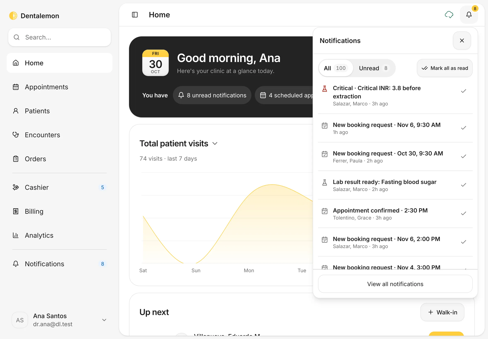
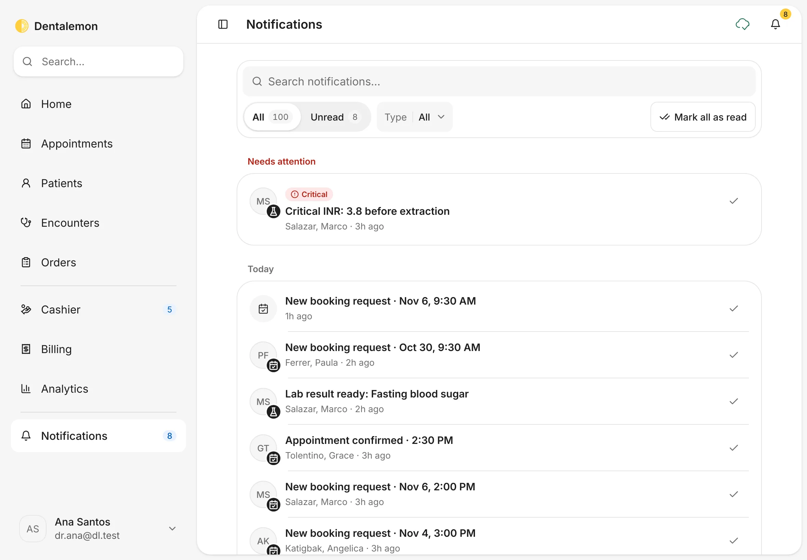
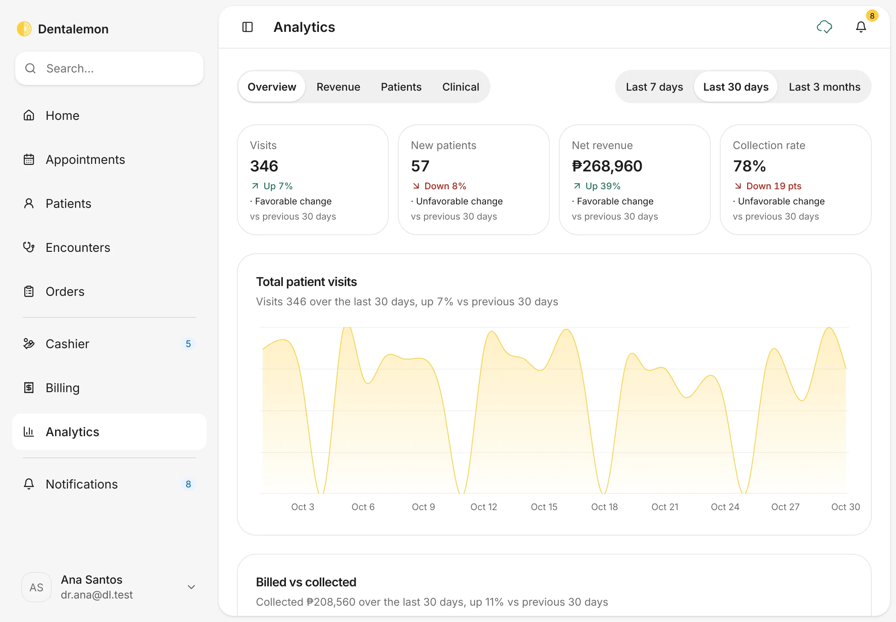
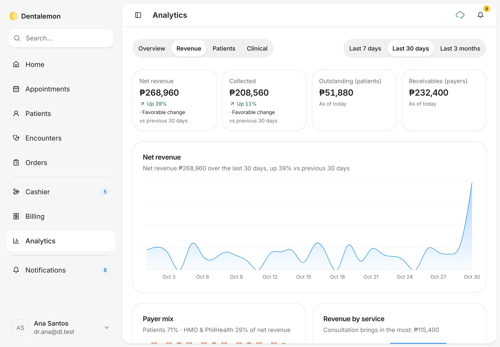
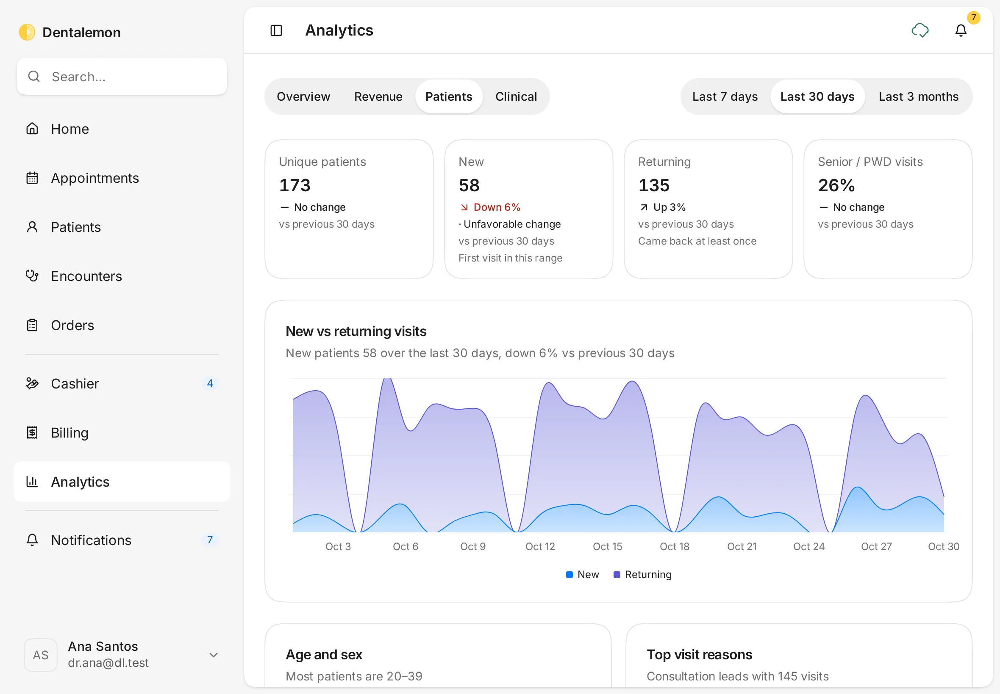
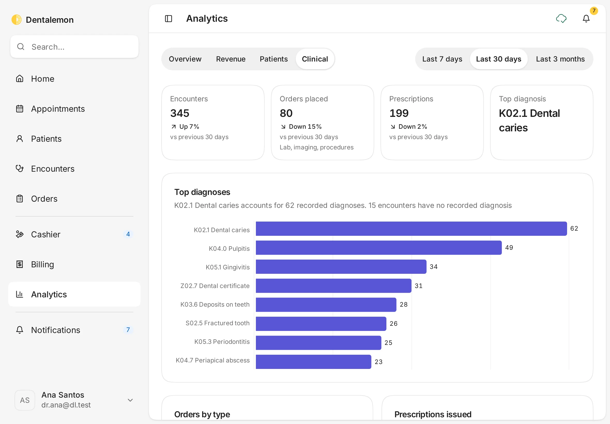

# Notifications and Analytics

Keep up with what needs your attention, and see how the clinic is doing: visits, revenue, patients and diagnoses.
{ .meta }

**Time:** about 3 minutes · **You'll need:** nothing. Both fill up as you use the app.
{ .meta }

## Before you start

- The number next to **Notifications** in the sidebar, and on the bell at the top right, is how many you haven't read yet.

## Steps

### 1. Glance at notifications from any page

Tap the bell at the top right.

You should see: the **Notifications** panel with **All** and **Unread**, your newest notifications, and **View all notifications** at the bottom.
{ .see }

Tap a notification to open what it's about. Tap the **✓** on its right to mark it read.

### 2. See all your notifications

Tap **Notifications** in the sidebar, or **View all notifications** in the panel.

You should see: a search box, **All** and **Unread**, a **Type** filter and **Mark all as read**. Critical items are grouped under **Needs attention** at the top, then **Today**, **Yesterday** and **Earlier**.
{ .see }

**Mark all as read** marks everything read. A note with **Undo** appears for a few seconds in case you tapped it by mistake.

### 3. Open Analytics

Tap **Analytics** in the sidebar. Pick a range at the top right: **Last 7 days**, **Last 30 days** or **Last 3 months**.

You should see: the **Overview** tab with **Visits**, **New patients**, **Net revenue** and **Collection rate**. Each is compared with the previous period of the same length (for example *Up 7% · Favorable change vs previous 30 days*). Below are the **Total patient visits** and **Billed vs collected** charts.
{ .see }

### 4. Revenue

Tap **Revenue**: **Net revenue**, **Collected**, **Outstanding (patients)** and **Receivables (payers)**, a revenue chart, then **Payer mix** and **Revenue by service**.

### 5. Patients

Tap **Patients**: **Unique patients**, **New**, **Returning** and **Senior / PWD visits**, the **New vs returning visits** chart, then **Age and sex** and **Top visit reasons**.

### 6. Clinical

Tap **Clinical**: **Encounters**, **Orders placed**, **Prescriptions** and **Top diagnosis**, then the **Top diagnoses** chart, **Orders by type** and **Prescriptions issued**.

## Tips

!!! tip "Turn off the ones you don't need"
    In **Settings › Notifications** you can mute types of notifications you don't want to see.

!!! info "Good to know"
    - Notifications only appear inside Dentalemon. There's no email or text message, and no way to mark one as unread again.
    - **Top diagnoses** only counts visits where a diagnosis was recorded. The chart says how many visits had none.

## What's next

- [Back to the start of the guide](../index.md)
