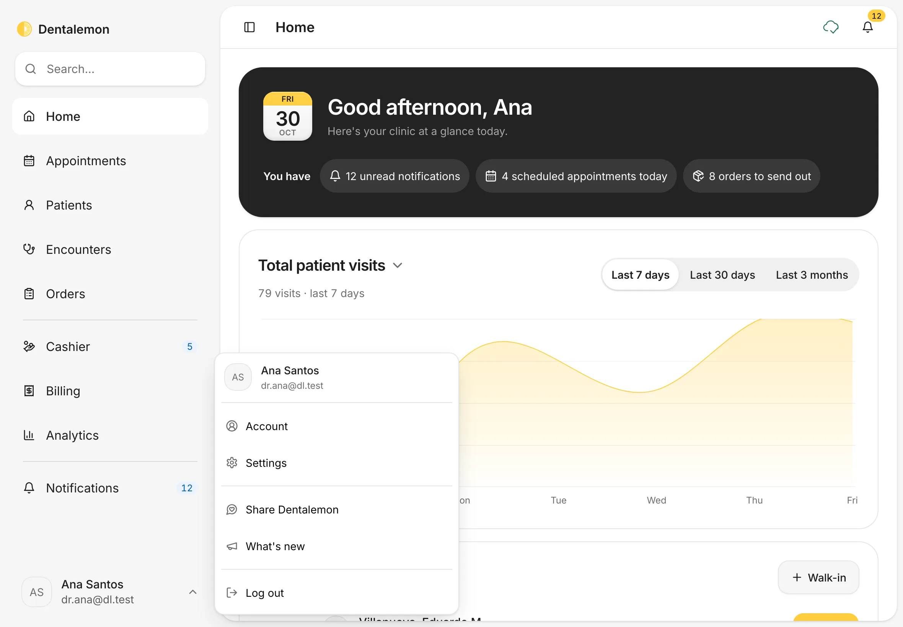
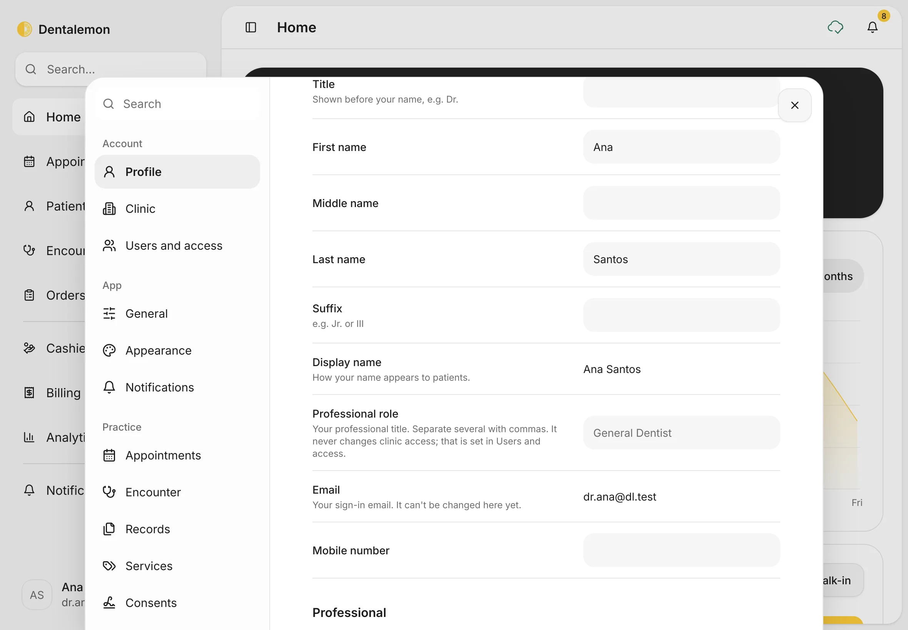
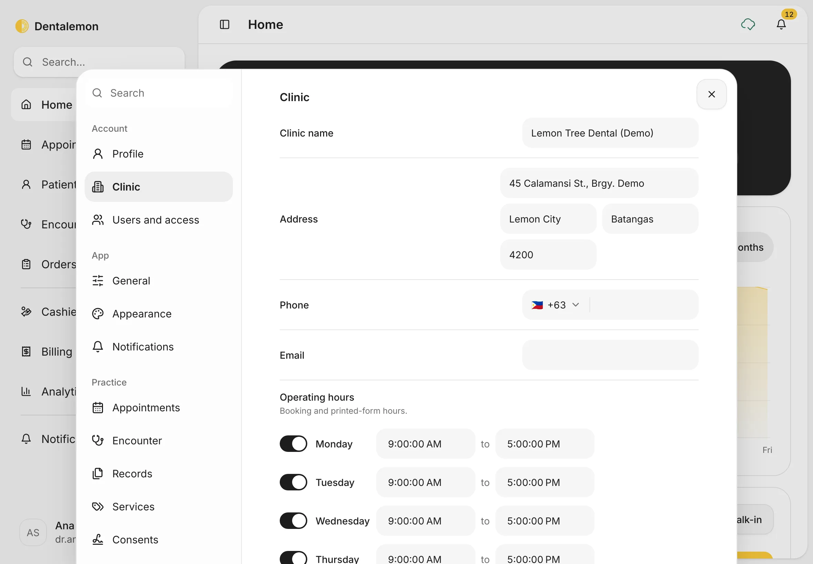
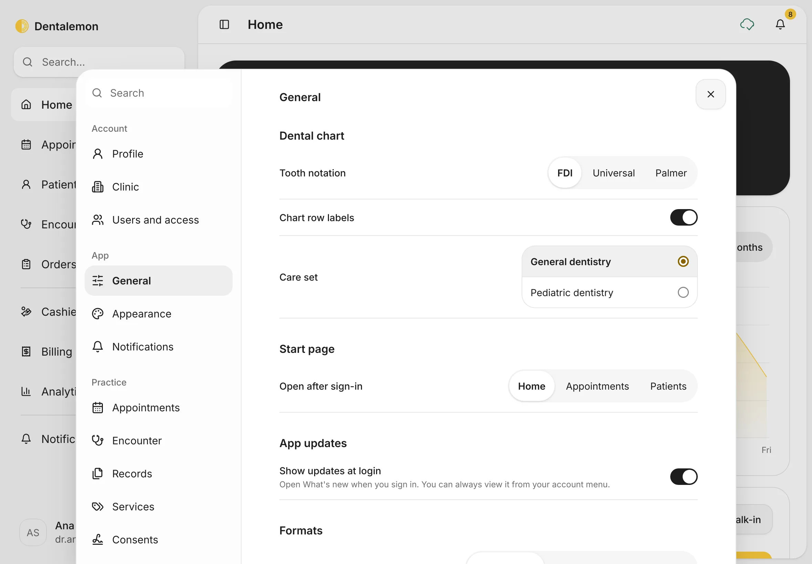
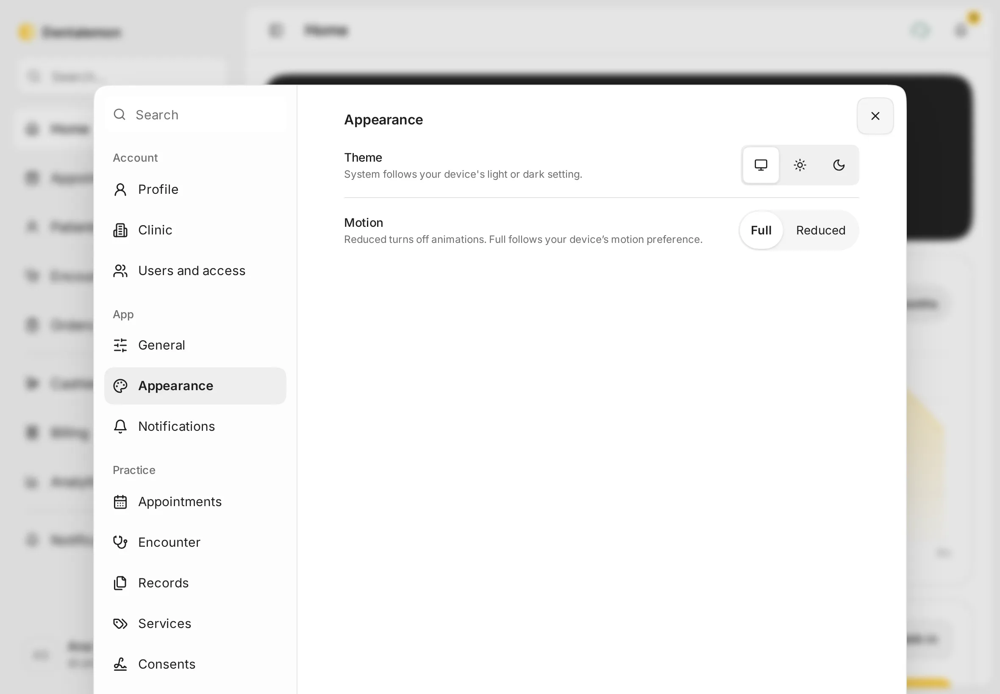
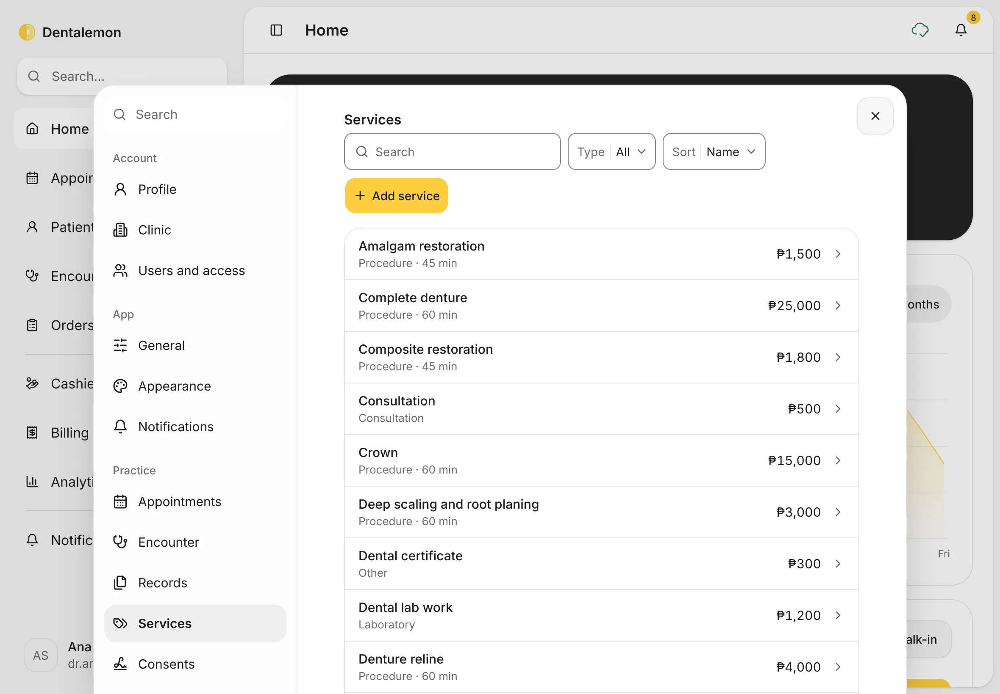
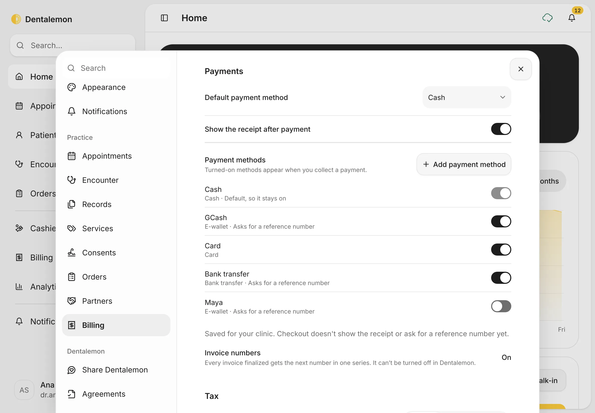
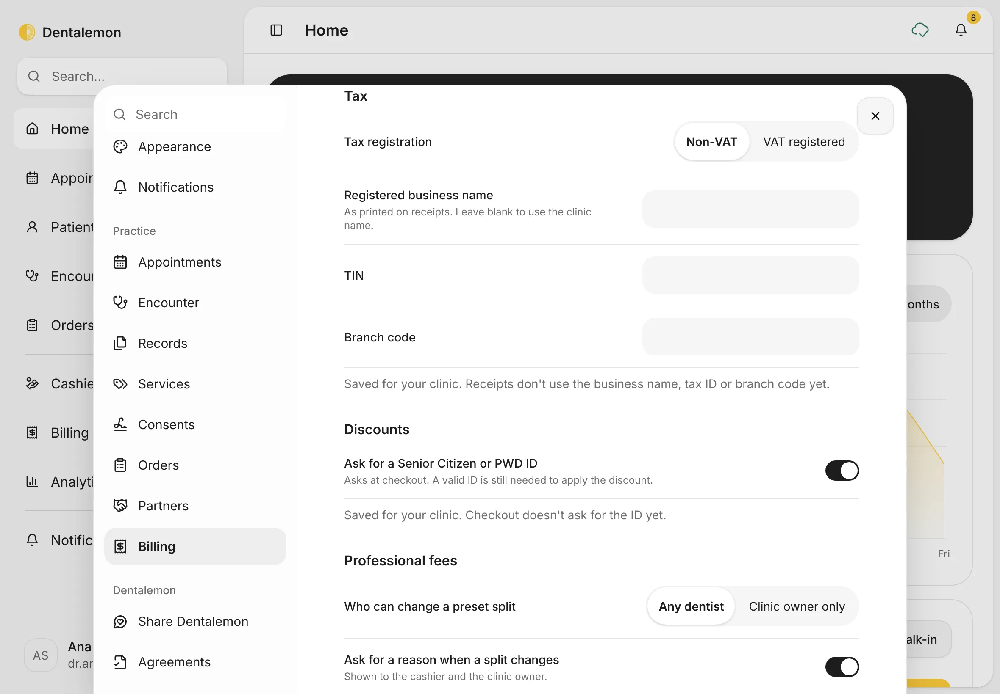
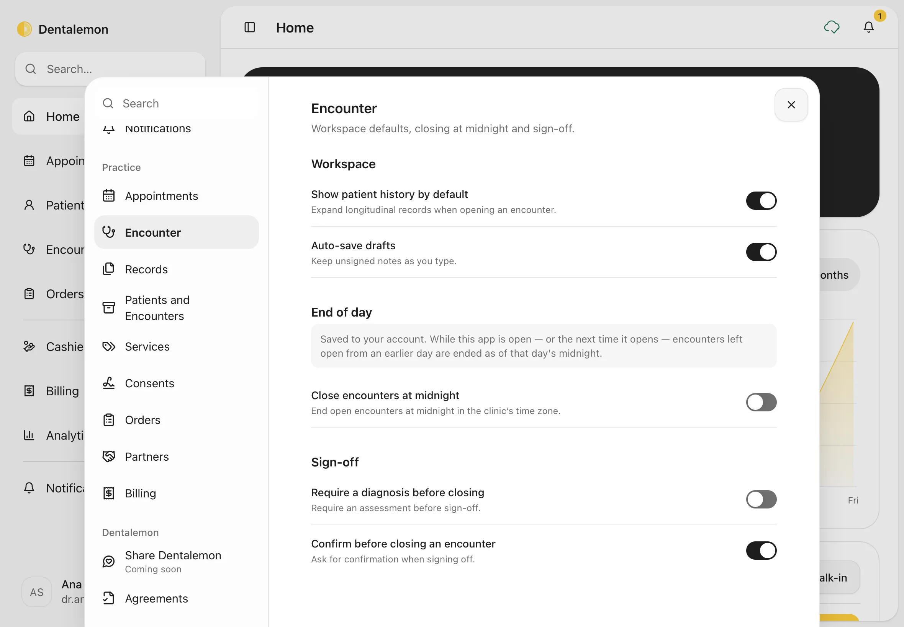

# Settings basics

Set up your profile, your clinic's details and hours, your price list, how you take payments, and how the app looks and behaves.
{ .meta }

**Time:** about 10 minutes the first time · **You'll need:** your clinic's address, opening hours and prices.
{ .meta }

## Before you start

- Settings save as you go. There's no Save button: a change is kept as soon as you make it.
- Some settings are yours alone (your profile, the theme, the tooth notation). Others apply to the whole clinic (clinic details, prices, payments).

## Steps

### 1. Open Settings

At the bottom of the sidebar, tap your name. In the menu, tap **Settings**.

You should see: the account menu with **Account**, **Settings**, **Share Dentalemon**, **What's new** and **Log out**.
{ .see }

Settings opens on **Profile**. The list on the left has four groups: **Account**, **App**, **Practice** and **Dentalemon**. To find a setting fast, type in **Search** at the top of the list.

### 2. Your profile

In **Profile**, fill in your **Title** (for example *Dr.*), your name, **Professional role**, mobile number, PTR and S2 numbers, and your signature. Tap **Add photo** to add a profile photo.

You should see: your name and email. Your **Display name** is how your name appears to patients.
{ .see }

### 3. Your clinic and opening hours

Tap **Clinic**. Fill in the **Clinic name**, **Address**, **Phone** and **Email**.

Under **Operating hours**, switch each day on or off and set its opening and closing times. Appointments can only be booked inside these hours.

### 4. Tooth notation and start page

Tap **General**.

- **Tooth notation**: **FDI**, **Universal** or **Palmer**. This changes how tooth numbers are shown everywhere in the app.
- **Chart row labels**: show or hide the Facial, Occlusal and Lingual labels on the chart.
- **Care set**: **General dentistry** or **Pediatric dentistry**.
- **Open after sign-in**: which page opens first (**Home**, **Appointments** or **Patients**).
- **Formats**: how dates, times and amounts are written.

### 5. Light or dark

Tap **Appearance**. Under **Theme**, pick the screen icon (follow your device), the sun (light) or the moon (dark). Under **Motion**, choose **Reduced** to turn off animations.

### 6. Your price list

Tap **Services**. This is the list Dentalemon uses for **Charges** and the **Cashier**.

- Tap a service to change its name, type, price or length.
- Tap **Add service** to add one.

You should see: every service with its type, length and price.
{ .see }

### 7. Payments and tax

Tap **Billing**.

- **Default payment method**: the method already chosen when you collect a payment.
- **Payment methods**: switch on the ones you accept (**Cash**, **GCash**, **Card**, **Bank transfer**, **Maya**), or tap **Add payment method**. Only switched-on methods appear at the Cashier.
- **Invoice numbers**: every invoice gets the next number in one series. This can't be turned off.

Scroll down to **Tax**. Set **Tax registration** to **Non-VAT** or **VAT registered**, and fill in the **Registered business name**, **TIN** and **Branch code**. Under **Discounts** and **Professional fees** are the Senior Citizen/PWD and fee-split rules.

### 8. Encounter rules

Tap **Encounter**.

- **Close encounters at midnight**: ends visits left open from an earlier day.
- **Require a diagnosis before closing**: blocks **End encounter** until a diagnosis is recorded.
- **Confirm before closing an encounter**: asks before ending a visit.

## Tips

!!! tip "Do these first"
    Before your first patient: **Clinic** (name, address, hours), **Services** (your prices) and **Billing** (payment methods and tax). Everything else can wait.

!!! info "Good to know"
    - Some settings are saved but not used yet, and the panel says so under them. For example, receipts don't print the business name, TIN or branch code yet, and checkout doesn't ask for a reference number yet.
    - **Users and access** is a preview on this device only. Inviting someone there doesn't send an email or give them access.
    - Your email can't be changed in **Profile** yet.

## What's next

- [Notifications and Analytics](notifications-and-analytics.md)
