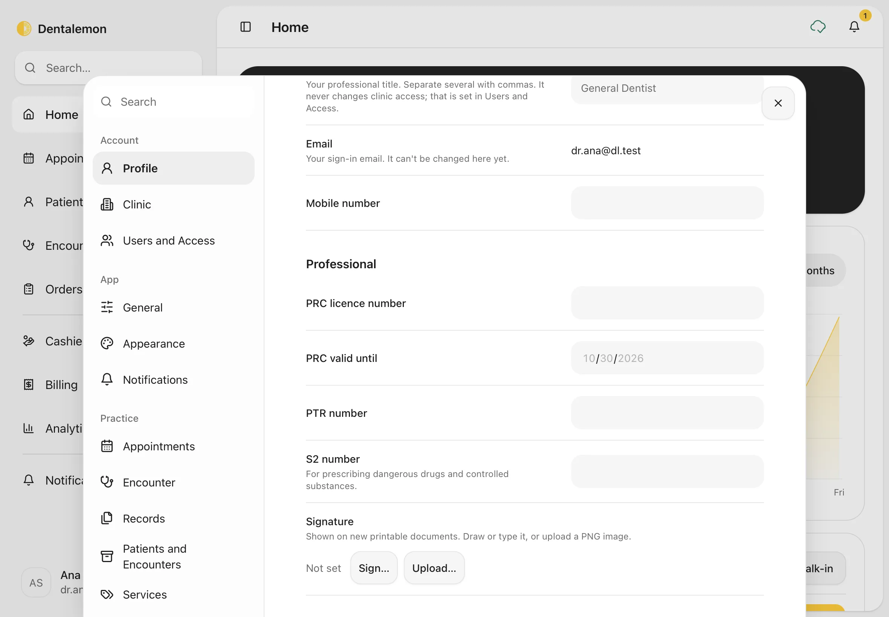
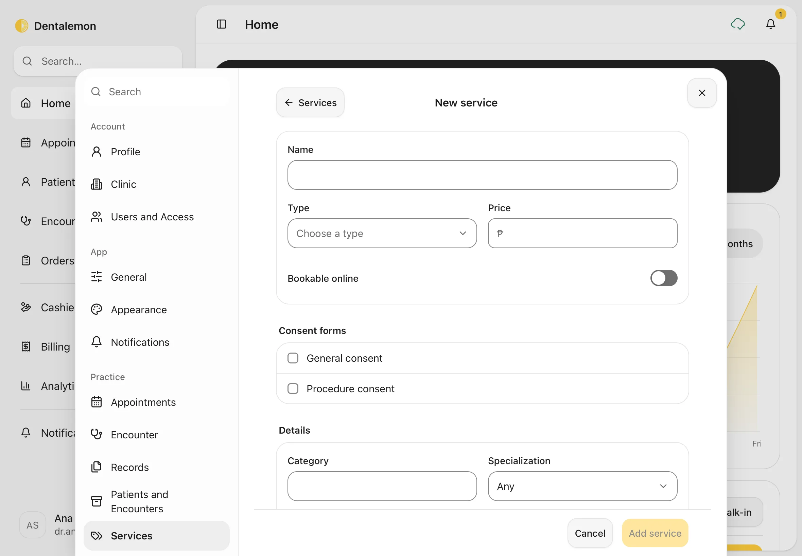
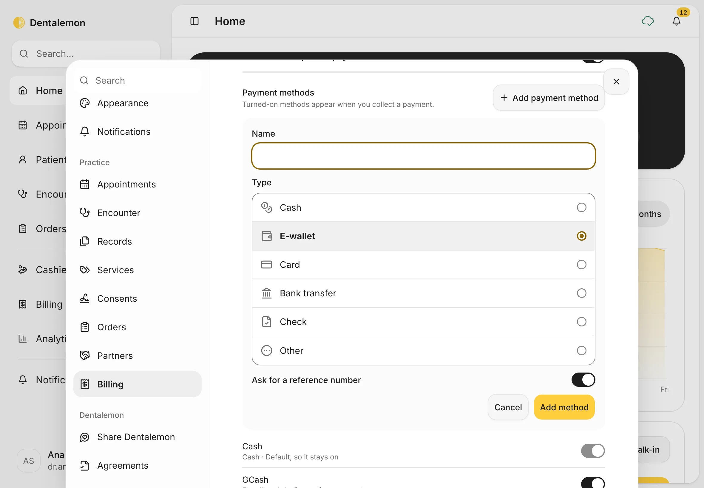
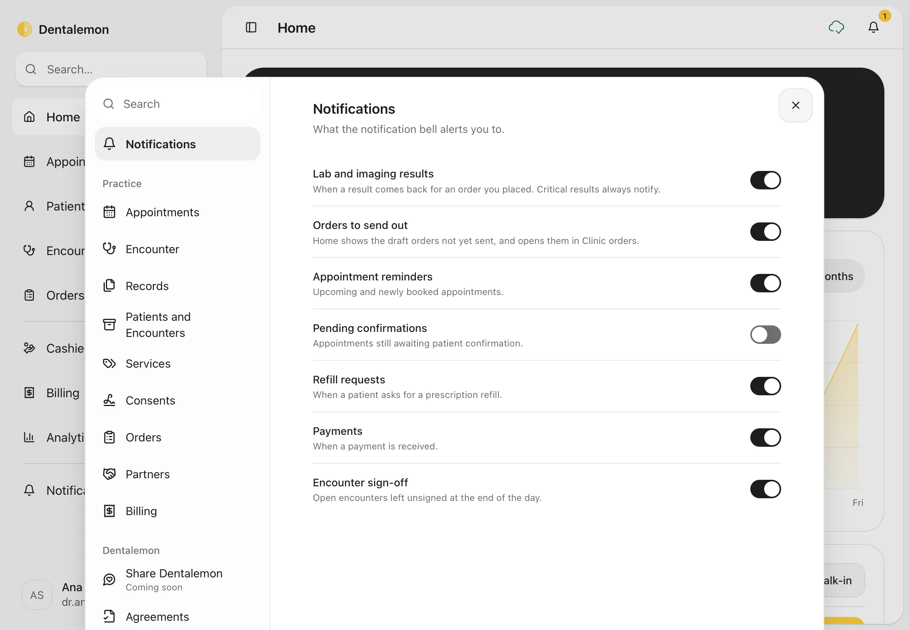
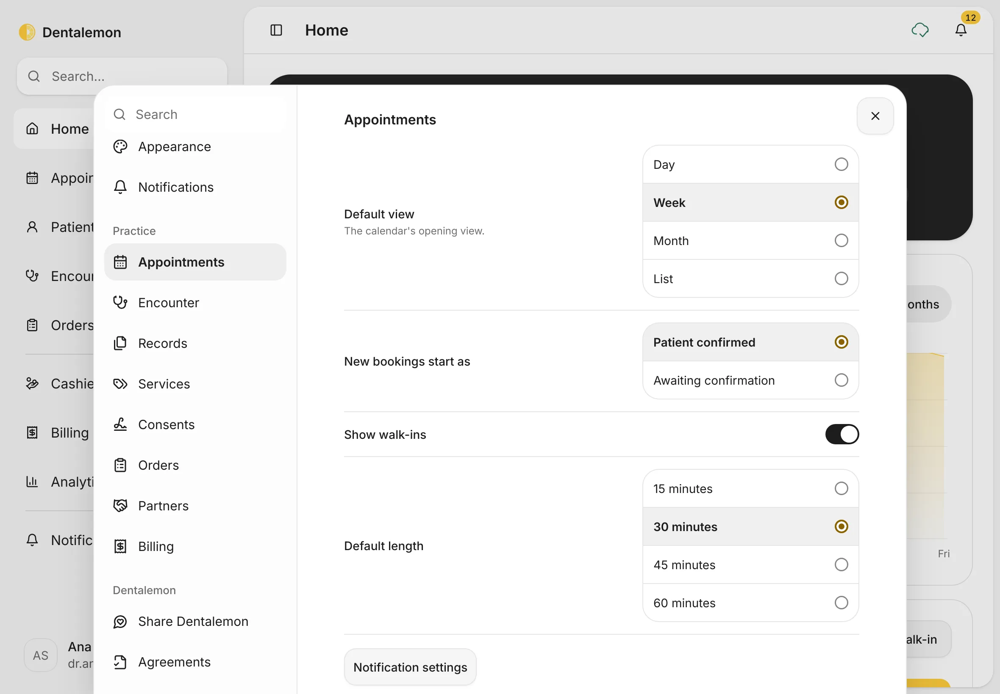
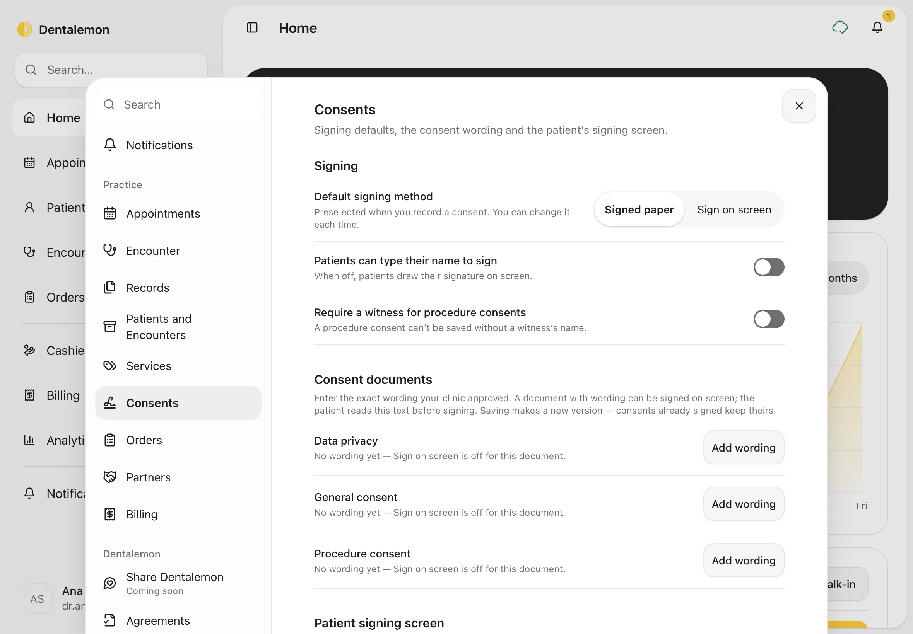

# Settings basics

Set up your profile, your clinic's details and hours, your price list, how you take payments, and how the app looks and behaves.
{ .meta }

**Time:** about 10 minutes the first time · **You'll need:** your clinic's address, opening hours and prices.
{ .meta }

## Before you start

- Settings save as you go. There's no Save button: a change is kept as soon as you make it.
- Some settings are yours alone (your profile, the theme, the tooth notation). Others apply to the whole clinic (clinic details, prices, payments).

## Steps

### 1. Open Settings

At the bottom of the sidebar, tap your name. In the menu, tap **Settings**.

You should see: the account menu with **Account**, **Settings**, **Share Dentalemon**, **What's new** and **Log out**.
{ .see }

Settings opens on **Profile**. The list on the left has four groups: **Account**, **App**, **Practice** and **Dentalemon**. To find a setting fast, type in **Search** at the top of the list.

### 2. Your profile

In **Profile**, fill in your **Title** (for example *Dr.*), your name, **Professional role**, mobile number, PTR and S2 numbers, and your signature. Tap **Add photo** to add a profile photo.

You should see: your name and email. Your **Display name** is how your name appears to patients.
{ .see }

### 3. Your licence numbers and signature

Scroll down **Profile** to **Professional**. These print on your prescriptions, so fill them in before you prescribe:

- **PRC licence number** and **PRC valid until**
- **PTR number**
- **S2 number**: only if you prescribe dangerous drugs or controlled substances

Under **Signature** (it says **Not set** until you add one):

1. Tap **Sign…** to sign with your finger or an Apple Pencil. You can also type your full name instead of drawing.
2. Tap **Use signature**. Tap **Cancel** to leave without saving.

Or tap **Upload…** to use a picture of your signature: a PNG image, up to 200 KB.

Your signature is saved straight away and appears on new printed documents. Documents you already printed keep the old one. To take it off, tap **Remove**.

### 4. Your clinic and opening hours

Tap **Clinic**. Fill in the **Clinic name**, **Address**, **Phone** and **Email**.

Under **Operating hours**, switch each day on or off and set its opening and closing times. Appointments can only be booked inside these hours.

### 5. Tooth notation and start page

Tap **General**.

- **Tooth notation**: **FDI**, **Universal** or **Palmer**. This changes how tooth numbers are shown everywhere in the app.
- **Chart row labels**: show or hide the Facial, Occlusal and Lingual labels on the chart.
- **Care set**: **General dentistry** or **Pediatric dentistry**.
- **Open after sign-in**: which page opens first (**Home**, **Appointments** or **Patients**).
- **Formats**: how dates, times and amounts are written.

### 6. Light or dark

Tap **Appearance**. Under **Theme**, pick the screen icon (follow your device), the sun (light) or the moon (dark). Under **Motion**, choose **Reduced** to turn off animations.

### 7. Your price list

Tap **Services**. This is the list Dentalemon uses for **Charges** and the **Cashier**.

You should see: every service with its type, length and price.
{ .see }

To change a service, tap it, change what you need, and save. To add one:

1. Tap **Add service**.
2. Type the **Name**, for example *Night guard*.
3. Choose the **Type** (for example a procedure or a consultation) and type the **Price**.
4. Optional: switch on **Bookable online**; tick **General consent** or **Procedure consent** under **Consent forms** if the patient must sign one first; fill in **Details** such as **Category**, **Specialization** and **Usual length** (how long the visit takes).
5. Tap **Add service**. Tap **Cancel** to leave without saving.

To stop offering a service, open it and tap **Archive service**. It no longer shows when you add charges; bills that already have it keep it.

### 8. Payments and tax

Tap **Billing**.

- **Default payment method**: the method already chosen when you collect a payment.
- **Payment methods**: switch on the ones you accept (**Cash**, **GCash**, **Card**, **Bank transfer**, **Maya**), or tap **Add payment method**. Only switched-on methods appear at the Cashier.
- **Invoice numbers**: every invoice gets the next number in one series. This can't be turned off.

To add a payment method your clinic accepts, for example another e-wallet:

1. Tap **Add payment method**.
2. Type its **Name**, for example *ShopeePay*.
3. Choose its **Type**: **Cash**, **E-wallet**, **Card**, **Bank transfer**, **Check** or **Other**. The type decides what the Cashier asks for when you collect (for example a reference number for an e-wallet).
4. Tap **Add method**. Tap **Cancel** to leave without adding.

Scroll down to **Tax**. Set **Tax registration** to **Non-VAT** or **VAT registered**, and fill in the **Registered business name**, **TIN** and **Branch code**. Under **Discounts** and **Professional fees** are the Senior Citizen/PWD and fee-split rules.

### 9. Encounter rules

Tap **Encounter**.

- **Close encounters at midnight**: ends visits left open from an earlier day.
- **Require a diagnosis before closing**: blocks **End encounter** until a diagnosis is recorded.
- **Confirm before closing an encounter**: asks before ending a visit.

### 10. Notifications you want to see

Tap **Notifications**. Switch off any kind of notification you don't want in your bell and on the **Notifications** page, for example **Pending confirmations** or **Payments**. The choice is yours alone and follows you to your other devices.

Critical lab and imaging results always notify you, even with **Lab and imaging results** switched off.

### 11. Appointment settings

Tap **Appointments** (under **Practice**).

- **Default view**: which view the Appointments calendar opens in (**Day**, **Week**, **Month** or **List**).
- **New bookings start as**: **Patient confirmed** or **Awaiting confirmation**. This is the status already chosen when you book.
- **Show walk-ins**: show patients seen without a booking on the calendar.
- **Default length**: how long a new appointment lasts (**15**, **30**, **45** or **60 minutes**). It's also the gap between the times offered when you book.
- **Booking hours**: further down, you can give a service its own bookable days and hours. Otherwise it uses your clinic hours.

### 12. Consents and signing on screen

Tap **Consents**. This is where you set how patients sign consents. See [Consents](../visits/consents.md) for recording one.

- **Default signing method**: **Signed paper** or **Sign on screen**, already chosen when you record a consent.
- **Patients can type their name to sign**: when off, patients draw their signature.
- **Require a witness for procedure consents**: when on, a procedure consent can't be saved without a witness's name.
- **Consent documents**: the wording patients read on the iPad. A document can only be signed on screen once its wording is entered. Until then it says **No wording yet — Sign on screen is off for this document.**
- **Signing passcode**: the code you enter to take the iPad back after the patient signs. You're asked to set it the first time you hand the iPad to a patient.

To enter a document's wording:

1. Next to **Data privacy**, **General consent** or **Procedure consent**, tap **Add wording**.
2. Type the **Title**, choose the **Language** (**English** or **Filipino**), and paste or type the exact **Approved wording**: the text your clinic approved for patients to sign.
3. Tap **Save new version**.

Saving creates a new version. Consents patients already signed keep the version they signed. To change the wording later, tap **Edit wording**.

## Tips

!!! tip "Do these first"
    Before your first patient: **Clinic** (name, address, hours), **Services** (your prices) and **Billing** (payment methods and tax). Everything else can wait.

!!! info "Good to know"
    - Some settings are saved but not used yet, and the panel says so under them. For example, receipts don't print the business name, TIN or branch code yet, and a payment method's **Ask for a reference number** switch isn't used yet: the Cashier always asks for a reference number for e-wallets, cards and bank transfers.
    - **Users and access** is a preview on this device only. Inviting someone there doesn't send an email or give them access.
    - Your email can't be changed in **Profile** yet.

## What's next

- [Notifications and Analytics](notifications-and-analytics.md)
