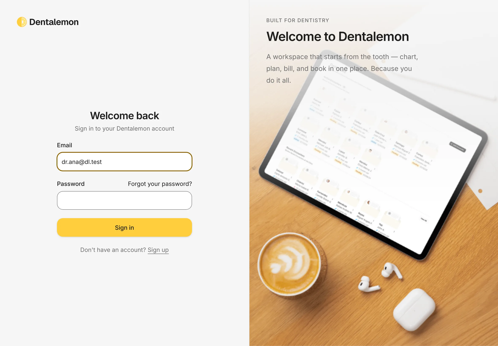
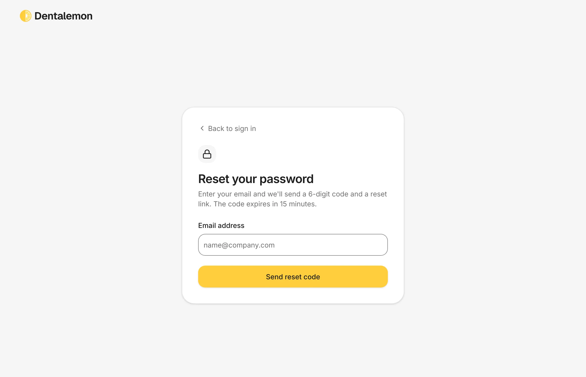
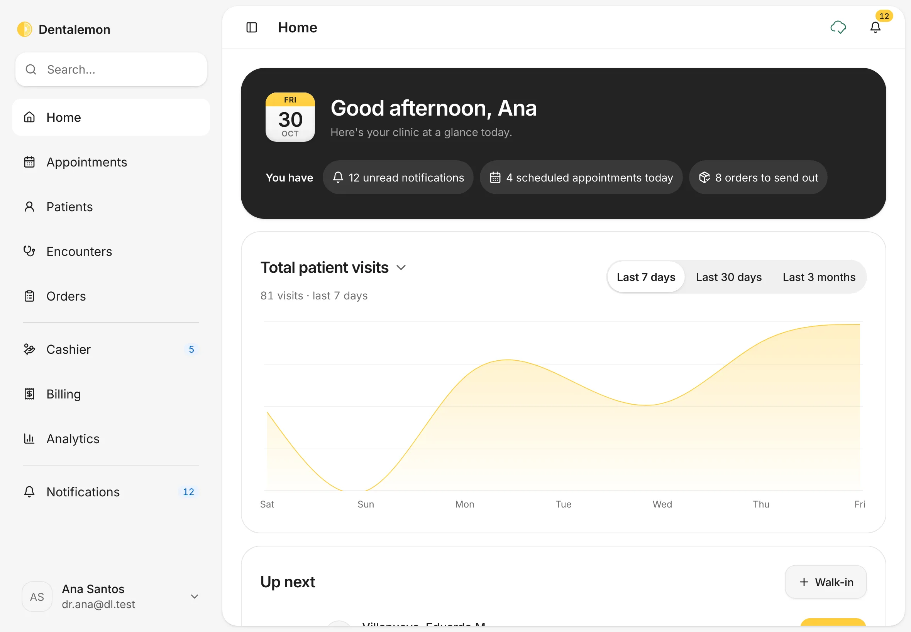
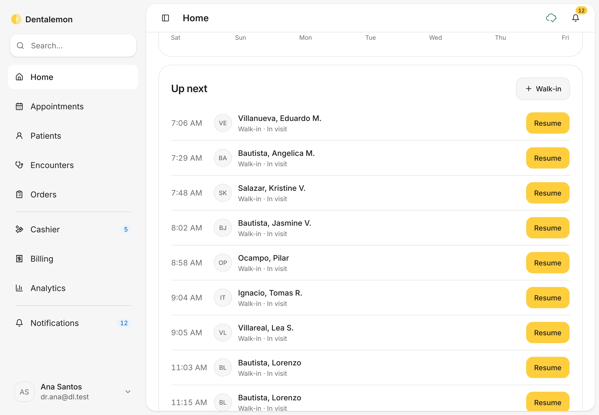
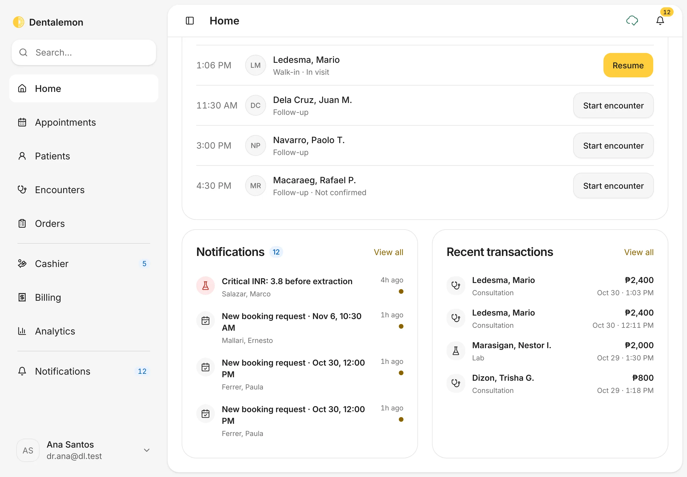
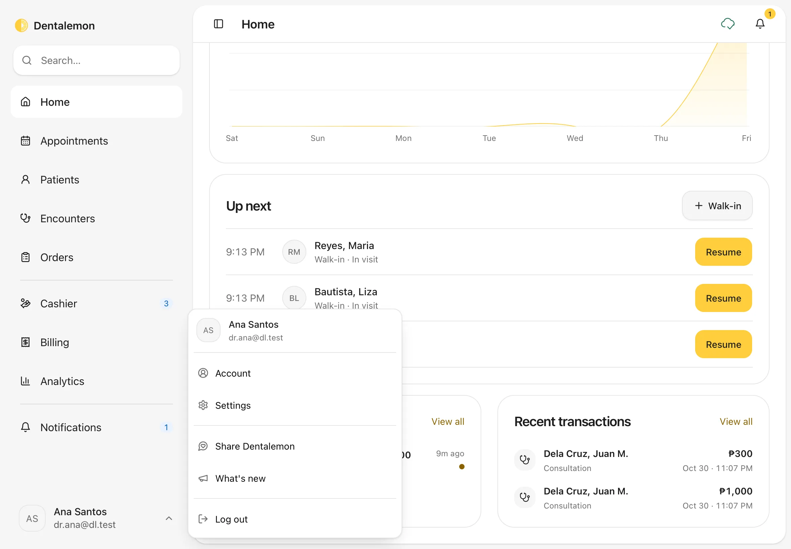

# Sign in and a first look around

Sign in each day and find your way around Home, the sidebar and your account menu.
{ .meta }

**Time:** about 3 minutes · **You'll need:** a Dentalemon account ([Sign up](sign-up-and-clinic-setup.md) if you don't have one).
{ .meta }

## Before you start

- Have your email and password ready.

## Steps

### 1. Sign in

Open Dentalemon. Type your **Email** and **Password**, then tap **Sign in**.

You should see: **Welcome back**, with your email and password boxes.
{ .see }

### 2. If you forgot your password

Tap **Forgot your password?** under the password box. Type your **Email address** and tap **Send reset code**.
You get a 6-digit code by email. Type it in to set a new password. The code works for 15 minutes.

You should see: **Reset your password**. Tap **Back to sign in** if you remembered it after all.
{ .see }

{ .shot-sm }

### 3. Read the top of Home

After you sign in, Dentalemon opens **Home**.

- The dark card greets you with today's date.
- Under it, **You have** shows what needs you today. Tap a chip to go straight there:
    - **unread notifications** opens your notifications.
    - **scheduled appointments today** opens today's calendar.
    - **orders to send out** opens your draft orders.
- **Total patient visits** charts your visits. Switch between **Last 7 days**, **Last 30 days** and **Last 3 months**. Tap the title to see other charts, such as **Orders by type**.

You should see: your greeting, the **You have** chips, and the visits chart.
{ .see }

!!! note
    A chip only shows when there's something to do. If you have no appointments today, that chip is hidden.

### 4. See who's up next

Scroll down to **Up next**. It lists today's patients in time order.

- **Start encounter** opens a new visit for a booked patient.
- **Resume** goes back to a visit that is still open.
- **Walk-in** is for a patient who came in without an appointment.

You should see: each patient's time, name, visit reason and a button.
{ .see }

### 5. Check notifications and recent payments

Keep scrolling. **Notifications** shows the newest alerts, such as lab results and booking requests. **Recent transactions** shows the latest payments. Tap **View all** on either card to see the full list.

You should see: the two cards side by side.
{ .see }

### 6. Find your way with the sidebar

The sidebar on the left is always there. It has three groups:

- **Home**, **Appointments**, **Patients**, **Encounters**, **Orders**: your daily clinic work.
- **Cashier**, **Billing**, **Analytics**: money and numbers.
- **Notifications**: all your alerts.

A small number next to an item tells you how many things are waiting there.
The **Search…** box at the top finds a patient by name: type and press Enter.

### 7. Open your account menu

Tap your name at the bottom of the sidebar.

- **Account**: your profile, photo and signature.
- **Settings**: your clinic, prices, formats and more. See [Settings basics](../clinic/settings-basics.md).
- **Share Dentalemon**: tell a colleague about the app.
- **What's new**: the latest changes to Dentalemon.
- **Log out**: sign out on this device.

You should see: the menu open above your name.
{ .see }

## Tips

!!! tip "Open a different page after sign-in"
    If you'd rather start each day on **Appointments** or **Patients**, change **Open after sign-in** in **Settings › General**.

!!! warning "If something goes wrong"
    **You can't sign in.** Check for a typo in your email and that Caps Lock is off. Still stuck? Use **Forgot your password?**.
    **A What's new window appears after you sign in.** That's normal after an update. Read it, then close it to reach Home.

## What's next

- [Find or add a patient](../patients/find-or-add-a-patient.md)
