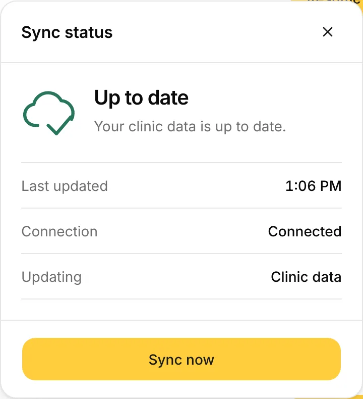
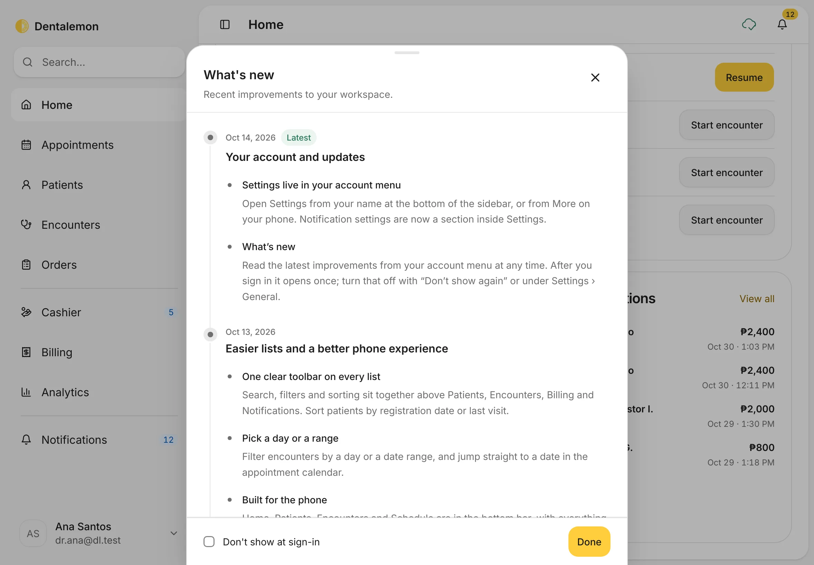

# Sign in and a first look around

Sign in each day and find your way around Home, the sidebar and your account menu.
{ .meta }

**Time:** about 3 minutes · **You'll need:** a Dentalemon account ([Sign up](sign-up-and-clinic-setup.md) if you don't have one).
{ .meta }

## Before you start

- Have your email and password ready.

## Steps

### 1. Sign in

Open Dentalemon. Type your **Email** and **Password**, then tap **Sign in**.

You should see: **Welcome back**, with your email and password boxes.
{ .see }

### 2. If you forgot your password

Tap **Forgot your password?**, next to **Password**. Type your **Email address** and tap **Send reset code**.
You get a 6-digit code by email. Type it in to set a new password. The code works for 15 minutes.

You should see: **Reset your password**. Tap **Back to sign in** if you remembered it after all.
{ .see }

{ .shot-sm }

### 3. Read the top of Home

After you sign in, Dentalemon opens **Home**.

- The dark card greets you with today's date.
- Under it, **You have** shows what needs you today. Tap a chip to go straight there:
    - **unread notifications** opens your notifications.
    - **scheduled appointments today** opens today's calendar.
    - **orders to send out** opens your draft orders.
- **Total patient visits** charts your visits. Switch between **Last 7 days**, **Last 30 days** and **Last 3 months**. Tap the title to see other charts, such as **Orders by type**.

You should see: your greeting, the **You have** chips, and the visits chart.
{ .see }

!!! note
    A chip only shows when there's something to do. If you have no appointments today, that chip is hidden.

### 4. See who's up next

Scroll down to **Up next**. It lists today's patients: visits under way first, then bookings in time order. Three rows show at a time; slide your finger on the card to see the rest.

- **Start encounter** checks a booked patient in and opens their visit, in one tap.
- **Resume** goes back to a visit that is still open.
- **Check in** shows for a booking whose patient isn't in your patient list yet.
- **Walk-in** is for a patient who came in without an appointment.

Under each name is the visit reason and, when it applies, **In visit**, **Not confirmed** or **Checked in**.

You should see: each patient's time, name, visit reason and a button.
{ .see }

**Seeing a walk-in patient:**

1. Tap **Walk-in**. Dentalemon opens **Patients**.
2. Search for the patient. If they're new, add them (see [Find or add a patient](../patients/find-or-add-a-patient.md)).
3. On the patient's page, tap **Start encounter**.

The visit then appears in **Up next** with the label **Walk-in**, so you can come back to it with **Resume**.

### 5. Check notifications and recent payments

Keep scrolling. **Notifications** shows the newest alerts, such as lab results and booking requests. **Recent transactions** shows the latest payments. Tap **View all** on either card to see the full list.

You should see: the two cards side by side.
{ .see }

### 6. Find your way with the sidebar

The sidebar on the left is always there. It has three groups:

- **Home**, **Appointments**, **Patients**, **Encounters**, **Orders**: your daily clinic work.
- **Cashier**, **Billing**, **Analytics**: money and numbers.
- **Notifications**: all your alerts.

A small number next to an item tells you how many things are waiting there.
The **Search…** box at the top finds a patient by name: type and press Enter.

To make more room on the screen, tap the panel button at the top left, next to the page title. It hides the sidebar. Tap it again to bring the sidebar back.

You should see: the page you tapped, with its name at the top and its item highlighted in the sidebar.
{ .see }

### 7. Check the icons at the top right

Two icons sit at the top right of every page.

- **The cloud** shows whether your data is up to date. A tick means everything is saved and current. Tap it to open **Sync status**:
    - **Up to date**: your clinic data is current.
    - **You're offline**: there's no internet connection. Changes you make can't reach the clinic until you're back online.
    - **Couldn't finish syncing**: the update didn't go through. Tap **Try again**.
    - **Sync now** fetches the latest changes straight away.
- **The bell** opens your notifications. The number on it is how many you haven't read. See [Notifications and Analytics](../clinic/notifications-and-analytics.md).

You should see: **Sync status**, with **Last updated**, **Connection** and a **Sync now** button.
{ .see }

{ .shot-sm }

### 8. Open your account menu

Tap your name at the bottom of the sidebar.

- **Account**: your profile, photo and signature.
- **Settings**: your clinic, prices, formats and more. See [Settings basics](../clinic/settings-basics.md).
- **Share Dentalemon**: your clinic's invite code for colleagues. It's marked **Coming soon**.
- **What's new**: the latest changes to Dentalemon.
- **Log out**: sign out on this device.

You should see: the menu open above your name.
{ .see }

### 9. See what's new

In the account menu, tap **What's new**. It lists recent improvements, newest first. Tap **Done** to close it.

What's new also opens by itself once after you sign in, when there's something new. Tick **Don't show at sign-in** if you'd rather open it yourself. You can switch it back on in **Settings › General › Show updates at login**.

You should see: **What's new**, with the newest change marked **Latest**.
{ .see }

### 10. Log out

In the account menu, tap **Log out**. Dentalemon signs you out on this device and shows the sign-in page.

You should see: **Welcome back**, the sign-in page.
{ .see }

Log out when you hand the iPad to someone else, or at the end of the day on a shared iPad.

## Using Dentalemon on an iPad

- **Tap** to choose. There's no need to double-tap.
- **Scroll** inside a panel or list by sliding your finger on it. Long forms and lists scroll on their own, while the top bar stays put.
- **Sheets** are panels that slide up from the bottom or in from the side, such as **Collect payment**. Close one with **✕**, **Cancel** or **Close**, or by dragging its handle down.
- **Landscape or portrait**: both work. In portrait, some panels, like the tooth panel, open as sheets instead of sitting beside the page.
- **Typing**: tap a box to bring up the keyboard. Use the keyboard's hide key when you're done.

## Tips

!!! tip "Open a different page after sign-in"
    If you'd rather start each day on **Appointments** or **Patients**, change **Open after sign-in** in **Settings › General**.

!!! warning "If something goes wrong"
    **You can't sign in.** Check for a typo in your email and that Caps Lock is off. Still stuck? Use **Forgot your password?**.
    **A What's new window appears after you sign in.** That's normal after an update. Read it, then close it to reach Home.

## What's next

- [Find or add a patient](../patients/find-or-add-a-patient.md)
