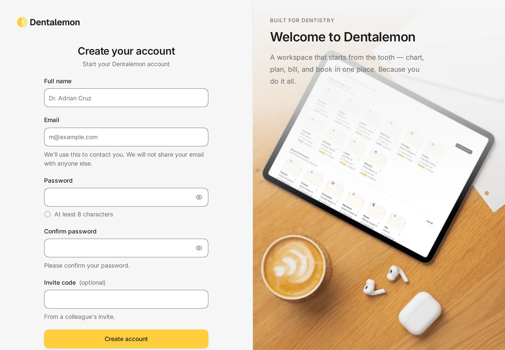
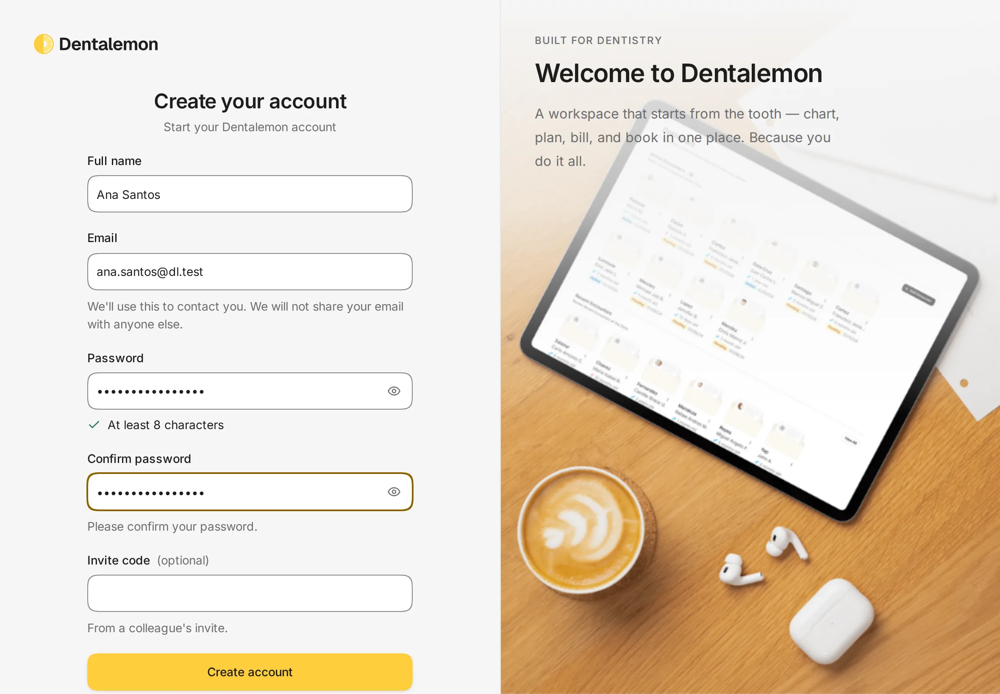
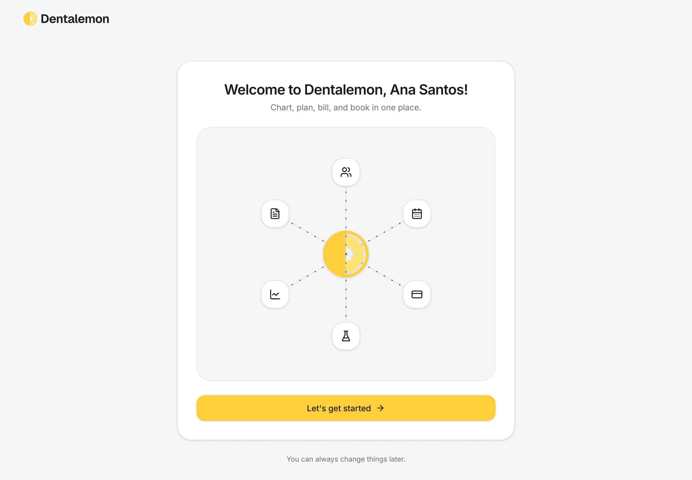
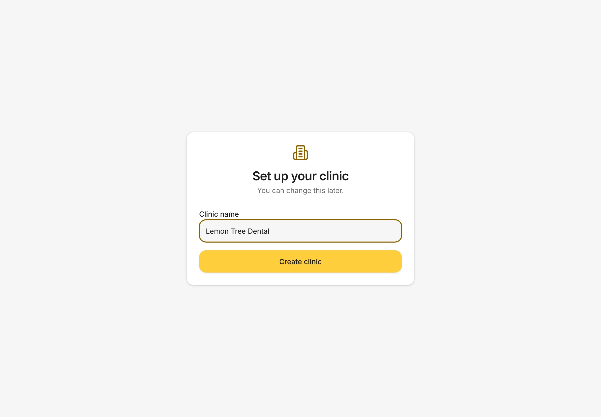
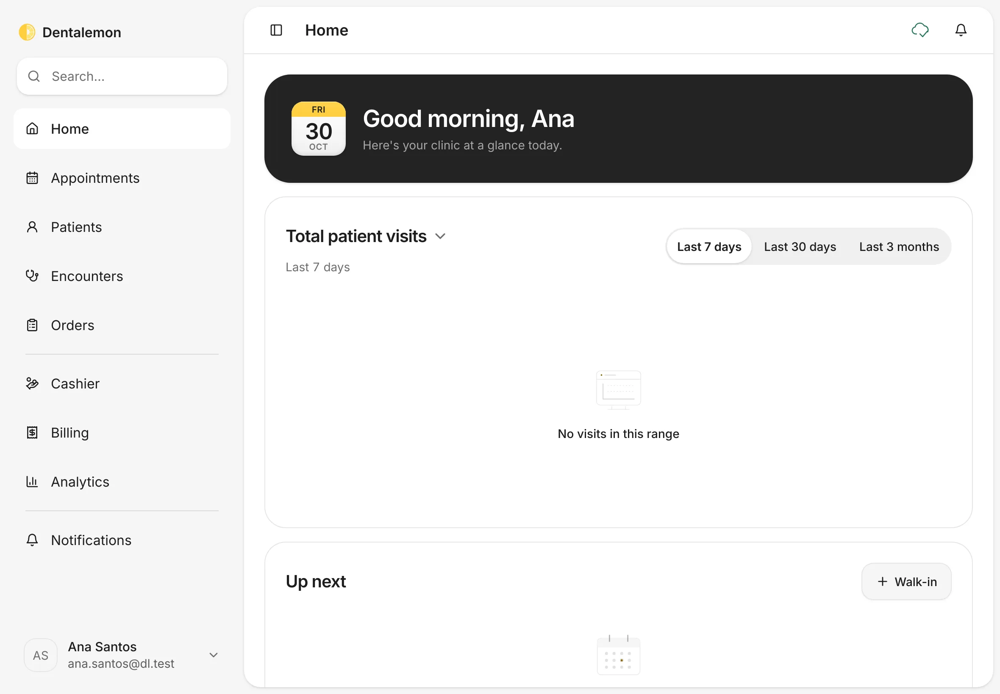

# Sign up and set up your clinic

Create your Dentalemon account and name your clinic. You only do this once.
{ .meta }

**Time:** about 2 minutes · **You'll need:** an email address you can use for work.
{ .meta }

## Before you start

- Use the email you want to sign in with every day. You can't change it later in the app yet.
- If a colleague sent you an **invite code**, have it ready. If not, leave that box empty.

## Steps

### 1. Open the sign-up page

Open Dentalemon and tap **Sign up** under the sign-in box.

You should see: **Create your account**, with boxes for your name, email and password.
{ .see }

### 2. Fill in your details

1. **Full name**: your name as patients know you, for example *Ana Santos*.
2. **Email**: your work email.
3. **Password**: at least 8 characters. A green check appears next to **At least 8 characters** when it's long enough.
4. **Confirm password**: type the same password again.
5. **Invite code (optional)**: only if a colleague gave you one.

Then tap **Create account**.

You should see: every box filled in and the password rule checked.
{ .see }

### 3. Get started

Dentalemon greets you by name.

Tap **Let's get started**.

You should see: **Welcome to Dentalemon, *your name*!**
{ .see }

### 4. Name your clinic

Type your clinic's name in **Clinic name**, then tap **Create clinic**.

You should see: **Set up your clinic** with your clinic name in the box.
{ .see }

### 5. You're in

Dentalemon opens **Home**. A new clinic has no patients or visits yet, so the cards are empty. They fill up as you work.

You should see: **Good morning, *your name*** at the top, and the sidebar on the left: **Home**, **Appointments**, **Patients**, **Encounters**, **Orders**, **Cashier**, **Billing**, **Analytics** and **Notifications**.
{ .see }

## Tips

!!! tip "Finish your clinic details next"
    Add your clinic's address, phone and opening hours, and your price list, before you see patients.
    See [Settings basics](../clinic/settings-basics.md).

!!! warning "If something goes wrong"
    **The Create account button does nothing.** Check that every box is filled in, the password is at least 8 characters, and both passwords match.
    The box with a problem shows a message under it.

!!! info "Good to know"
    - Sign-up uses email and password only. There's no Apple or Google sign-in.
    - **You can change this later** applies to the clinic name: you can rename it in **Settings › Clinic**.

## What's next

- [Sign in and a first look around](sign-in-and-home.md)
