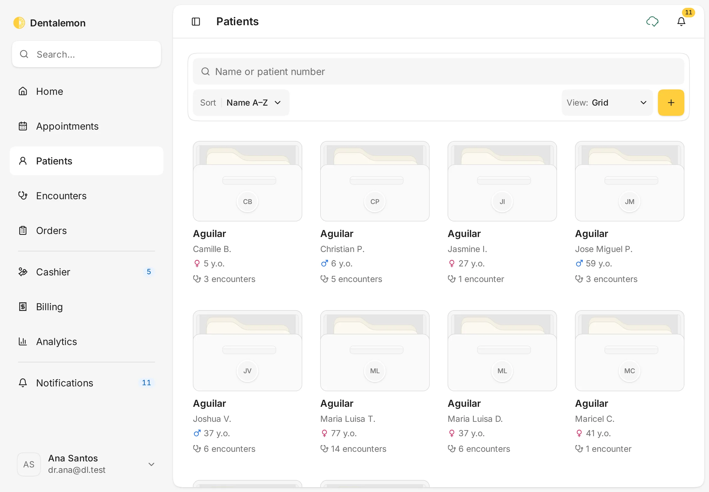
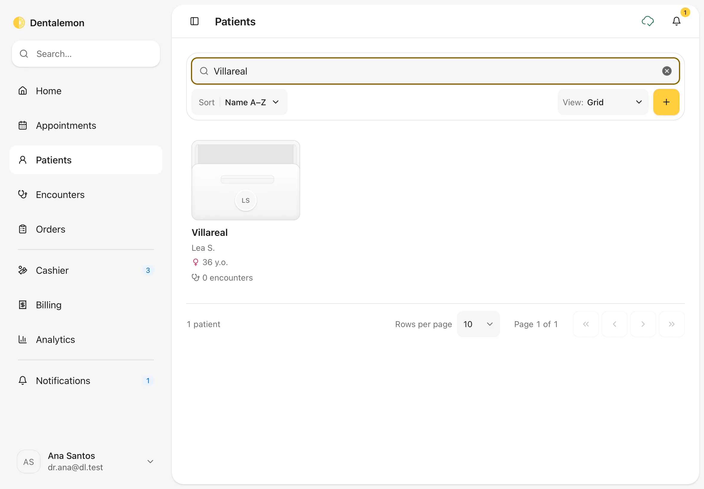
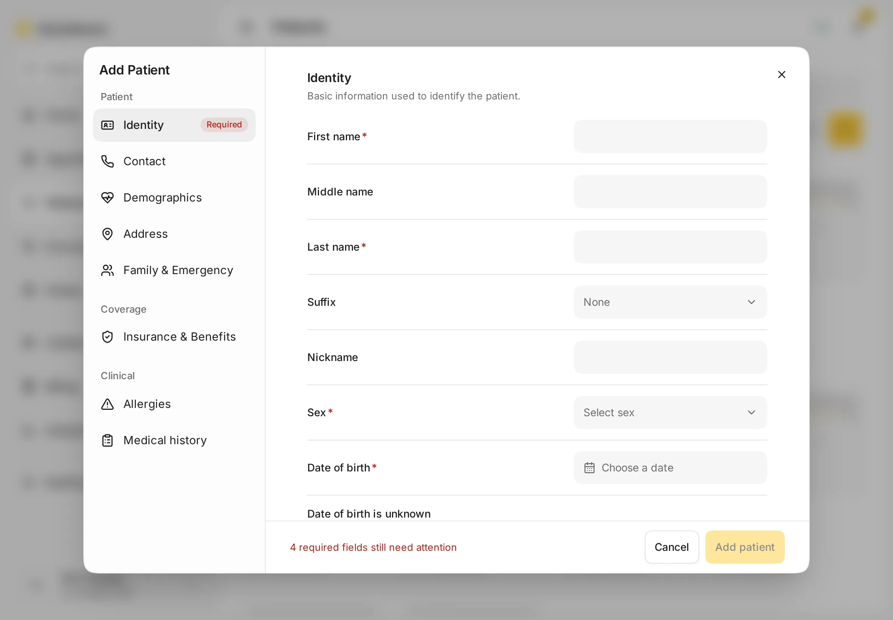
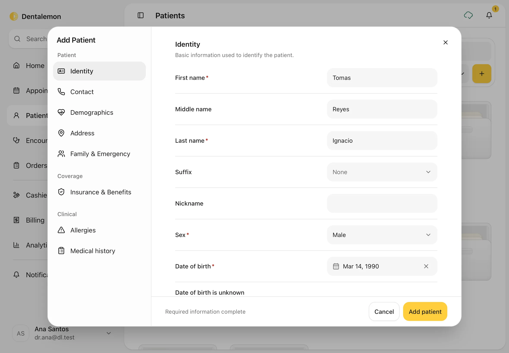
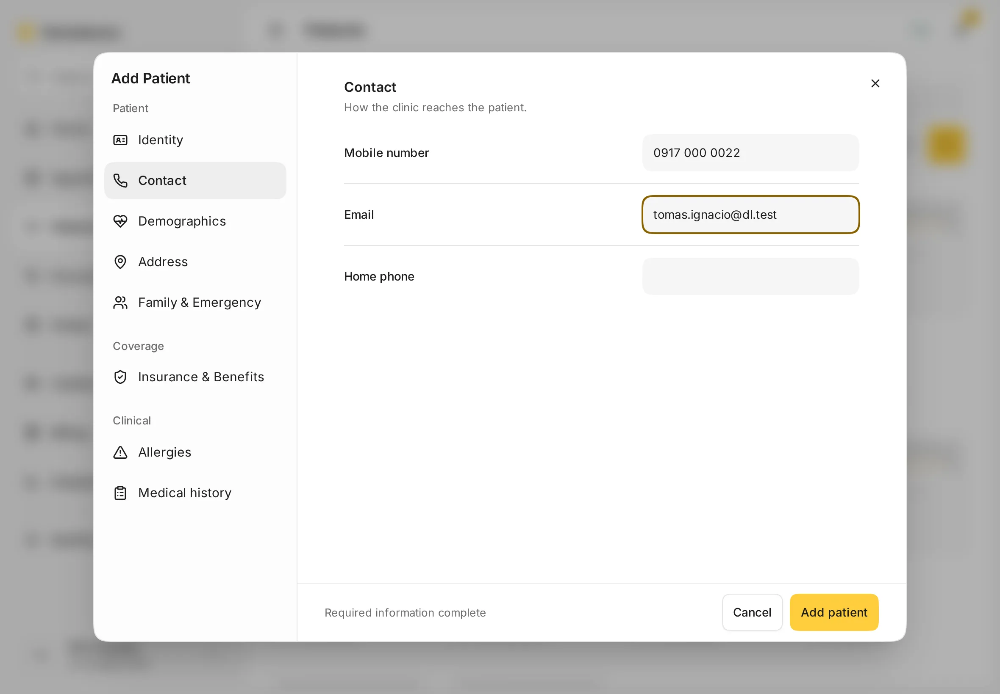
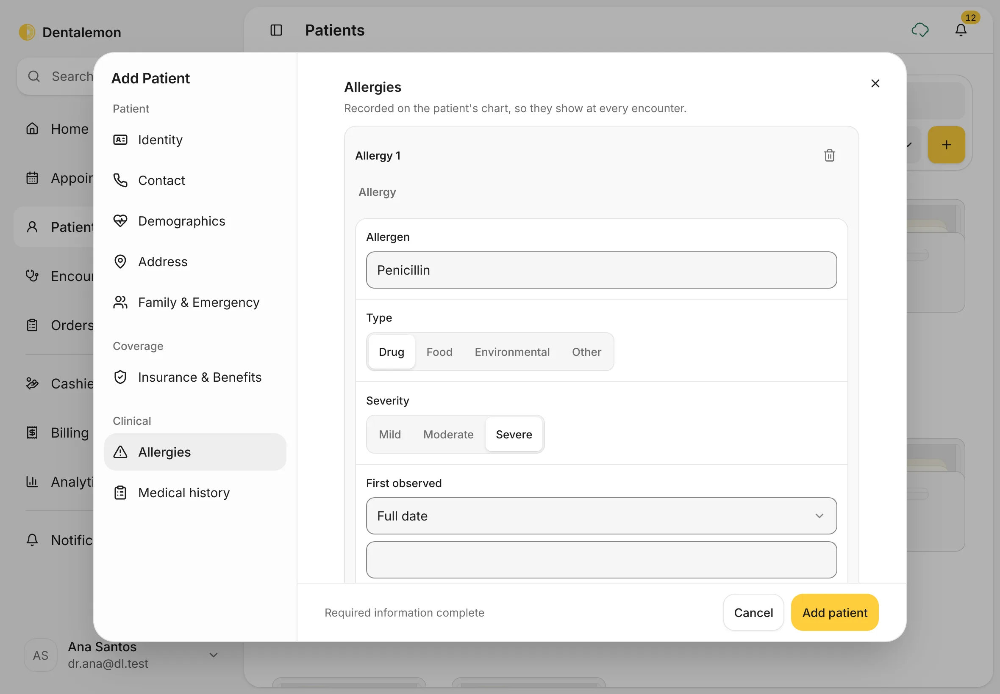
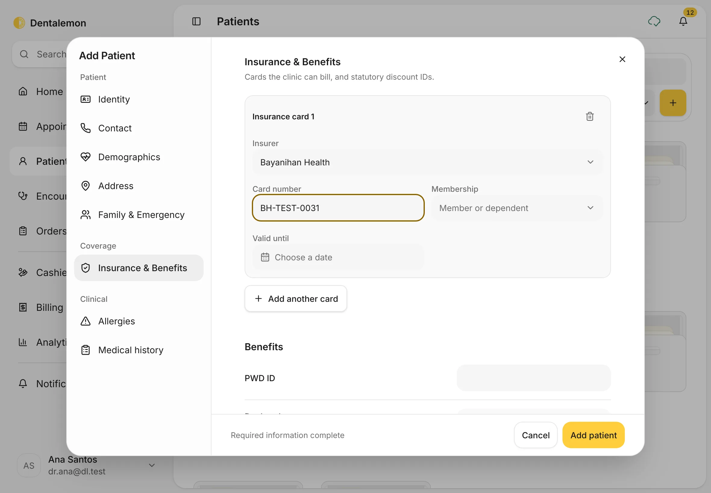
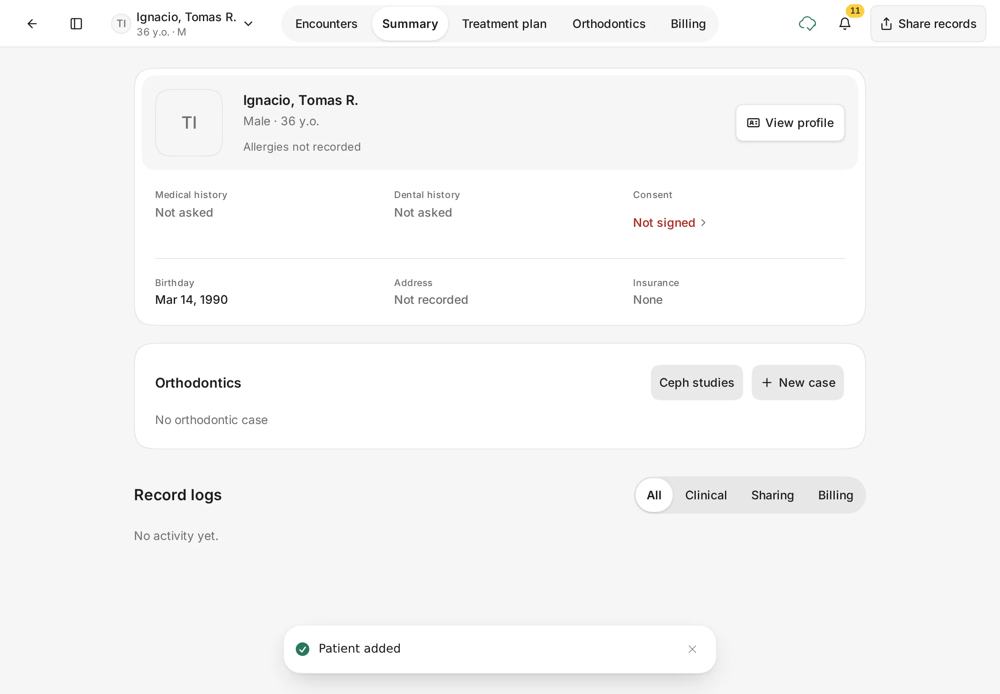

# Find or add a patient

Look up a patient who's been to your clinic before, or add a new one.
{ .meta }

**Time:** about 3 minutes · **You'll need:** the patient's name, sex and date of birth.
{ .meta }

## Before you start

- [Sign in](../getting-started/sign-in-and-home.md) to Dentalemon.
- Always search first. Adding someone who is already on file creates a second, separate record.

## Steps

### 1. Open Patients

Tap **Patients** in the sidebar.

You should see: your patients as folders, sorted by last name (**Sort: Name A–Z**).
Each folder shows the patient's name, sex, age and number of encounters.
{ .see }

!!! tip "Prefer a list?"
    Use **View** to switch between **Grid**, **List** and **Table**. The table shows the most at once: **Patient**, **Sex**, **Age**, **Encounters**, **Date registered**, **Last visit** and **Status**.

### 2. Search for the patient

Type part of the name, or the patient number, in **Name or patient number**. The list updates as you type.

You should see: only the patients that match. Tap a folder to open that patient.
Tap **×** in the search box to clear it.
{ .see }

!!! note
    Search matches first, middle and last names. Searching a common name such as *Dela Cruz* also finds patients whose middle name is Dela Cruz.

If the patient isn't there, add them in the next step.

### 3. Open the Add Patient form

Tap the yellow **+** button next to **View**.

You should see: **Add Patient**, open on **Identity**. The footer says how many required fields are left, for example **4 required fields still need attention**. **Add patient** stays greyed out until they're filled.
{ .see }

### 4. Fill in the required fields

On **Identity**, fill in the four fields marked with a red star:

1. **First name**
2. **Last name**
3. **Sex**: tap the box and choose.
4. **Date of birth**: tap **Choose a date**, pick the year, month and day, then apply.

If the patient doesn't know their birthday, tick **Date of birth is unknown** instead.

You should see: **Required information complete** in the footer.
{ .see }

### 5. Add contact details and anything else you have

Use the list on the left to move between sections. Nothing here is required, but it saves time later:

- **Contact**: **Mobile number**, **Email**, **Home phone**.
- **Demographics**, **Address**, **Family & Emergency**.
- **Insurance & Benefits**: HMO or PhilHealth cards, and Senior Citizen or PWD IDs (step 7).
- **Allergies** (step 6) and **Medical history**: record these before the first treatment.

You should see: the section you tapped, with your details filled in.
{ .see }

### 6. Record allergies

Always ask about allergies before the first treatment. Allergies you record here appear in red on the patient's page and at every visit.

1. Tap **Allergies** in the list on the left.
2. Tap **Add allergy**.
3. In **Allergen**, type what the patient is allergic to, for example *Penicillin*. Pick a suggestion if one matches, or keep what you typed.
4. Under **Type**, tap **Drug**, **Food**, **Environmental** or **Other**.
5. Under **Severity**, tap **Mild**, **Moderate** or **Severe**.
6. Under **First observed**, add when it started, if the patient knows. You can leave it empty.
7. For another allergy, tap **Add allergy** again. To remove one, tap the bin next to its name.

If you haven't asked about allergies yet, leave this section empty. The patient's page then says **Allergies not recorded**, so you know to ask.

You should see: **Allergy 1** with the allergen, type and severity filled in.
{ .see }

!!! note
    You can add allergies here only while you're adding the patient. Later, add or change them during a visit: in the encounter, open **Records** and tap **+ Allergies**. See [Notes, prescriptions, orders and attachments](../visits/notes-prescriptions-orders-attachments.md).

### 7. Add insurance cards and discount IDs

Fill this in if the patient has an HMO or PhilHealth card, or a PWD or Senior Citizen ID. The Cashier uses it later for coverage and discounts.

1. Tap **Insurance & Benefits** in the list on the left.
2. Tap **Add insurance card**.
3. Tap **Select insurer** and choose the HMO or PhilHealth. The list shows the payers your clinic works with.
4. Type the **Card number**. Choose the **Membership** (member or dependent) and **Valid until** date if you have them.
5. For a second card, tap **Add another card**.
6. Under **Benefits**, type the **PWD ID** if the patient has one, and the **Declared on** date (the day they showed it to you). For patients aged 60 or over, a **Senior Citizen ID (OSCA)** box appears here too.

You should see: **Insurance card 1** with the insurer and card number.
{ .see }

### 8. Save

Tap **Add patient**.

You should see: a **Patient added** message, and the new patient's page opens on **Summary**. Allergies you added show in red under the name, and the insurer shows under **Insurance**.
{ .see }

## Tips

!!! tip "Search from anywhere"
    The **Search…** box at the top of the sidebar also finds patients. Type a name and press Enter.

!!! warning "If something goes wrong"
    **Add patient is greyed out.** A required field is still empty. The footer says how many, and **Required** appears next to the section that needs attention.
    **You closed the form by mistake.** If you had typed something, Dentalemon asks **Discard this patient?**. Tap **Keep editing** to go back to your work.

!!! info "Good to know"
    The patient's details can be changed at any time. See [The patient page and profile](patient-page-and-profile.md).

## What's next

- [The patient page and profile](patient-page-and-profile.md)
- [Start an encounter](../visits/start-an-encounter.md)
