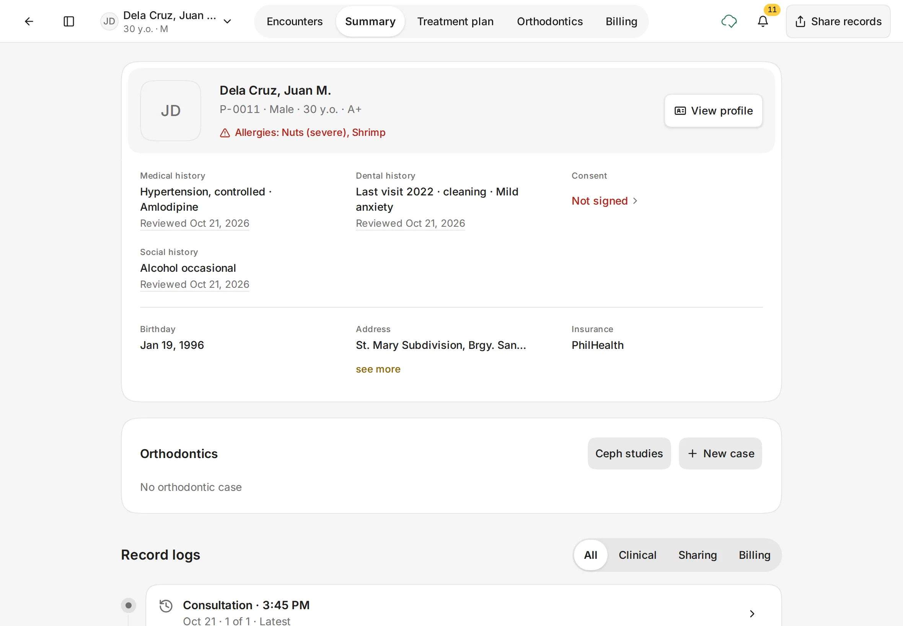
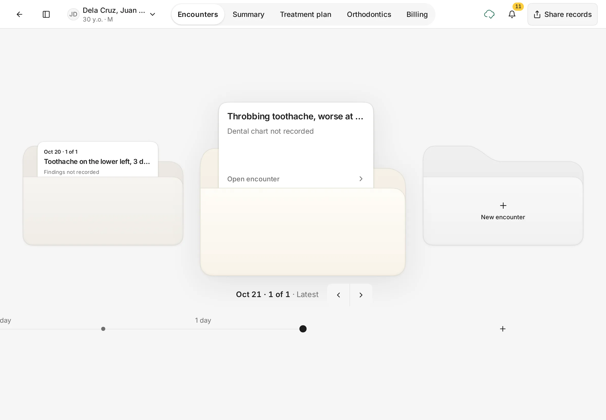
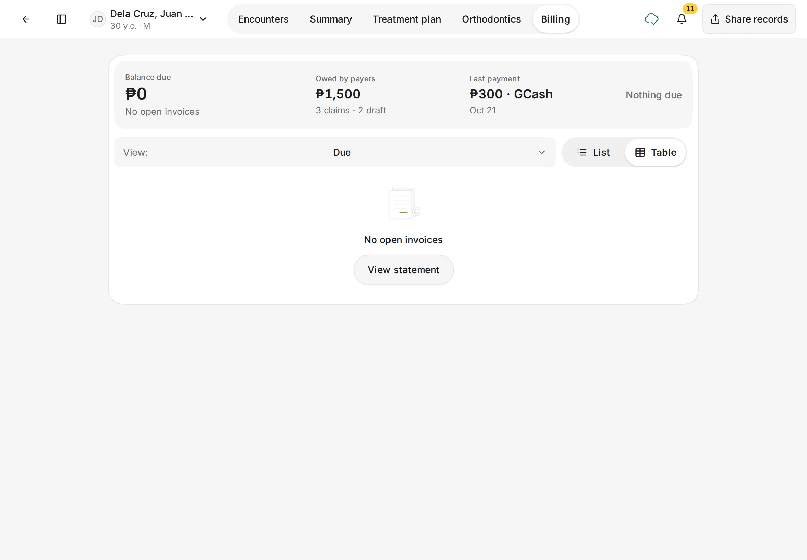
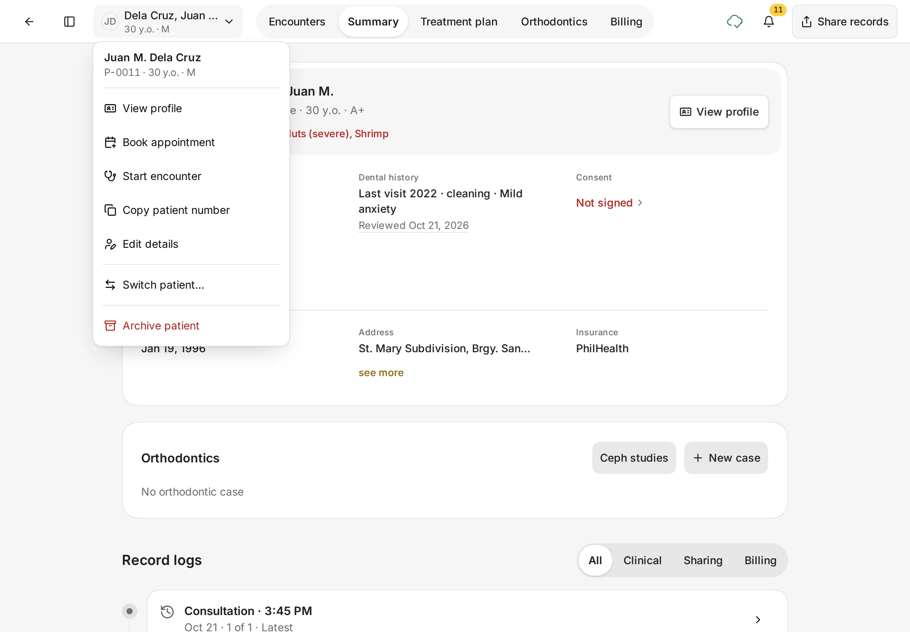
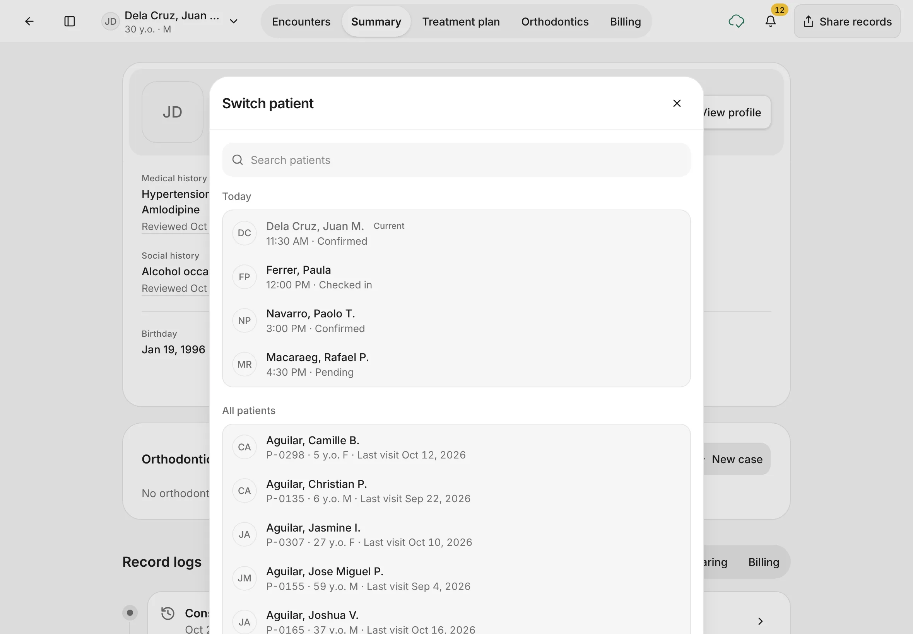
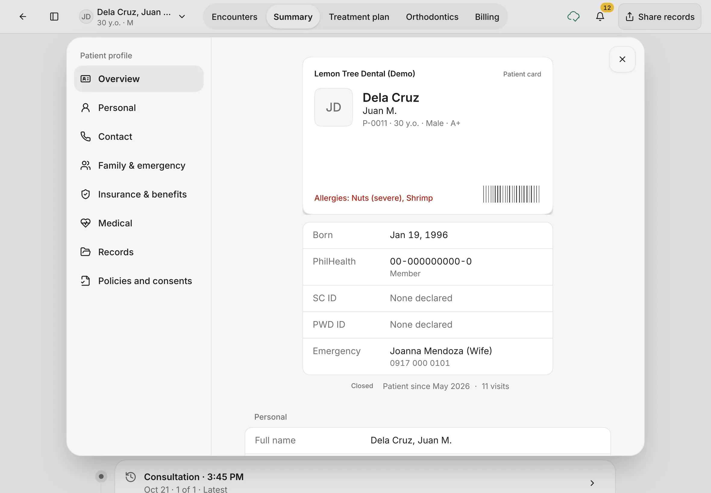
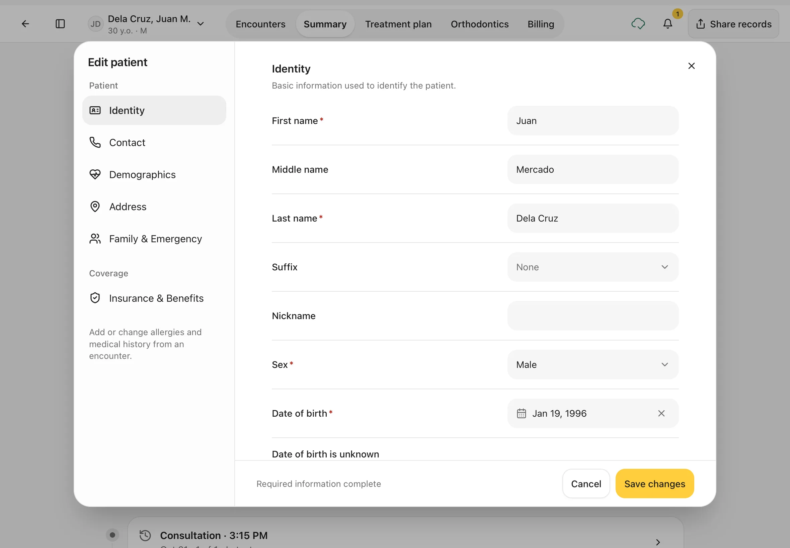
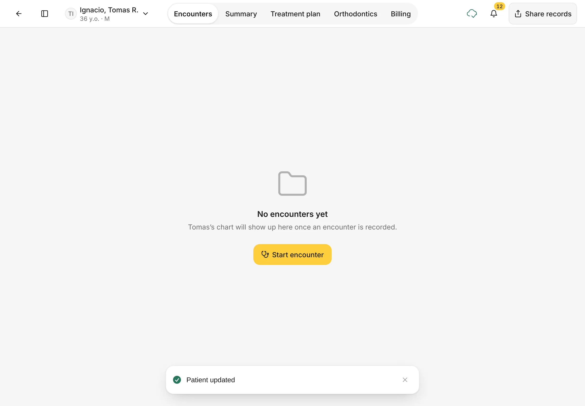
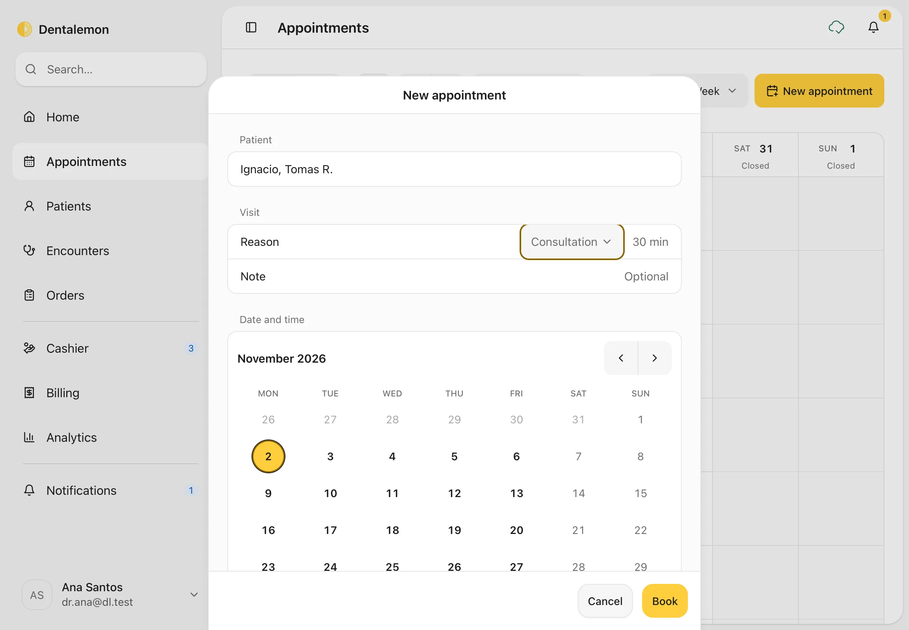
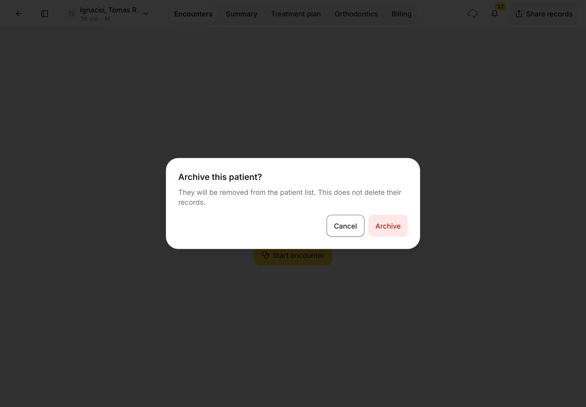

# The patient page and profile

Everything about one patient lives on their page: past visits, a summary, the treatment plan and billing.
{ .meta }

**Time:** about 4 minutes · **You'll need:** a patient on file ([Find or add a patient](find-or-add-a-patient.md)).
{ .meta }

## Before you start

- Open the patient: tap **Patients** in the sidebar, then tap their folder.

## Steps

### 1. Read the Summary

The tabs across the top are **Encounters**, **Summary**, **Treatment plan**, **Orthodontics** and **Billing**. Tap **Summary**.

You should see: the patient's name, patient number, sex, age and blood type, with **Allergies** in red when there are any. Below are **Medical history**, **Dental history**, **Social history** and **Consent**, then **Birthday**, **Address** and **Insurance**. Further down, **Record logs** lists everything recorded for this patient, newest first.
{ .see }

!!! tip
    Use **All**, **Clinical**, **Sharing** and **Billing** above **Record logs** to show only one kind of activity.

### 2. See past visits on Encounters

Tap **Encounters**. Each visit is a folder on a shelf, newest in the middle, with the main complaint on top.

- Tap **‹** and **›**, or a dot on the timeline, to move between visits.
- Tap **Open encounter** to go into a visit.
- The **New encounter** folder on the right starts a new visit. See [Start an encounter](../visits/start-an-encounter.md).

You should see: the latest visit in the middle, marked **Latest**.
{ .see }

### 3. Check what the patient owes on Billing

Tap **Billing**.

You should see: **Balance due** (what the patient owes), **Owed by payers** (what HMOs or PhilHealth owe for this patient) and **Last payment**. Use **View** to switch between due invoices, the statement, invoices and claims.
{ .see }

More on payments in [Billing and balances](../payments/billing-and-payment-plans.md).

### 4. Use the patient menu

Tap the patient's name at the top left. The menu has:

- **View profile**: the full patient card (next step).
- **Book appointment**: book this patient straight away (step 8).
- **Start encounter**: open a new visit now.
- **Copy patient number**: copies the number (for example *P-0011*) so you can paste it elsewhere.
- **Edit details**: change the patient's details (step 7).
- **Switch patient…**: jump to another patient (step 5).
- **Archive patient**: take the patient off your list (step 9).

You should see: the menu under the patient's name.
{ .see }

### 5. Switch to another patient

Tap **Switch patient…**.

You should see: **Switch patient**, with **Today** (today's booked patients and their status) and **All patients**. Search by name or number, or tap a patient to go to their page.
{ .see }

### 6. View the full profile

From the patient menu, tap **View profile**. You can also tap **View profile** on the Summary.

You should see: the **Patient card** with your clinic's name, the patient's allergies, PhilHealth number, Senior Citizen and PWD IDs, and emergency contact. The list on the left jumps to **Personal**, **Contact**, **Family & emergency**, **Insurance & benefits**, **Medical**, **Records** and **Policies and consents**.
{ .see }

The profile is for reading. To change anything, use **Edit details**.

### 7. Edit the patient's details

1. From the patient menu, tap **Edit details**.
2. Use the list on the left to go to the section you need, for example **Contact** for a new mobile number, or **Insurance & Benefits** for a new card.
3. Change what you need.
4. Tap **Save changes**. To leave without saving, tap **Cancel**.

You should see: **Edit patient**, with the same sections as when you added the patient.
{ .see }

After you save, a **Patient updated** message appears and the patient's page shows the new details.

!!! note
    Allergies and medical history aren't edited here. Add or change them during an encounter, so each change is dated to a visit: in the encounter, open **Records** and tap **+ Allergies**.

### 8. Book an appointment for this patient

From the patient menu, tap **Book appointment**. Dentalemon opens **Appointments** with a **New appointment** form, and the patient is already filled in.

Choose the **Reason**, a day and a time, then tap **Book**. The rest of the booking works the same as from the Appointments page. See [Appointments](../schedule/appointments.md).

You should see: **New appointment** with the patient's name under **Patient**.
{ .see }

### 9. Archive a patient (only when needed)

From the patient menu, tap **Archive patient**.

You should see: **Archive this patient?**. Tap **Archive** to confirm, or **Cancel** to keep them.
{ .see }

{ .shot-sm }

Archiving takes the patient off your patient list. Their records are kept.

## Tips

!!! tip "Back to the list"
    Tap **←** at the top left to go back to where you came from.

!!! warning "If something goes wrong"
    **Start encounter is greyed out in the menu.** The patient already has an open visit. Open it from **Encounters** instead of starting a new one.

!!! info "Good to know"
    **Share records** at the top right prints or shares the patient's records from your device. Dentalemon doesn't track who receives a shared copy, and a shared copy can't be taken back.

## What's next

- [Start an encounter](../visits/start-an-encounter.md)
- [Appointments](../schedule/appointments.md)
