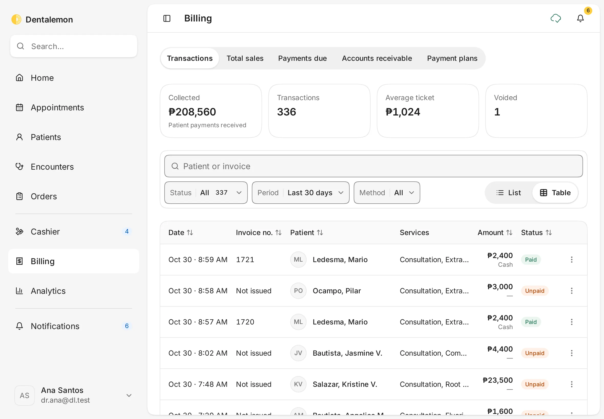
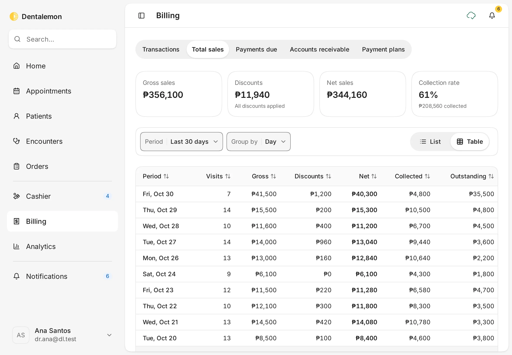
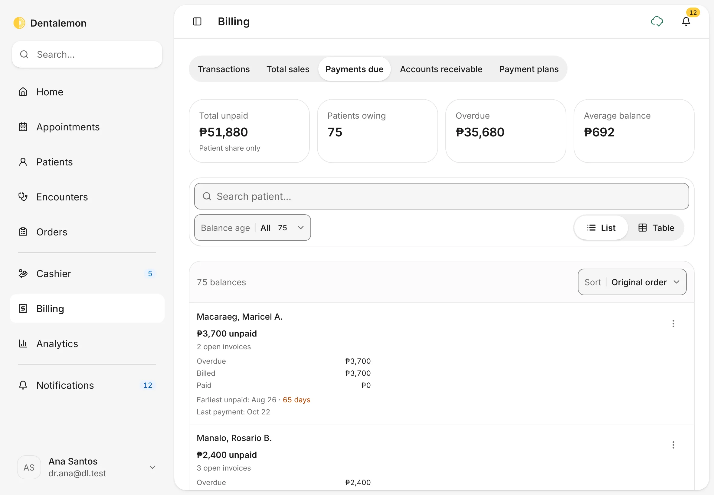
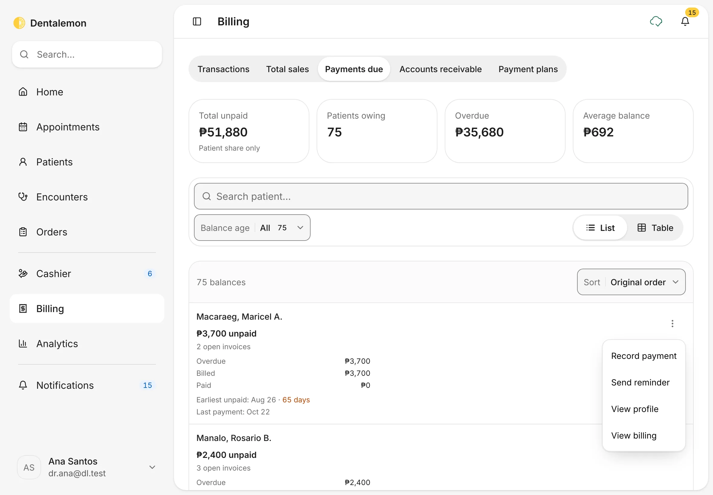
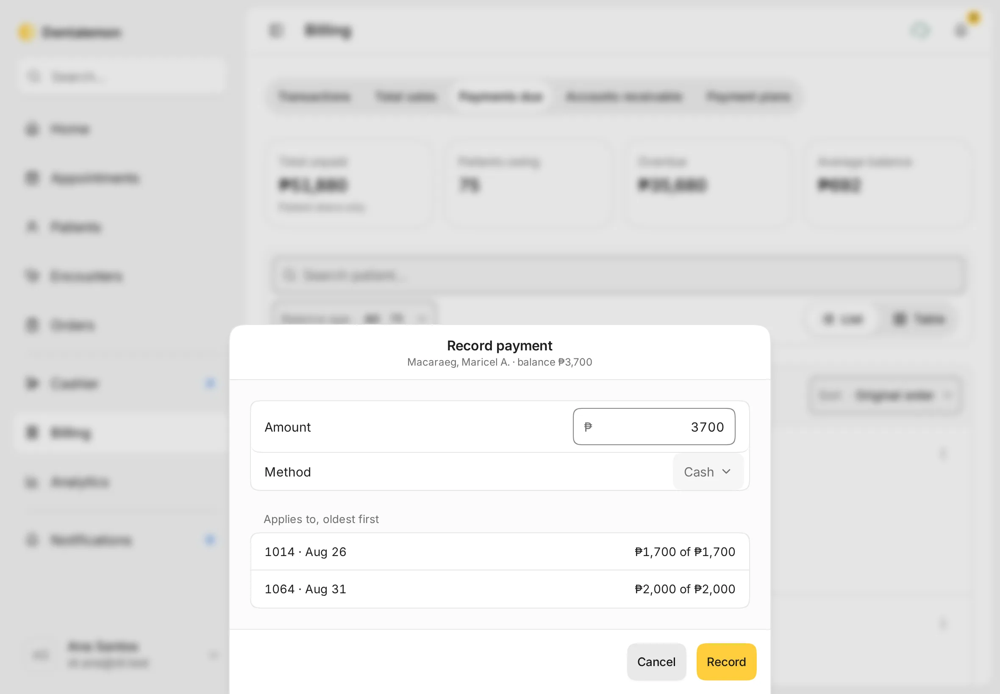
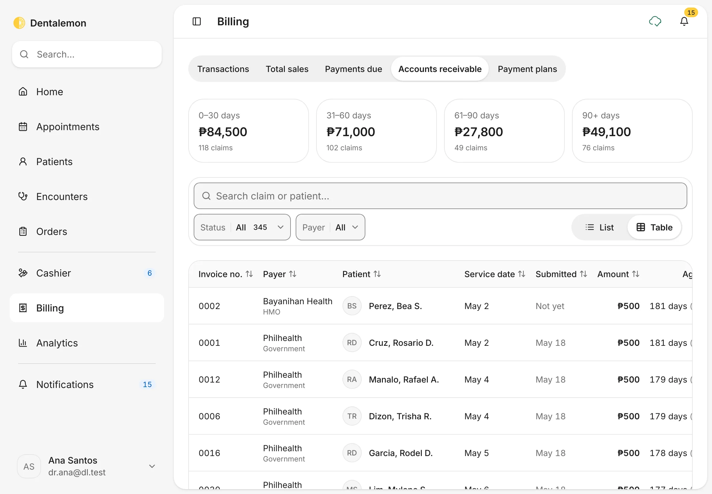
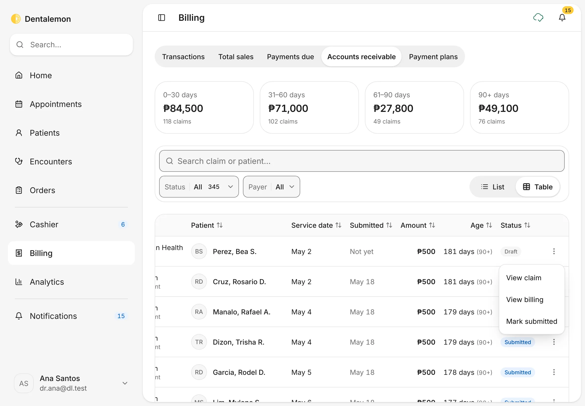
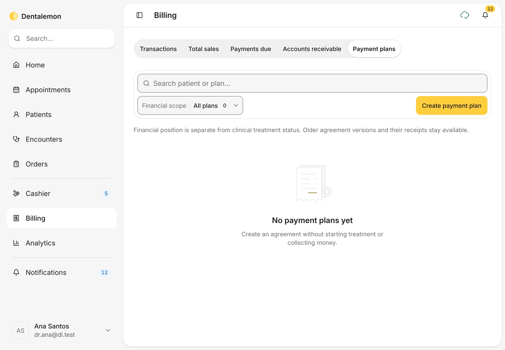
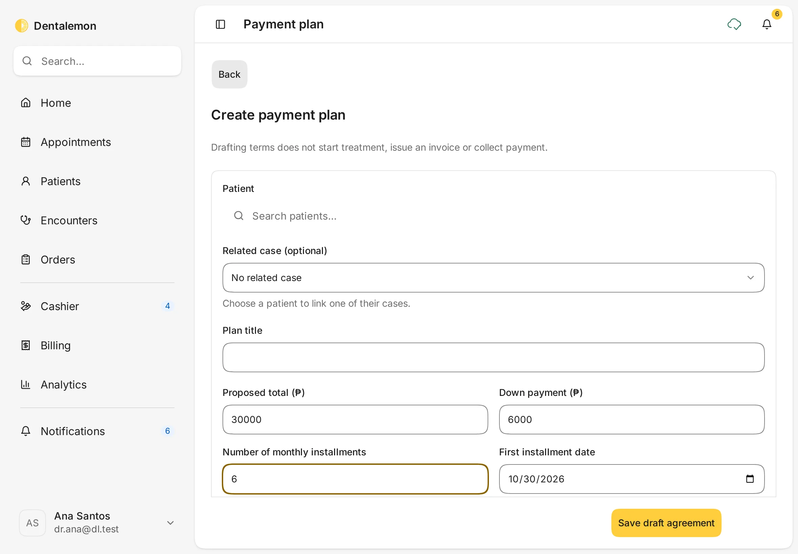
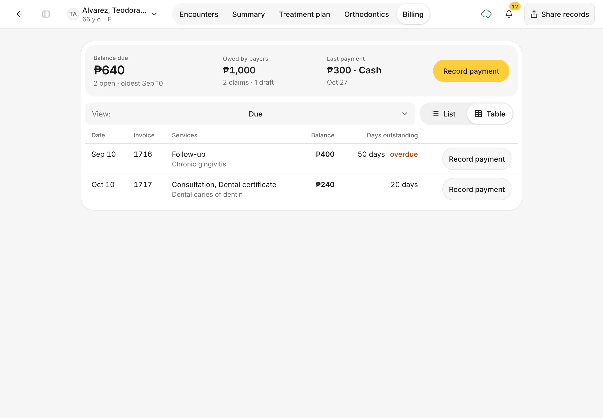

# Billing, balances and payment plans

See what came in, who still owes you, what HMOs and PhilHealth owe, and set up payment plans for bigger treatments.
{ .meta }

**Time:** about 5 minutes to learn · **You'll need:** some bills already made at the [Cashier](charges-and-cashier.md).
{ .meta }

## Before you start

- **Billing** is for looking back and following up. Day-to-day payments happen at the [Cashier](charges-and-cashier.md).

## Steps

### 1. Open Billing

Tap **Billing** in the sidebar.

You should see: five tabs (**Transactions**, **Total sales**, **Payments due**, **Accounts receivable**, **Payment plans**) with **Transactions** open. The cards at the top sum up the period: **Collected**, **Transactions**, **Average ticket** and **Voided**.
{ .see }

Use the search box (**Patient or invoice**) and the **Status**, **Period** and **Method** filters to narrow the list. **List** and **Table** switch the layout.

### 2. Check your sales

Tap **Total sales**.

You should see: **Gross sales**, **Discounts**, **Net sales** and **Collection rate** for the period, then one row per day (or per week or month, with **Group by**).
{ .see }

### 3. Follow up unpaid balances

Tap **Payments due**.

You should see: each patient who owes you, how much is unpaid, how many invoices are open, and how long the oldest has waited. Overdue days show in orange.
{ .see }

Tap **⋮** on a patient for **Record payment**, **Send reminder**, **View profile** and **View billing**.

### 4. Record a payment

Tap **Record payment**. **Amount** starts at the full balance. Change it for a partial payment, choose the **Method**, then tap **Record**.

You should see: under **Applies to, oldest first**, which invoices the money will pay off, before you record it.
{ .see }

{ .shot-sm }

### 5. Track what payers owe you

Tap **Accounts receivable**. This is the money HMOs and PhilHealth owe the clinic for covered work.

You should see: the amounts grouped by age (**0–30 days**, **31–60 days**, **61–90 days**, **90+ days**), and a table of claims with the payer, the patient, the service date, when it was submitted, the amount, the age and the status (**Draft**, **Submitted**, **Paid**).
{ .see }

Filter by **Status** or **Payer**. Tap **⋮** on a claim to move it along. A draft claim offers **Mark submitted**, and a submitted one **Mark paid**.

### 6. Set up a payment plan

Tap **Payment plans**, then **Create payment plan**.

Choose the **Patient**, give the plan a **Plan title**, then fill in **Proposed total (₱)**, **Down payment (₱)**, **Number of monthly installments** and **First installment date**. Tap **Save draft agreement**.

You should see: the plan saved as a draft. Drafting a plan does not start treatment, issue an invoice or collect money.
{ .see }

From the plan's page you can then offer it to the patient, record that they accepted or declined, issue the invoice and record payments.

### 7. See one patient's billing

Open a patient and tap the **Billing** tab. Or, in Billing, tap **⋮ › View billing** on a row.

You should see: **Balance due**, **Owed by payers** and **Last payment** at the top, the open invoices with **Record payment** on each, and a **View** menu for **Due**, **Statement**, **Invoices**, **Claims** and **Plans**.
{ .see }

## Tips

!!! tip "Patient share only"
    **Payments due** counts only what patients owe. What HMOs and PhilHealth owe is under **Accounts receivable**, so the two never double-count.

!!! warning "If something goes wrong"
    **Record stays greyed out.** Read the message under **Amount**: it must be above ₱0 and can't be more than the balance.

!!! info "Good to know"
    - Claims are tracked by hand. **Mark submitted** and **Mark paid** only record what you did with the payer. Dentalemon doesn't send claims to PhilHealth or HMOs, and there are no claim numbers yet.
    - **Send reminder** writes the message for you to check, then opens your device's share sheet (Messages, Mail, Viber and so on). Dentalemon doesn't send it itself.

## What's next

- [Appointments](../schedule/appointments.md)
