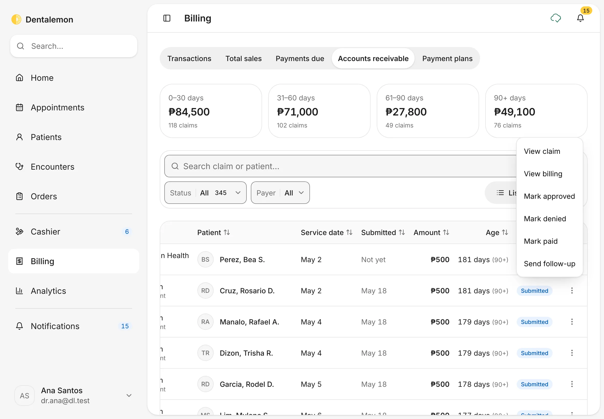

# Billing and balances

See what came in, who still owes you, and what HMOs and PhilHealth owe.
{ .meta }

**Time:** about 5 minutes to learn · **You'll need:** some bills already made at the [Cashier](charges-and-cashier.md).
{ .meta }

## Before you start

- **Billing** is for looking back and following up. Day-to-day payments happen at the [Cashier](charges-and-cashier.md).

## Steps

### 1. Open Billing

Tap **Billing** in the sidebar.

You should see: the tabs **Transactions**, **Total sales**, **Payments due**, **Accounts receivable** and **Payment plans**, with **Transactions** open. The cards at the top sum up the period: **Collected**, **Transactions**, **Average ticket** and **Voided**.
{ .see }

Use the search box (**Patient or invoice**) and the **Status**, **Period** and **Method** filters to narrow the list. **List** and **Table** switch the layout. Tap **⋮** at the end of a row for **View invoice**, **Record payment** (while something is unpaid) and **View patient**.

### 2. Check your sales

Tap **Total sales**.

You should see: **Gross sales**, **Discounts**, **Net sales** and **Collection rate** for the period, then one row per day (or per week or month, with **Group by**).
{ .see }

### 3. Follow up unpaid balances

Tap **Payments due**.

You should see: **Total unpaid**, **Patients owing**, **Overdue** and **Average balance** at the top, then each patient who owes you: how many invoices are open, what was billed and paid, the **Total unpaid**, the **Earliest unpaid date** and the **Last payment**.
{ .see }

Use **Balance age** to show only the overdue balances. Tap **⋮** on a patient for **Record payment**, **Send reminder**, **View profile** and **View billing**.

### 4. Record a payment

Tap **Record payment**. **Amount** starts at the full balance. Change it for a partial payment, choose the **Method**, then tap **Record**.

You should see: under **Applies to, oldest first**, which invoices the money will pay off, before you record it.
{ .see }

{ .shot-sm }

### 5. Track what payers owe you

Tap **Accounts receivable**. This is the money HMOs and PhilHealth owe the clinic for covered work.

You should see: the amounts grouped by age (**0–30 days**, **31–60 days**, **61–90 days**, **90+ days**), and a table of claims with the payer, the patient, the service date, when it was submitted, the amount, the age and the status.
{ .see }

A **claim** is what a payer owes for one patient's covered work. Filter by **Status** or **Payer**, or search by patient. Tap **⋮** at the end of a claim's row to move it along as you deal with the payer:

| Status | What it means | What you can do next (in **⋮**) |
|---|---|---|
| **Draft** | Not sent to the payer yet | **Mark submitted** once you've sent it |
| **Submitted** | Sent, waiting for the payer | **Mark approved**, **Mark denied**, **Mark paid**, **Send follow-up** |
| **Approved** | The payer agreed to pay | **Mark paid** when the money arrives, or **Mark denied** |
| **Denied** | The payer refused. You type the reason when you mark it denied. | **Reopen claim** to try again |
| **Paid** | The payer paid | Nothing more to do. Paid claims leave the **Submitted** and **Approved** lists; **Status** has no **Paid** option. |

**View claim** shows the claim's details, and **View billing** opens the patient's own billing.

When you tap **Mark paid** (or another step), a message with **Undo** appears for a few seconds before the change is saved.

**Mark paid** settles the whole invoice with that payer, not only the row you tapped. For example, tapping one ₱500 row can mark ₱6,000 paid when the invoice has more covered lines for the same payer. Check the amount in the message, for example *0001 marked paid — ₱6,000 from Philippine Health Insurance Corporation (Philhealth)*, and tap **Undo** if it isn't what you meant. **Send follow-up** writes a reminder for you to send from your iPad's share sheet.

### 6. See one patient's billing

Open a patient and tap the **Billing** tab. Or, in Billing, tap **⋮ › View billing** on a row.

You should see: **Balance due**, **Owed by payers** and **Last payment** at the top, the open invoices with **Record payment** on each, and a **View** menu for **Due**, **Statement**, **Invoices** and **Claims**.
{ .see }

## Tips

!!! tip "Patient share only"
    **Payments due** counts only what patients owe. What HMOs and PhilHealth owe is under **Accounts receivable**, so the two never double-count.

!!! warning "If something goes wrong"
    **Record stays greyed out.** Read the message under **Amount**: it must be above ₱0 and can't be more than the balance.

!!! info "Good to know"
    - Claims are tracked by hand. **Mark submitted** and **Mark paid** only record what you did with the payer. Dentalemon doesn't send claims to PhilHealth or HMOs, and there are no claim numbers yet.
    - **Send reminder** writes the message for you to check, then opens your device's share sheet (Messages, Mail, Viber and so on). Dentalemon doesn't send it itself.
    - Payment plans are coming soon. The **Payment plans** tab says so, and invoices and payments work as usual.

## What's next

- [Appointments](../schedule/appointments.md)
