# Charges and payment at the Cashier

Put the visit's work on the bill, send it to the Cashier, apply a Senior Citizen, PWD or insurance discount, and take payment.
{ .meta }

**Time:** about 3 minutes per patient · **You'll need:** an open encounter with some work done, and your price list set up in **Settings › Services**.
{ .meta }

## Before you start

- Record the work you did in the chart, and mark it **Done today**. See [Chart teeth](../visits/chart-teeth.md).
- Prices come from your price list. See [Settings basics](../clinic/settings-basics.md).
- Payment is never taken inside the encounter. The encounter decides **what** is charged; the **Cashier** takes the money.

## Steps

### 1. Open the charges from the encounter

In the encounter, look at the top-right button. While the visit is still going, it reads **Finish encounter**. After the visit has ended, it reads **Charges**.

Tap it.

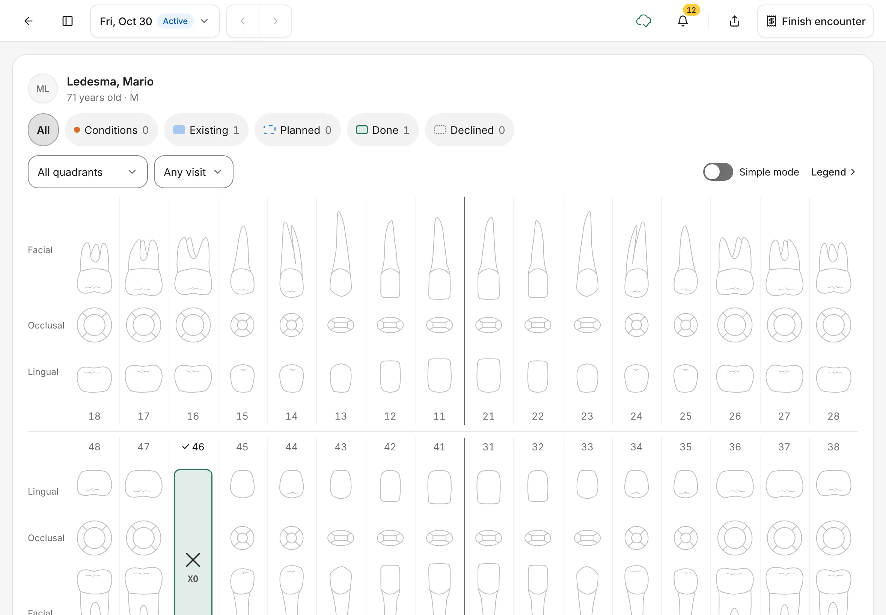

You should see: the **Finish encounter** sheet. Under **Charges** are the visit itself (for example **Consultation**, from the encounter type) and each piece of work marked **Done today**, with its price. Nothing is ticked yet, and **Total charges** is ₱0.
{ .see }

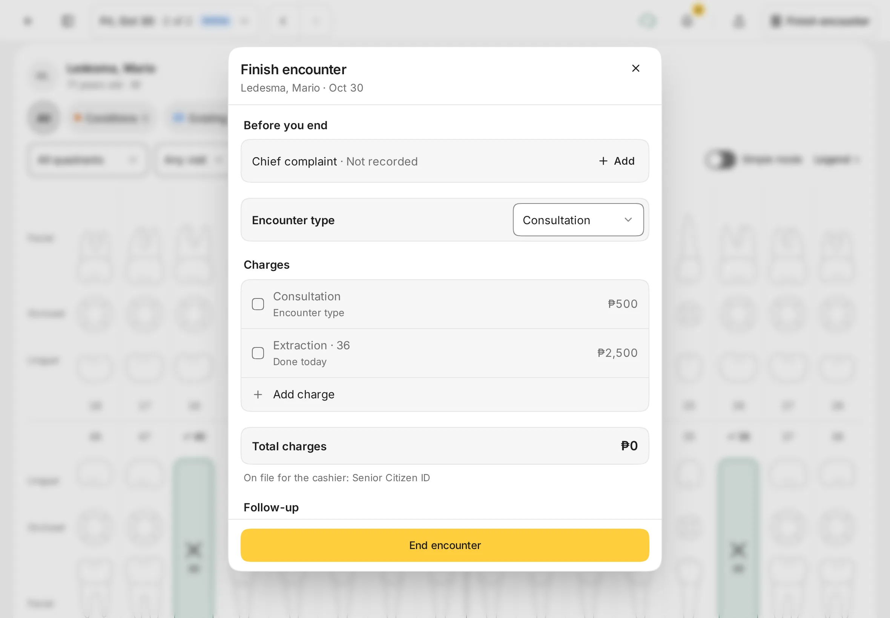

### 2. Tick what you're charging

Tap the box next to each line you want on the bill.

You should see: a tick on each line, a short note such as **Extraction · 46 added to the invoice** (with **Undo**), and the new **Total charges**. The yellow button now reads **End and send to cashier · ₱3,000**.
{ .see }

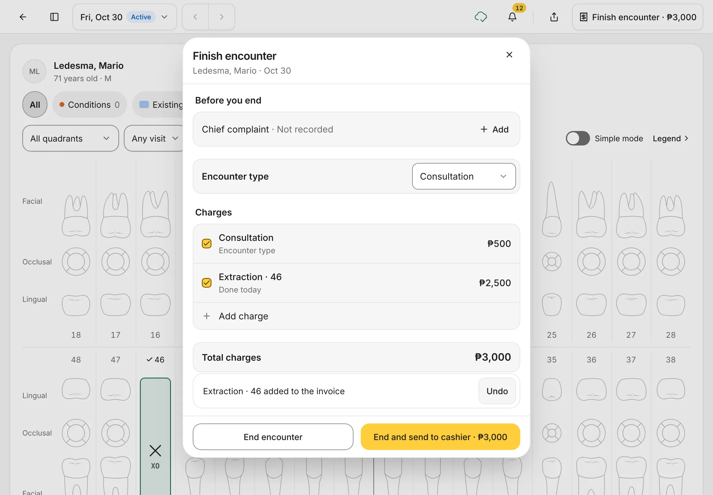

### 3. Add anything else from your price list (optional)

Tap **Add charge**, type part of the name (for example *certificate*), then tap the item.

You should see: the item added to the list, already ticked.
{ .see }

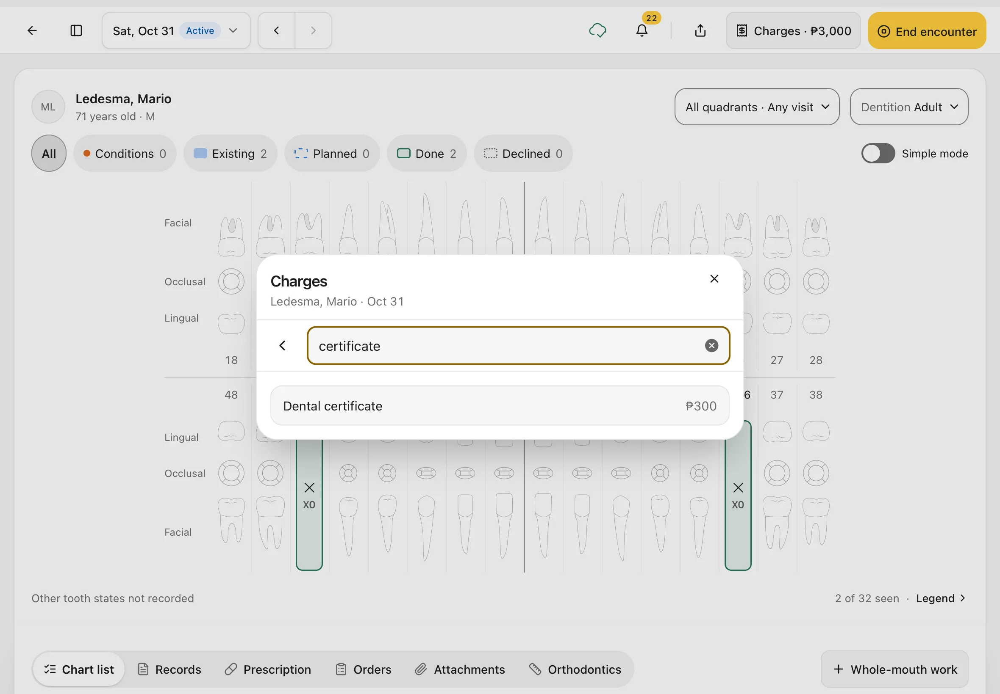{ .shot-sm }

### 4. Send it to the Cashier

Tap **End and send to cashier · ₱X**. This ends the visit and puts the bill in the Cashier's **Waiting** list.

You should see: the sheet closes. The top-right button now reads **Charges**.
{ .see }

!!! tip
    To end the visit without billing yet, tap **End encounter** instead. You can open **Charges** again later and send it then.
    See [Finish the visit](../visits/finish-the-visit.md).

### 5. Find the bill at the Cashier

Tap **Cashier** in the sidebar.

You should see: the **Waiting** list. Each row shows the patient, the visit type, how many charges and when the bill was ready, and the amount. The number next to **Cashier** in the sidebar counts the bills waiting.
{ .see }

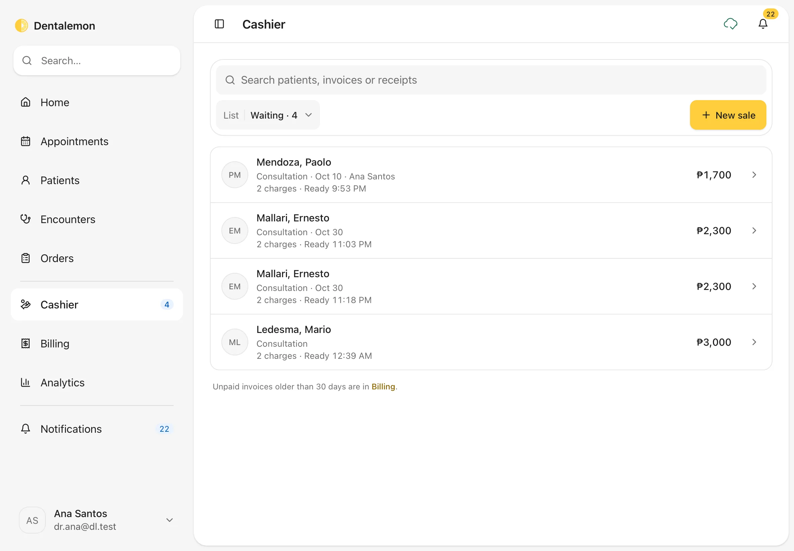

Tap the **List** menu (it shows **Waiting**) to switch to the other lists: **In consultation**, **In progress** and **Paid today**.

### 6. Open the invoice

Tap the patient's row.

You should see: the invoice. **Items on this invoice** is in the middle, the totals are on the right, and **Collect · ₱X** is at the bottom. On the left, **Add to invoice** lets the cashier add more items from the price list.
{ .see }

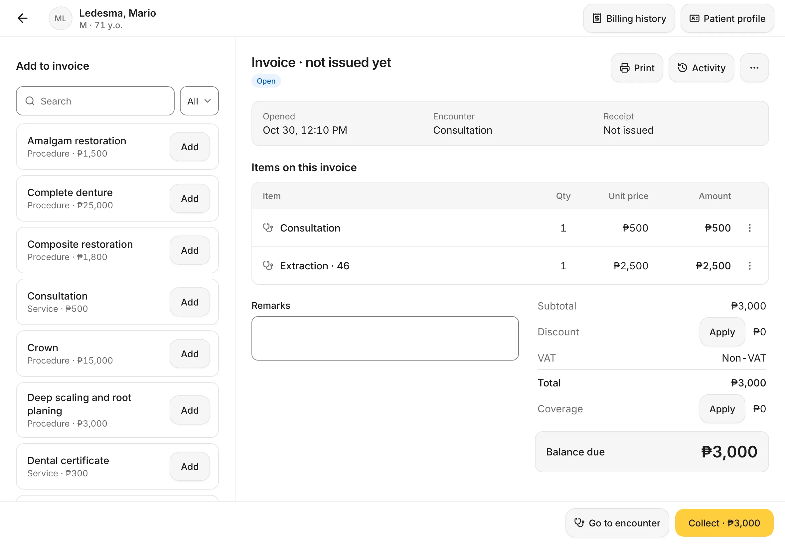

### 7. Apply a Senior Citizen or PWD discount

Next to **Discount**, tap **Apply**. Choose **Senior Citizen** or **PWD** (person with disability).

Check the ID number in **Senior Citizen ID no.** or **PWD ID no.** If the ID is already in the patient's details, it fills in by itself. If not, type the number from the ID card the patient shows you. Then tap **Apply discount**.

The PWD discount works the same way as the Senior Citizen one: 20% off.

You should see: the discount and the new total before you confirm it (20% off).
{ .see }

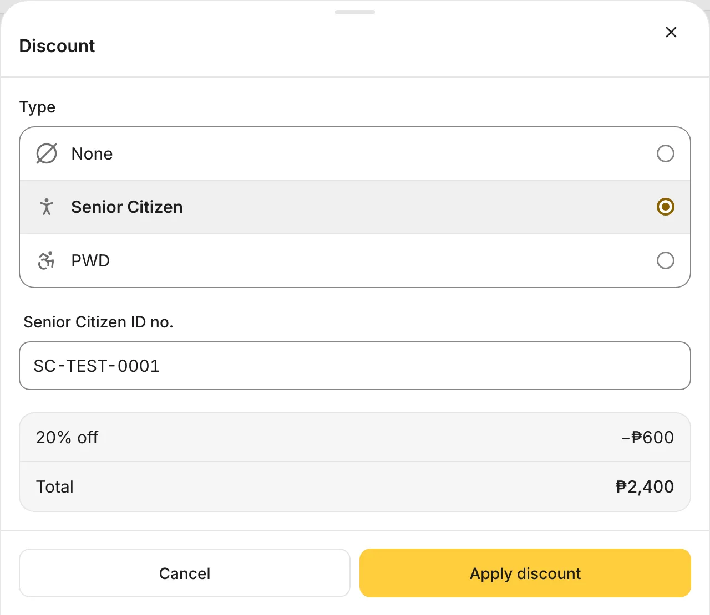{ .shot-sm }

Back on the invoice, each line shows its discount under **Adjustments**, and **Balance due** goes down.

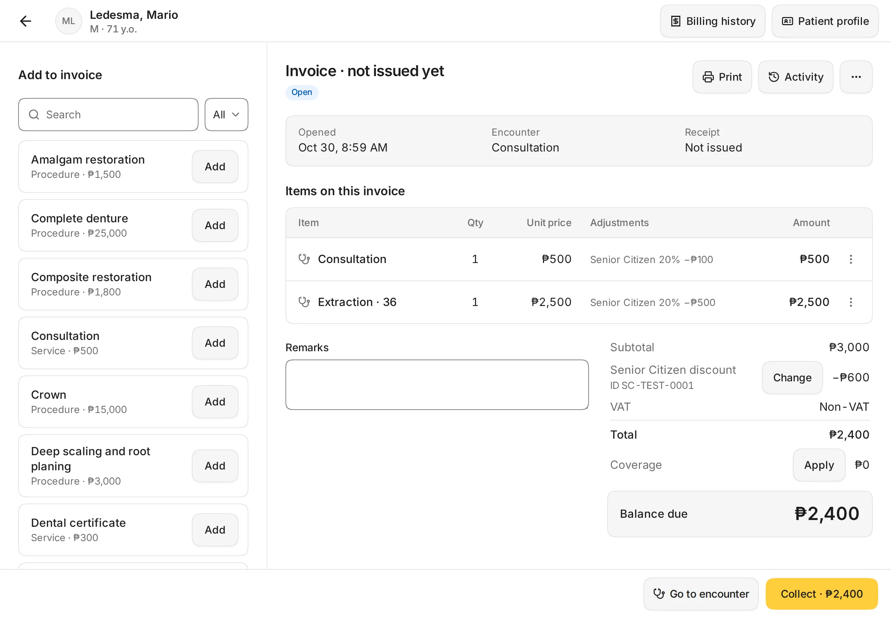

### 8. Apply insurance coverage (if the patient has it)

Next to **Coverage**, tap **Apply**. Choose **HMO** or **PhilHealth**. If you have an approval or LOA number, type it in. Then tap **Apply coverage**.

You should see: what the payer covers line by line (**Not covered** where it pays nothing), then **PhilHealth pays** (or the HMO's name) and **Patient pays**.
{ .see }

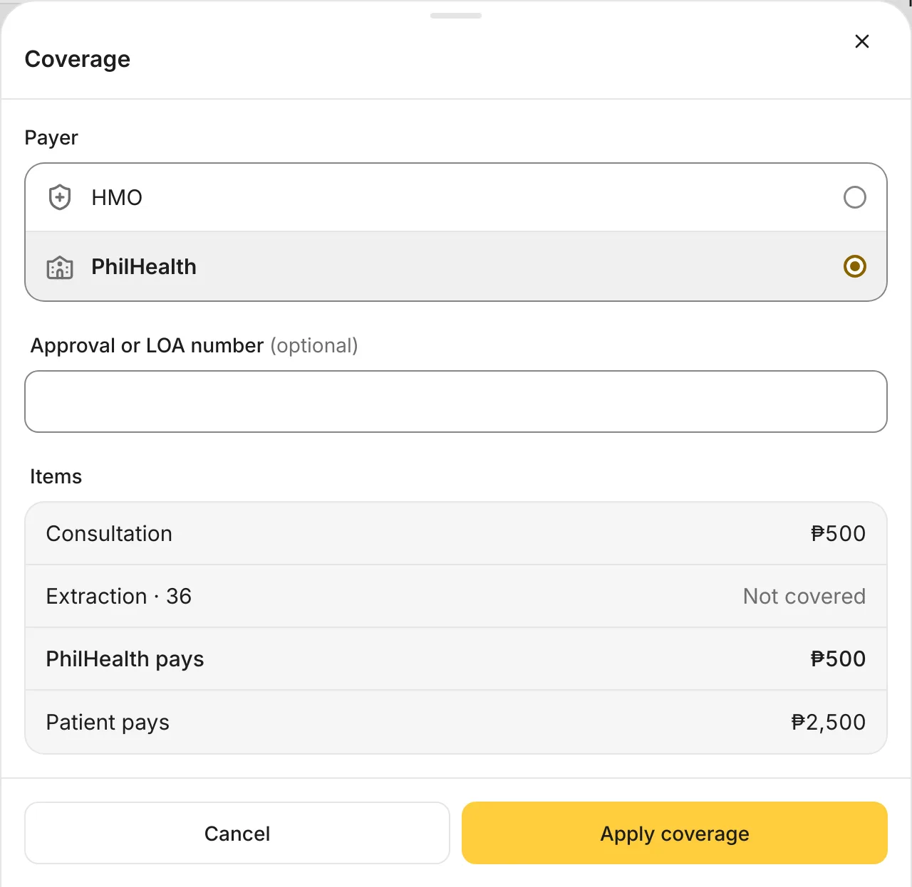{ .shot-sm }

### 9. Collect the payment

Tap **Collect · ₱X**. Under **Pay with**, choose **Cash**, **GCash**, **Card** or **Bank transfer**.

For cash, type the amount the patient handed you in **Cash received**, or tap a quick amount such as **Exact ₱2,400** or **₱2,500**. Dentalemon works out the **Change**.

The **Official receipt** (OR) number is the next in your series. If you write receipts from a paper booklet, switch on **Manual OR number** and type the number from the booklet.

Tap **Collect ₱X**.

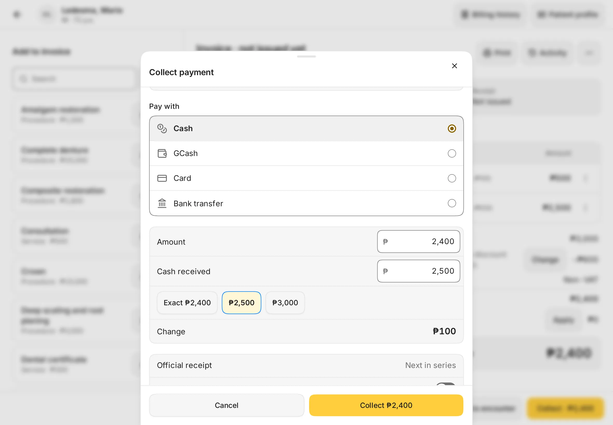

For other payment methods, Dentalemon asks for proof of payment instead of **Cash received**:

| Pay with | What to type |
|---|---|
| **GCash** (or another e-wallet) | The **Reference number** from the patient's payment confirmation |
| **Card** | The **Approval code** from the card terminal. The last 4 digits of the card are optional. |
| **Bank transfer** | The **Bank** the money came from, and the transfer's **Reference number** |

You can't collect until the reference number or approval code is filled in.

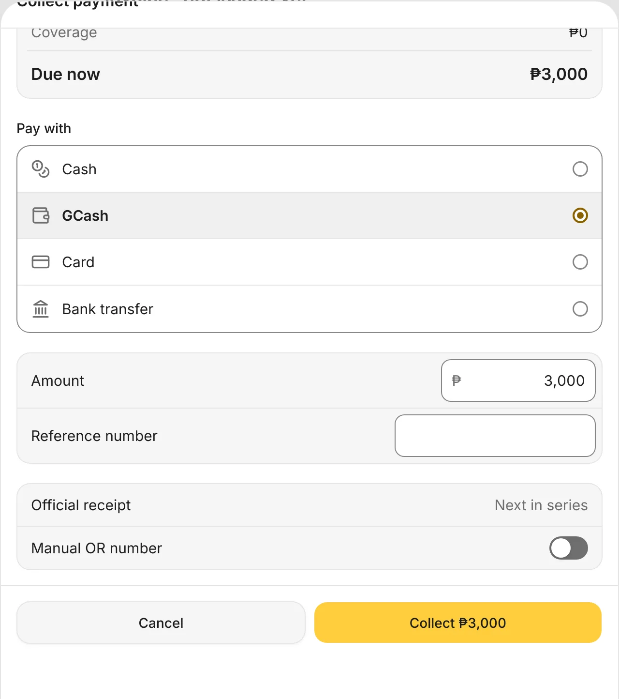{ .shot-sm }

You should see: the receipt with its number, the change, and **Balance due · Paid in full**. Tap **Done**.
{ .see }

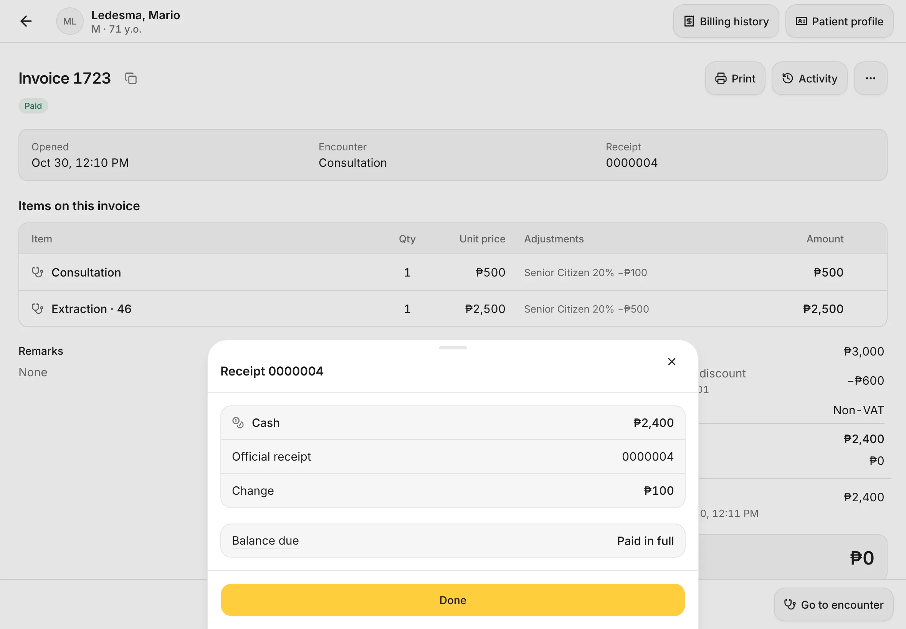

### 10. Print the invoice (optional)

Tap **Print** at the top of the invoice, check the preview, then tap **Print**.

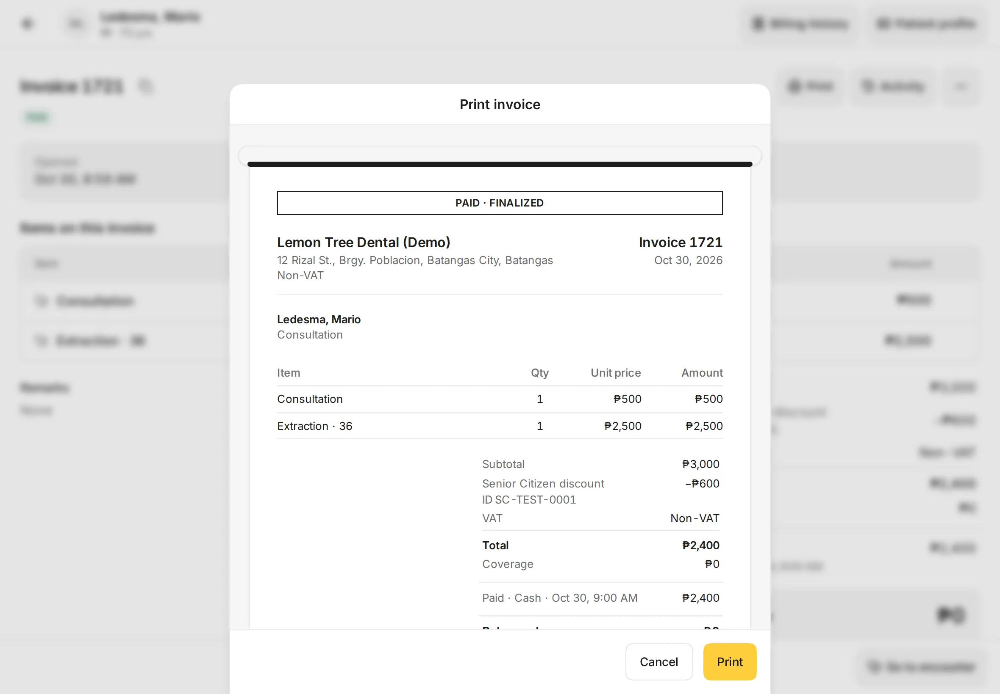

## Other things you can do

The **More** button (**⋯**) at the top of the invoice has **Send receipt** (**Send invoice** before payment), **Duplicate as new sale** and **Void…**.

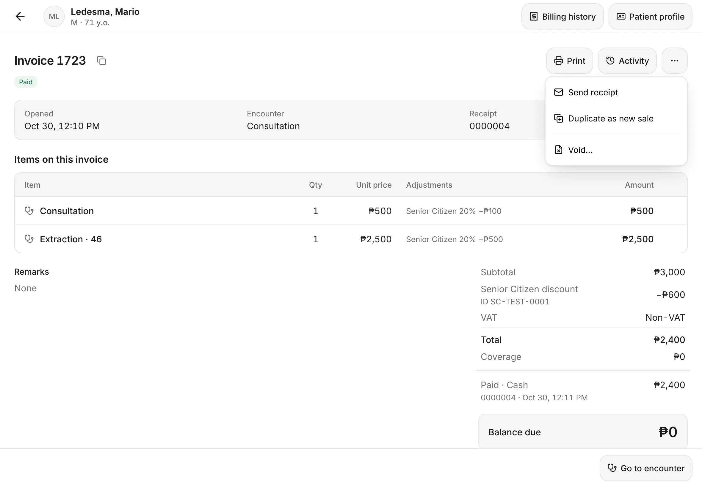

### Send a receipt or invoice to the patient

1. Tap **⋯**, then **Send receipt**.
2. At the top, choose what to send: the **Invoice**, or a **Receipt** (one per payment).
3. Choose **Email** or **Text message**. The patient's email or mobile number on file fills in. Change it if you need to.
4. Tap **Send**.

You should see: your iPad's Mail or Messages app open with the message ready. Send it from there.
{ .see }

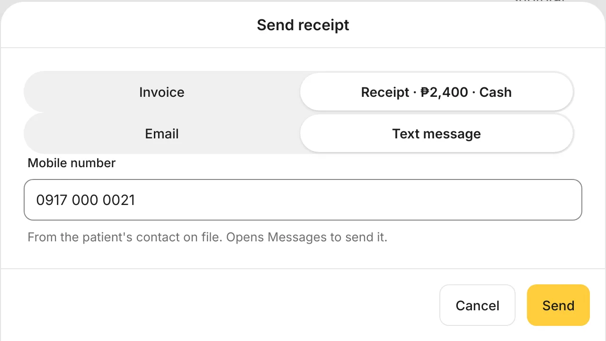{ .shot-sm }

### Void an invoice

Voiding cancels a bill that was made by mistake, for example for the wrong patient or with a charge that shouldn't be there. A voided invoice stays on record, marked as voided.

1. Tap **⋯**, then **Void…**.
2. Choose **Whole invoice**, or **Items** to void only some lines, then tick those lines.
3. Type the **Reason for voiding**. It's required.
4. Check the summary: **Voids** (the amount), **Refund** (what to give back, by payment method and receipt number) and, for a visit's bill, **Encounter's charges · New invoice** (the visit gets a new invoice, so it can be billed again).
5. Tap the red button, for example **Void invoice · refund ₱2,400**. Tap **Cancel** to leave without voiding.

You should see: a message confirming the void and the amount refunded.
{ .see }

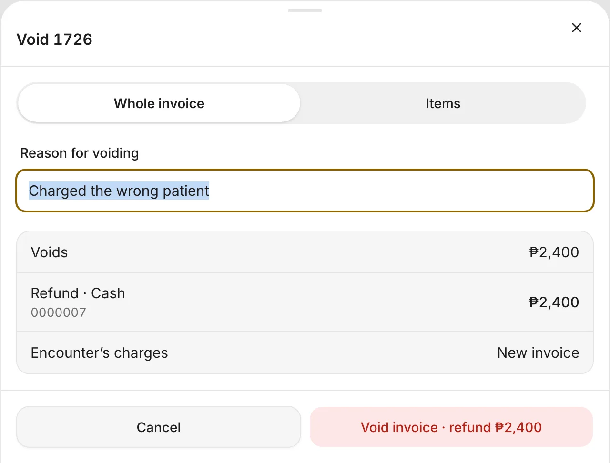{ .shot-sm }

!!! warning "Give the refund yourself"
    Dentalemon only records the refund. Hand the money back to the patient, or reverse the GCash or card payment, yourself.

### Sell something without a visit (New sale)

Use **New sale** to bill a patient who isn't in a visit, for example someone buying a toothbrush or picking up a dental certificate.

1. On the **Cashier** page, tap **New sale**.
2. Under **Patient**, type part of the name and tap the patient. For someone who isn't registered yet, tap **Add a new patient**.
3. Tap **Start sale**.
4. A new invoice opens. Add items from **Add to invoice** on the left (tap **Add** next to each one), then take payment with **Collect**, as in step 9.

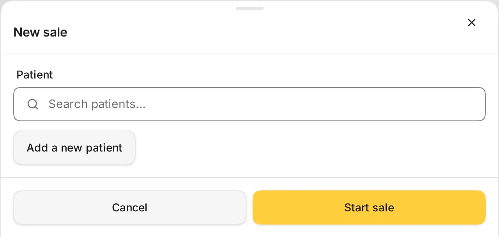{ .shot-sm }

You should see: the patient's name in the **Patient** box before you tap **Start sale**.
{ .see }

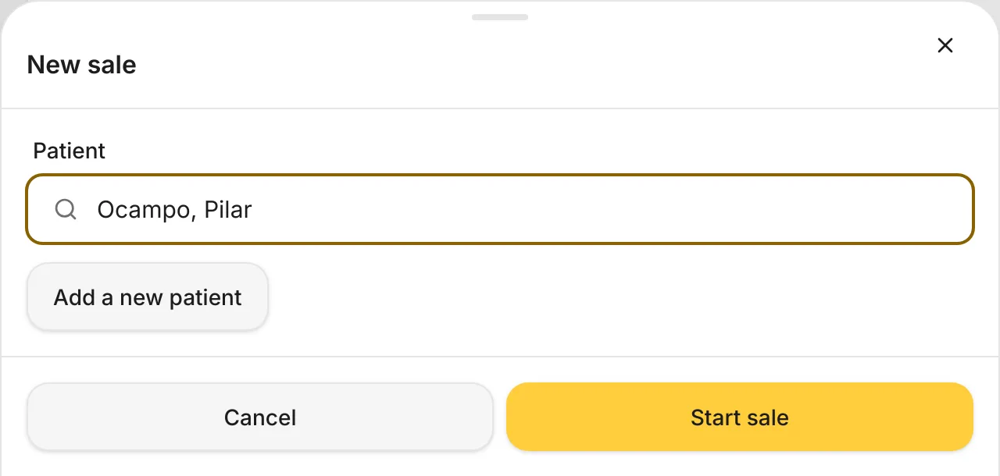{ .shot-sm }

If the patient already has a bill waiting at the Cashier, the sheet offers to open that bill, so you don't start a second one by mistake.

## Tips

!!! tip "Partial payments"
    To take part of the bill now, change **Amount** in **Collect payment** before you tap **Collect**. The rest stays in **Balance due**, and you can follow it up in [Billing](billing-and-payment-plans.md).

!!! warning "If something goes wrong"
    **The Discount or Coverage Apply button is gone.** These lock once the first payment is taken. Apply the discount or coverage before collecting.

    **A charge is missing at the Cashier.** Open the encounter's **Charges** and check the line is ticked.

!!! info "Good to know"
    - A line can't have both a payer's coverage and a Senior Citizen or PWD discount. The discount applies only to lines the payer doesn't cover.
    - **Send receipt** opens your device's Mail or Messages app. Dentalemon doesn't send it for you.
    - A patient gets a Senior Citizen discount only with a Senior Citizen ID number, and a PWD discount only with a PWD ID number.

## What's next

- [Billing, balances and payment plans](billing-and-payment-plans.md)
