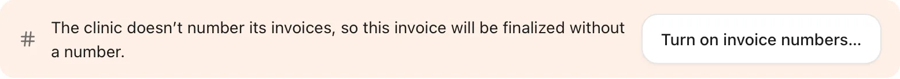
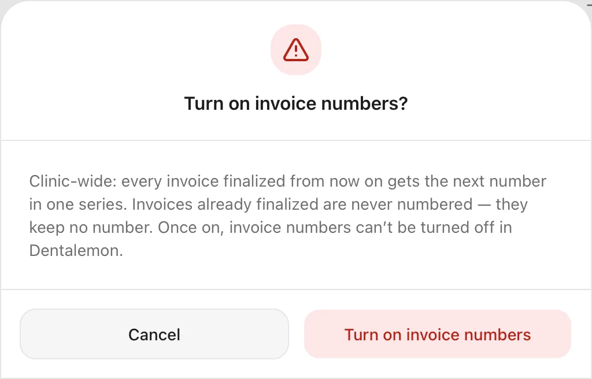
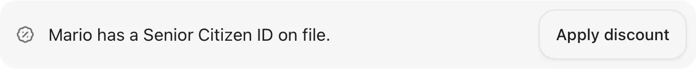

# Charges and payment at the Cashier

Put the visit's work on the bill, send it to the Cashier, apply a Senior Citizen, PWD or insurance discount, and take payment.
{ .meta }

**Time:** about 3 minutes per patient · **You'll need:** an open encounter with some work done, and your price list set up in **Settings › Services**.
{ .meta }

## Before you start

- Record the work you did in the chart, and mark it **Done today**. See [Chart teeth](../visits/chart-teeth.md).
- Prices come from your price list. See [Settings basics](../clinic/settings-basics.md).
- For HMO or PhilHealth coverage, add the payer in **Settings › Partners**, then, in **Settings › Services**, open each service the payer covers and add it under **Coverage**.
- Payment is never taken inside the encounter. The encounter decides **what** is charged; the **Cashier** takes the money.

## Steps

### 1. Open the charges from the encounter

In the encounter, the top bar has two buttons on the right: **Charges** (with the amount so far, for example **Charges · ₱0**) and the yellow **End encounter**.

Tap **End encounter**.

You should see: the **End encounter** sheet. **Before you end** reminds you of anything not recorded yet, such as the **Chief complaint**. Under **Charges** are the visit itself (for example **Consultation**, set by **Encounter type**) and each piece of work marked **Done today**, with its price. Nothing is ticked yet, and **Total charges** is ₱0.
{ .see }

!!! info "The Charges button"
    **Charges** in the top bar opens this visit's bill at the Cashier, if you're allowed to take payments. Someone who can't take payments sees the list of charges instead.

### 2. Tick what you're charging

Tap the box next to each line you want on the bill.

You should see: a tick on each line, a short note such as **Extraction · 46 added to the invoice** (with **Undo**), and the new **Total charges**. At the bottom are **End encounter** and the yellow **End and send to cashier · ₱3,000**.
{ .see }

### 3. Add anything else from your price list (optional)

Tap **Add charge**, type part of the name (for example *certificate*), then tap the item.

You should see: the item added to the list, already ticked.
{ .see }

{ .shot-sm }

### 4. Send it to the Cashier

Tap **End and send to cashier · ₱X**. This ends the visit and puts the bill in the Cashier's **Waiting** list.

You should see: the sheet closes and Dentalemon opens the visit's bill at the Cashier (step 6). If you can't take payments, it opens the patient's **Billing** tab instead.
{ .see }

!!! tip
    To end the visit without billing yet, tap **End encounter** instead. You can send the charges later.
    See [Finish the visit](../visits/finish-the-visit.md).

### 5. Find a bill at the Cashier

Whoever takes payments at the front desk finds the bills here. Tap **Cashier** in the sidebar.

You should see: the **Waiting** list. Each row shows the patient, the visit type, how many charges and when the bill was ready, and the amount. The number next to **Cashier** in the sidebar counts the bills waiting.
{ .see }

Tap the **List** menu (it shows **Waiting** and how many) to switch to the other lists: **In consultation**, **In progress** and **Paid today**. The search box finds a patient, an invoice or a receipt. Unpaid bills older than 30 days leave these lists; find them in [Billing](billing-and-payment-plans.md).

### 6. Open the invoice

Tap the patient's row.

You should see: the invoice. **Items on this invoice** is in the middle, with **Subtotal**, **Discount**, **Total**, **Coverage** and **Balance due** under it, and **Collect · ₱X** at the bottom. On the left, **Add to invoice** lets the cashier add more items from the price list.
{ .see }

Each line's **⋮** menu has **Edit**, **Discount…**, **Coverage…** and **Remove**.

!!! note "The first time: invoice numbers"
    A new clinic doesn't number its invoices yet, and the invoice says so: *The clinic doesn't number its invoices, so this invoice will be finalized without a number.* To number them, tap **Turn on invoice numbers…**, read the message, then tap **Turn on invoice numbers**. From then on, every invoice gets the next number in one series. This is for the whole clinic and can't be turned off in Dentalemon. Invoices already finalized keep no number. A clinic admin can also turn it on in **Settings › Billing**.

    

    { .shot-sm }

### 7. Apply a Senior Citizen or PWD discount

Tap **Collect · ₱X**. When the patient is 60 or older, or has a PWD ID on file, the top of **Collect payment** says so, for example *Mario has a Senior Citizen ID on file.* Tap **Apply discount** there.

{ .shot-sm }

In the **Discount** sheet, under **Type**, choose **Senior Citizen** or **PWD** (person with disability). Check the number in **Senior Citizen ID no.** or **PWD ID no.** If the ID is already in the patient's details, it fills in by itself. If not, type the number from the ID card the patient shows you. Then tap **Apply discount**.

The Senior Citizen discount is only for patients aged 60 or older. For a younger patient, Dentalemon says so, for example *Teresa is 41. The Senior Citizen discount starts at 60.* The PWD discount works the same way: 20% off.

You should see: what comes off and the new total before you confirm it (20% off).
{ .see }

{ .shot-sm }

Back on the invoice, each line shows its discount under **Adjustments**, and **Balance due** goes down.

!!! tip "One line only"
    To discount a single line, tap **⋮** at the end of that line, then **Discount…**. Untick **Apply to every line on this invoice** to keep the discount to that line.

### 8. Apply insurance coverage (if the patient has it)

Tap **⋮** at the end of a line the payer covers, then **Coverage…**.

Choose **HMO** or **PhilHealth**, then the **Partner**. If you have an approval or LOA number, type it in **Approval or LOA number**. Then tap **Apply coverage**.

You should see: what the payer covers line by line (**Not covered** where it pays nothing), then what the partner pays and **Patient pays**.
{ .see }

{ .shot-sm }

### 9. Collect the payment

Tap **Collect · ₱X**. Under **Pay with**, choose **Cash**, **GCash**, **Card** or **Bank**. These are the payment methods set up in **Settings › Billing**.

For cash, type the amount the patient handed you in **Cash received**, or tap a quick amount such as **Exact ₱2,400** or **₱2,500**. Dentalemon works out the **Change**.

The **Official receipt** (OR) number is the next in your series. If you write receipts from a paper booklet, switch on **Manual OR number** and type the number from the booklet.

Tap **Collect ₱X**.

For other payment methods, Dentalemon asks for proof of payment instead of **Cash received**:

| Pay with | What to type |
|---|---|
| **GCash** (or another e-wallet) | The **Reference number** from the patient's payment confirmation |
| **Card** | The **Approval code** from the card terminal. The **Last 4 digits** of the card are optional. |
| **Bank** | The **Bank** the money came from, and the transfer's **Reference number** |

You can't collect until the reference number or approval code is filled in.

{ .shot-sm }

You should see: the receipt with its number, the change, and **Balance due · Paid in full**. Tap **Done**.
{ .see }

### 10. Print the invoice (optional)

Tap **Print** at the top of the invoice, check the preview, then tap **Print**.

## Other things you can do

At the top of the invoice, **Activity** lists everything that happened to it (charges, payments, prints), newest first. **Billing history** opens the patient's billing, and **Go to encounter** returns to the visit.

The **More** button (**⋯**) at the top of the invoice has **Duplicate as new sale** and **Void…**. On an invoice with a balance still owed, it also has **Mark uncollectible**. **Send receipt** (**Send invoice** before payment) is marked **Coming soon** and can't be used yet.

### Void an invoice

Voiding cancels a bill that was made by mistake, for example for the wrong patient or with a charge that shouldn't be there. A voided invoice stays on record, marked as voided.

1. Tap **⋯**, then **Void…**.
2. Choose **Whole invoice**, or **Items** to void only some lines, then tick those lines.
3. Type the **Reason for voiding**. It's required.
4. Check the summary: **Voids** (the amount), **Refund** (what to give back, by payment method and receipt number) and, for a visit's bill, **Encounter's charges · New invoice** (the visit gets a new invoice, so it can be billed again).
5. Tap the red button, for example **Void invoice · refund ₱2,400**. Tap **Cancel** to leave without voiding.

You should see: a message confirming the void and the amount refunded.
{ .see }

{ .shot-sm }

!!! warning "Give the refund yourself"
    Dentalemon only records the refund. Hand the money back to the patient, or reverse the GCash or card payment, yourself.

### Mark a bill uncollectible

When a patient won't pay what's left, tap **⋯**, then **Mark uncollectible**, and type a **Reason** (for example *Left without paying*). The balance isn't cancelled: it stays owed in **Billing**, labelled **Uncollectible**, and a later payment still settles it. The bill leaves the Cashier's lists, but search still finds it.

### Sell something without a visit (New sale)

Use **New sale** to bill a patient who isn't in a visit, for example someone buying a toothbrush or picking up a dental certificate.

1. On the **Cashier** page, tap **New sale**.
2. Under **Patient**, type part of the name and tap the patient. For someone who isn't registered yet, tap **Add a new patient**.
3. Tap **Start sale**.
4. A new invoice opens. Add items from **Add to invoice** on the left (tap **Add** next to each one), then take payment with **Collect**, as in step 9.

{ .shot-sm }

You should see: the patient's name in the **Patient** box before you tap **Start sale**.
{ .see }

{ .shot-sm }

If the patient already has a bill waiting at the Cashier, the sheet offers to open that bill, so you don't start a second one by mistake.

## Tips

!!! tip "Partial payments"
    To take part of the bill now, change **Amount** in **Collect payment** before you tap **Collect**. The rest stays in **Balance due**, and you can follow it up in [Billing](billing-and-payment-plans.md).

!!! warning "If something goes wrong"
    **Discount… or Coverage… is missing from a line's ⋮ menu.** These lock once the first payment is taken. Apply the discount or coverage before collecting.

    **A charge is missing at the Cashier.** Open the encounter's **End encounter** sheet (or **Charges** after the visit has ended) and check the line is ticked.

    **The Coverage sheet has no partner to choose.** Add the payer in **Settings › Partners** first.

!!! info "Good to know"
    - A patient gets a Senior Citizen discount only with a Senior Citizen ID number, and a PWD discount only with a PWD ID number.
    - Sending a receipt or invoice to the patient is coming soon. For now, print it.

## What's next

- [Billing and balances](billing-and-payment-plans.md)
