# Appointments

Book patients, see your day and week at a glance, and check patients in when they arrive.
{ .meta }

**Time:** about 4 minutes · **You'll need:** your clinic hours set in **Settings › Clinic** (see [Settings basics](../clinic/settings-basics.md)).
{ .meta }

## Before you start

- Dentalemon offers only times when your clinic is open. Set your opening hours first.

## Steps

### 1. Open Appointments

Tap **Appointments** in the sidebar. Switch between **List** and **Calendar** at the top left.

In **Calendar**, choose **Day**, **Week** or **Month** from **View**. Tap **Today** to come back to today, and **‹ ›** to move between days or weeks.

You should see: your appointments in the calendar, with today's date circled. Each appointment shows the patient and its status, such as **Confirmed** or **Pending**. A blue line marks the time now.
{ .see }

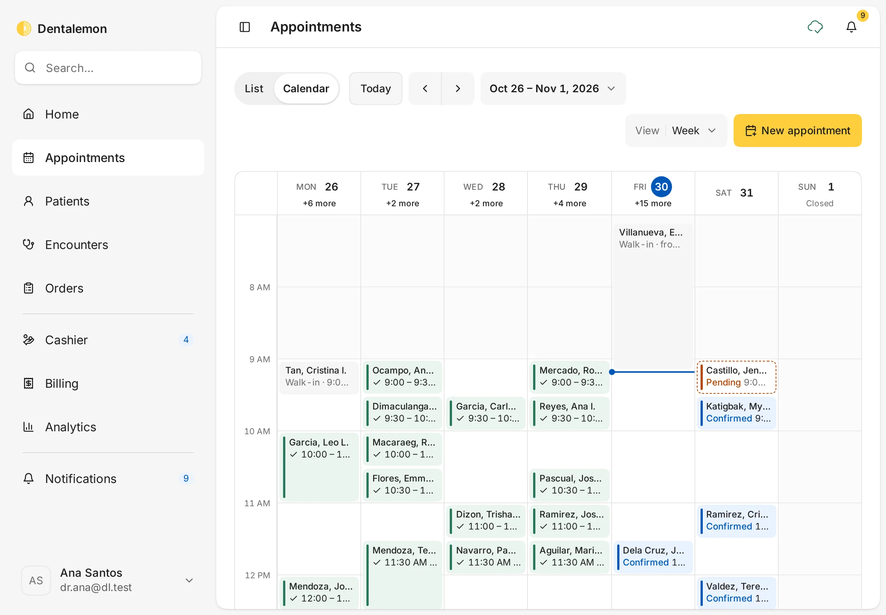

- **Day** shows one day hour by hour. Use it on a busy day: each block is one patient. Walk-ins (patients seen without a booking) appear as grey blocks.
- **Month** shows the whole month. Each day lists its first appointments, then **+N more**. Tap **+N more** to open that day. Days the clinic is closed say **Closed**.

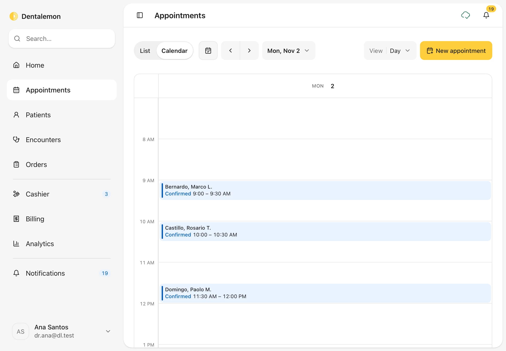

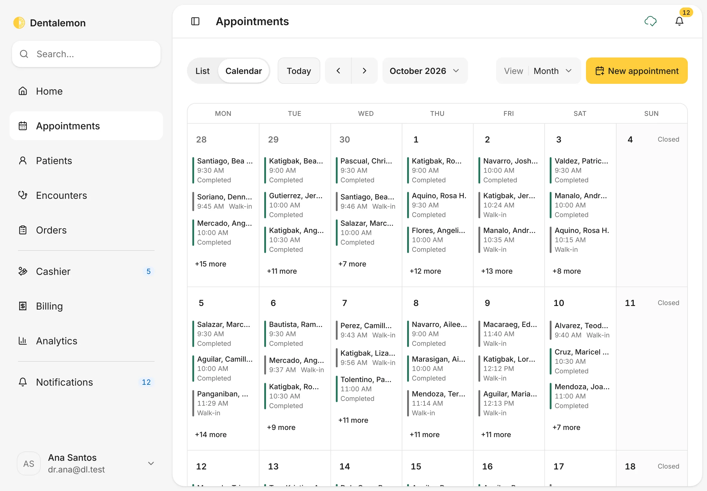

!!! tip "Choose the view that opens first"
    In **Settings › Appointments**, set **Default view** to **Day**, **Week**, **Month** or **List**. See [Settings basics](../clinic/settings-basics.md).

### 2. Use the list

Tap **List**. The cards at the top show **Next available**, **Awaiting confirmation**, **This week's fill** and **No-show rate**.
Below, filter by **Timing** (for example **Upcoming**) and **Status**, or search for a patient.

You should see: a table with **Date**, **Time**, **Patient**, **Reason** and **Status**.
{ .see }

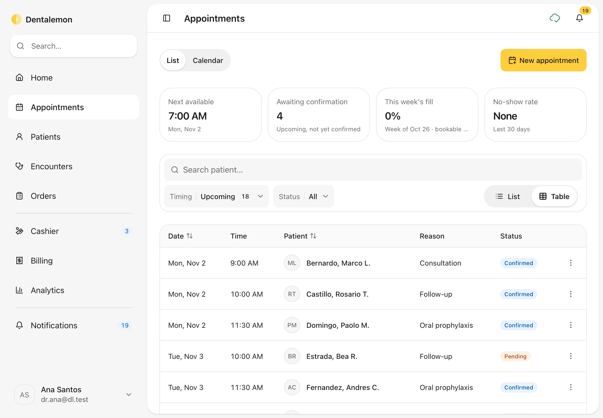

### 3. Book a new appointment

Tap **New appointment**. (You can also tap an empty time in the calendar, or use **Book appointment** in a patient's menu.)

1. **Patient**: type a name and pick the patient. For someone new, tap **New patient**.
2. **Visit**: choose a **Reason**, such as **Consultation**. The length shows next to it. Add a **Note** if you like.

You should see: the patient's name, and the visit reason with its length.
{ .see }

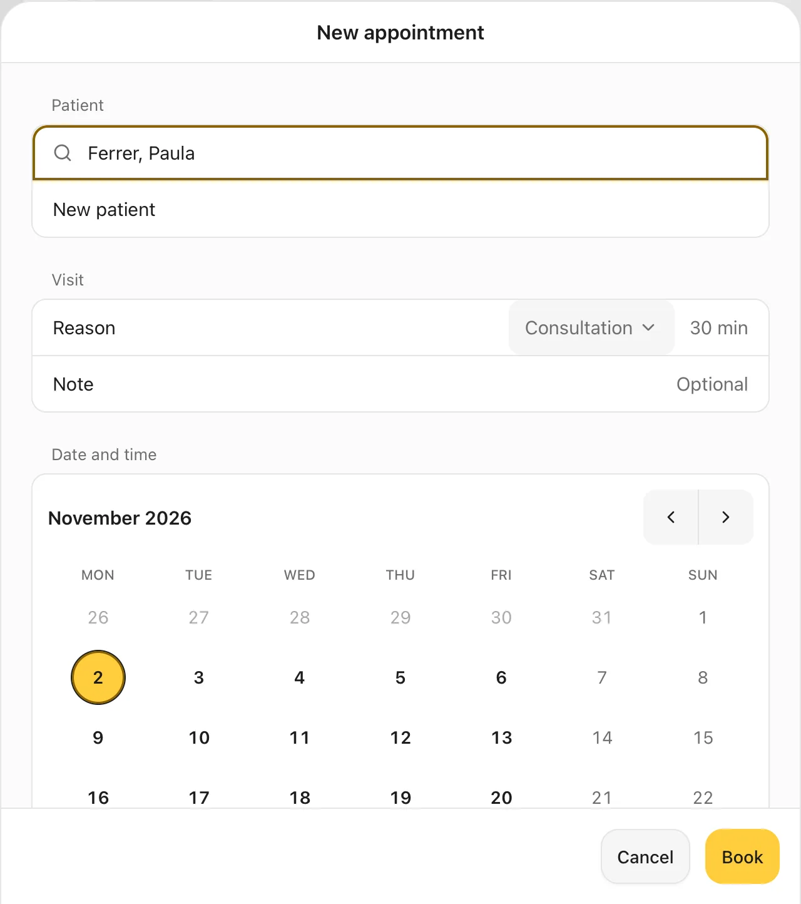{ .shot-sm }

### 4. Pick a day and time, then book

Scroll to **Date and time**. Tap a day, then one of the times shown. Only free times appear, and the line above them says how many, for example **Fri, Oct 30 · 8 times available**.

Under **Status**, choose **Confirmed** if the patient has agreed to the time, or **Not yet confirmed** if you still need to check with them. Tap **Book**.

You should see: your chosen day circled and the time highlighted in yellow.
{ .see }

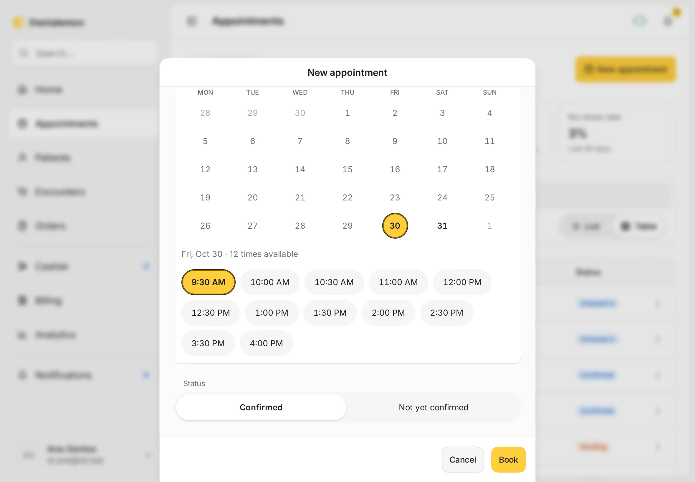

### 5. Check the booking

A message confirms the booking with the patient, day and time, for example **Booked Ferrer, Paula · Fri, Oct 30 · 12:00 – 12:30 PM**. Tap **View** on it to open the appointment.

You should see: the new appointment in the list.
{ .see }

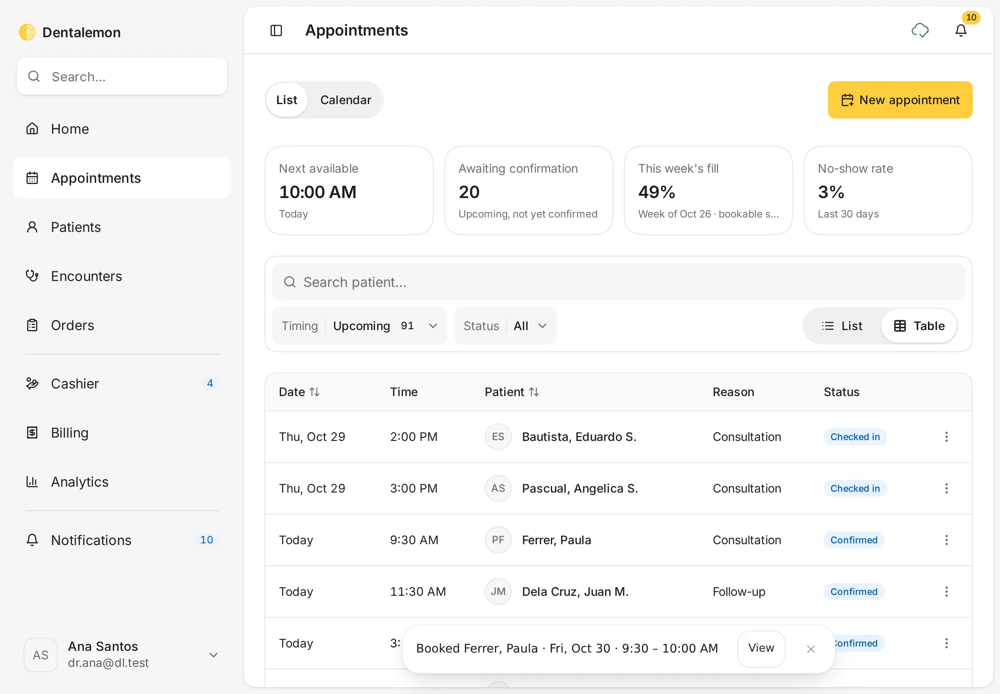

### 6. Open an appointment

Tap any appointment to open it.

You should see: **When**, **Status**, **Booked** and **Note**, with **View profile**. At the bottom are **Check in**, **Reschedule** and **Cancel appointment**.
{ .see }

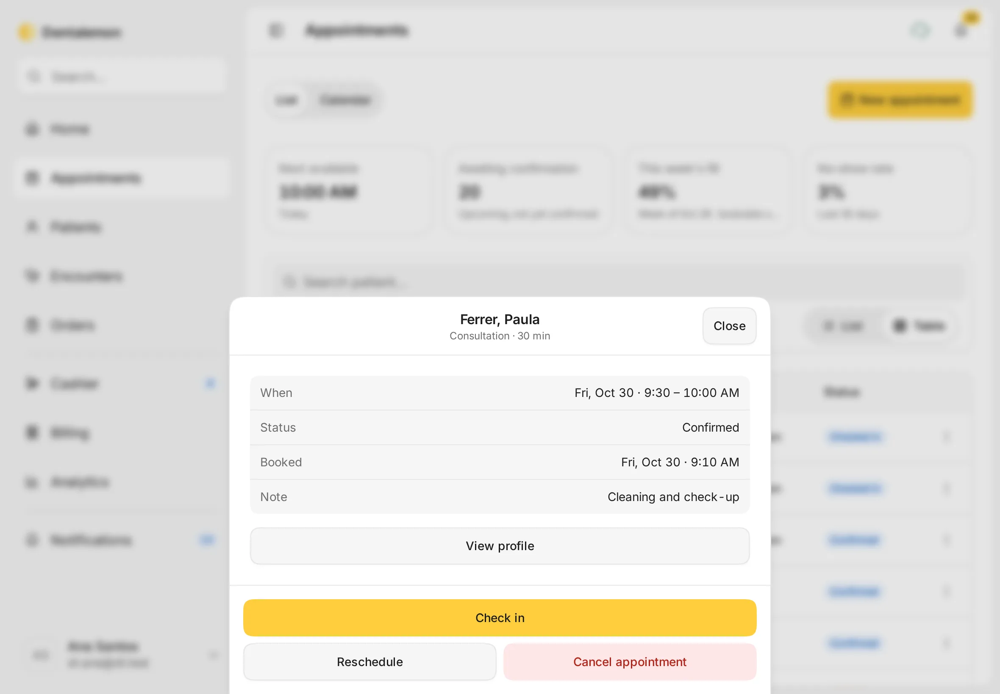

!!! note
    The big yellow button changes with the appointment: **Confirm** for one that isn't confirmed yet, **Check in** on the day, then **Open encounter** once the patient is checked in.

### 7. Reschedule

Tap **Reschedule**, pick a new day and time, then tap **Save**.

You should see: **Reschedule appointment**, with the patient and visit already filled in.
{ .see }

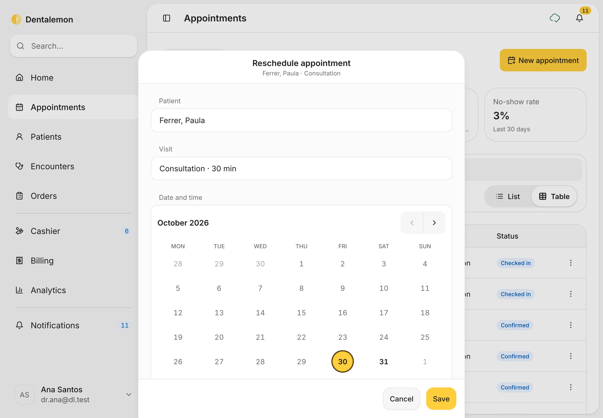

A **Moved…** message appears with an **Undo** button. The old time is freed once the Undo countdown ends.

### 8. Cancel an appointment

Tap **Cancel appointment**. Add a **Reason (optional)**, then tap **Cancel appointment** again to confirm. Tap **Keep appointment** if you changed your mind.

You should see: **Cancel appointment?** with the appointment's details.
{ .see }

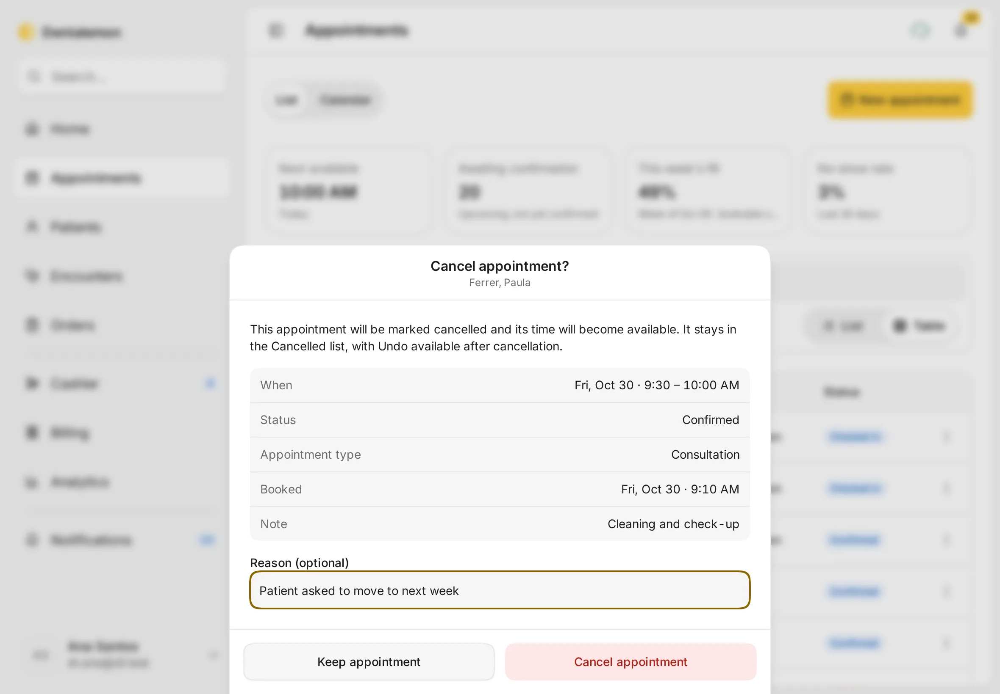

A message with **Undo** appears for a few seconds. The appointment is only cancelled once that time runs out.

### 9. Check the patient in

When the patient arrives, open their appointment and tap **Check in**.

You should see: **Ferrer, Paula checked in**, with an **Open encounter** button. The appointment's status changes to **Checked in**.
{ .see }

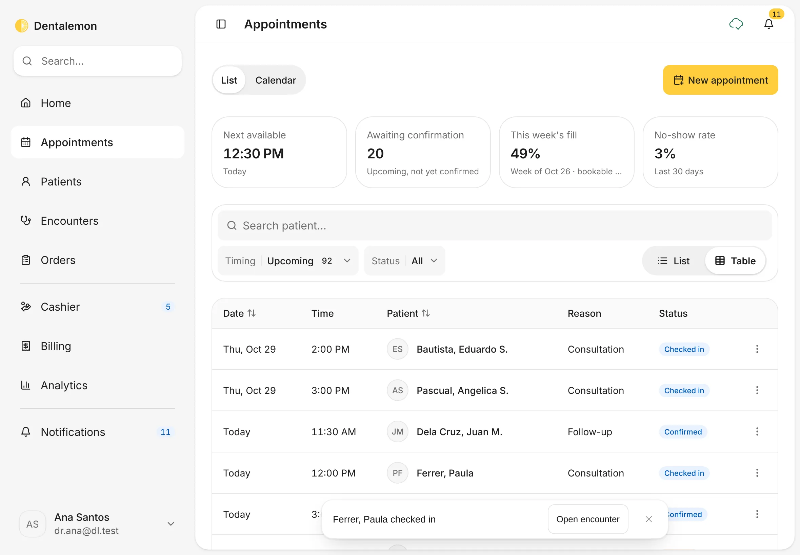

Checking in opens the patient's encounter for today, ready for charting and charges. Tap **Open encounter** to go straight there.

### 10. Confirm an appointment

An appointment booked as **Not yet confirmed** shows the status **Pending**. When the patient confirms (for example by phone or text), open the appointment and tap **Confirm**.

You should see: **Status · Pending** and a yellow **Confirm** button. After you tap it, the status changes to **Confirmed**.
{ .see }

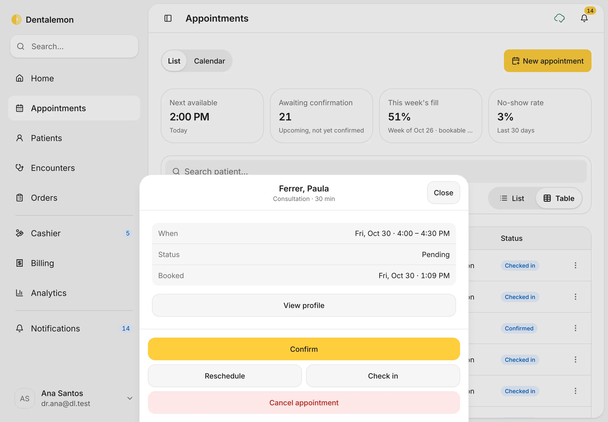

!!! tip "Find the ones to call"
    The **Awaiting confirmation** card at the top of the list counts every upcoming pending appointment. Use **Status** in the list to show only those.

### 11. Mark a no-show

If a patient with a **Confirmed** appointment doesn't come, open the appointment and tap **No-show**.

**No-show** appears from 5 minutes after the appointment's start time. It isn't offered for pending appointments: cancel those instead.

You should see: **No-show** among the buttons at the bottom of the appointment.
{ .see }

A message says **Marked *name* as a no-show**, with **Undo**. Tap **Undo** within a few seconds if you tapped it by mistake. After that, the appointment's status is **No-show**, and it counts in the **No-show rate** card.

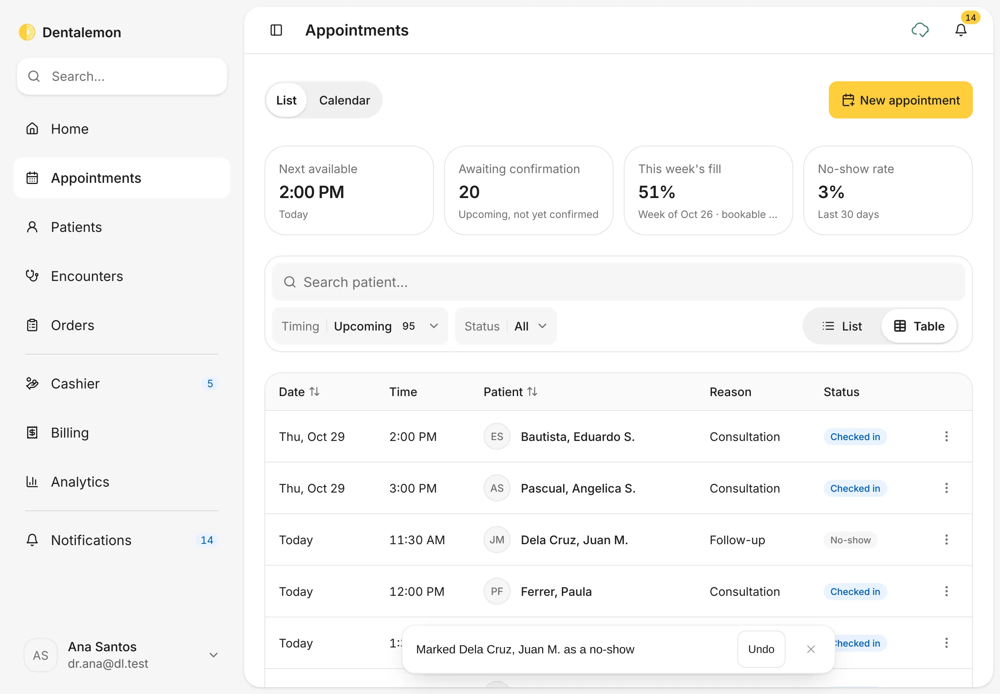

### 12. Follow-ups booked when you finish a visit

When you finish an encounter and choose a **Follow-up** (for example **1 week**), Dentalemon books it for you. It shows up here as a **Confirmed** appointment with the reason **Follow-up**, on the first open time that day. Open it like any other appointment to move or cancel it. See [Finish the visit](../visits/finish-the-visit.md).

## Tips

!!! tip "Not sure the patient will come?"
    Book as **Not yet confirmed**. Those appointments count in **Awaiting confirmation**, so you can call them later and tap **Confirm**.

!!! warning "If something goes wrong"
    **"That time isn't available"**: someone else booked that time while you were choosing. Pick another time.
    **No times appear for a day**: the clinic is closed that day, or it's fully booked. Try the next day, or check your clinic hours.

!!! info "Good to know"
    - Dentalemon doesn't send reminders or confirmation messages to patients. Contact them yourself.
    - You can check patients in only on the day of their appointment.
    - A checked-in appointment can't be cancelled. If the visit shouldn't go ahead, use **End encounter early…** on the appointment.
    - Appointments can't be dragged to a new time. Use **Reschedule**.

## What's next

- [Start an encounter](../visits/start-an-encounter.md)
- [Chart teeth](../visits/chart-teeth.md)
