# Chart teeth

Record what you find on each tooth, and the treatment it needs, right on the chart.
{ .meta }

**Time:** about 5 minutes for your first tooth · **You'll need:** an open encounter for the patient.
{ .meta }

## Before you start

- Open the patient's encounter. See [Start an encounter](start-an-encounter.md).
- Teeth are numbered with the FDI system unless you changed it in **Settings › General › Tooth notation**.

## Steps

### 1. Open the chart

The chart is at the top of the encounter, under the patient's name. The first time you see a patient, no tooth is marked yet.

### 2. Get to know the chart

Each tooth is drawn from three sides (**Facial**, **Occlusal**, **Lingual**), with its number underneath.

Above the chart:

- The chips **All**, **Conditions**, **Existing**, **Planned**, **Done** and **Declined** show only that kind of mark, with a count of each.
- **All quadrants** lets you zoom into one quadrant, for example **Q4 · Lower right**, so the teeth are bigger and easier to tap. Choose **All quadrants** again to see the whole mouth.
- **Any visit** shows marks from this visit (**This visit**), earlier visits (**Earlier**), or both.
- **Simple mode** shows only the biting surface of each tooth, without the side views. It's quicker to read; switch it off to see every surface. Your choice is remembered for you.
- **Legend** explains every colour and code.

You should see: a blank permanent chart with teeth 18 to 28 on top and 48 to 38 below.
{ .see }

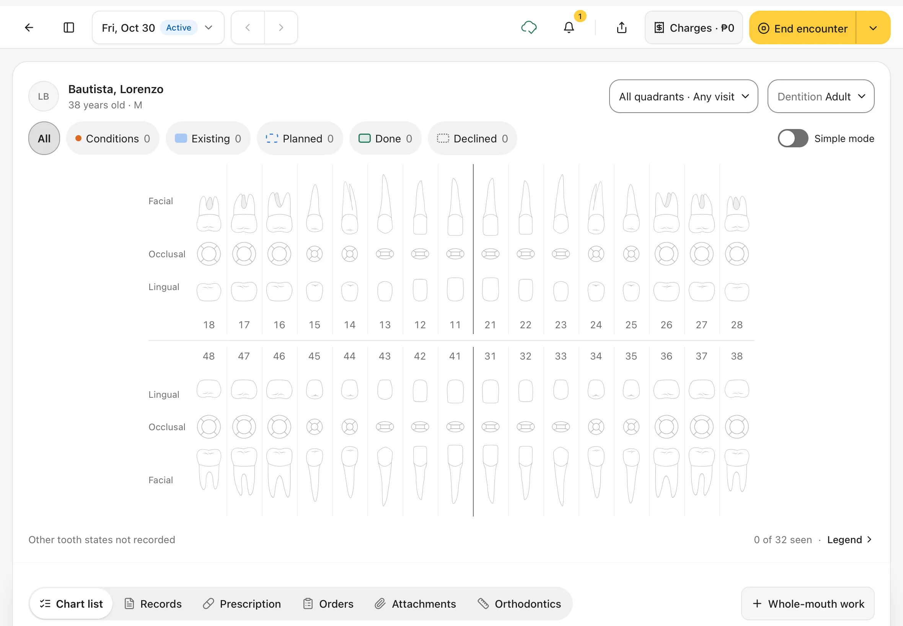

### 3. Tap a tooth

Tap any tooth. The **tooth panel** opens on the right, with:

- the tooth's number and name, for example **36 Lower left first molar**
- its state (**Not examined** until you record something)
- **‹** and **›** to move to the previous or next tooth
- its records, and a **Tooth note** box

You should see: the tooth highlighted on the chart and its panel on the right, with **No findings** and **Create record** at the bottom.
{ .see }

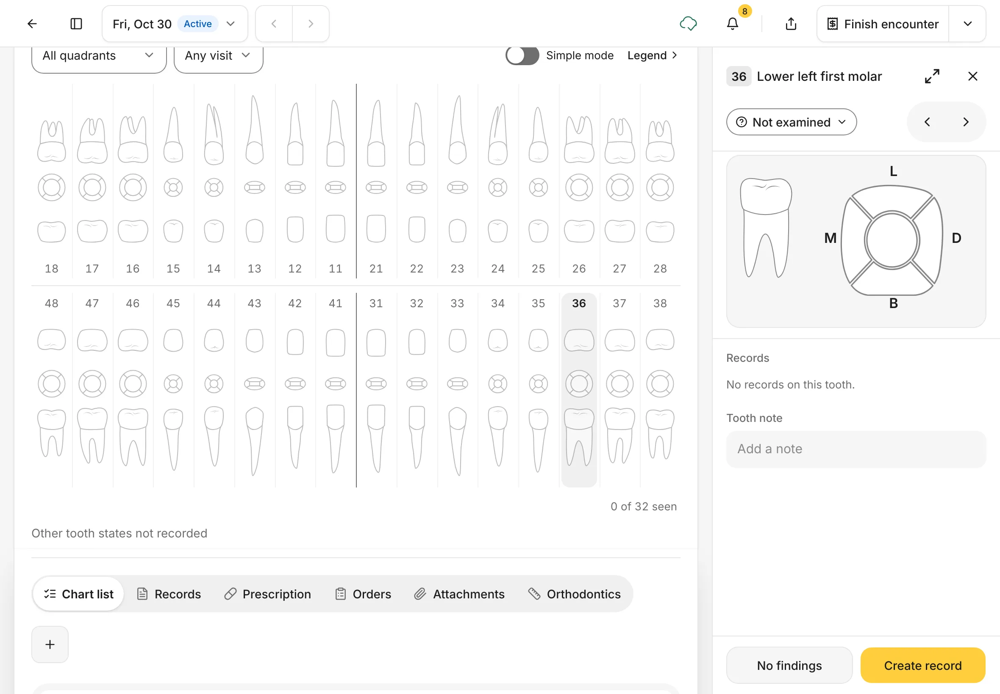

### 4. Create a record: choose the condition

Tap **Create record**. A short three-step record opens: **Condition**, **Treatment**, **Review**.

1. Tap the surfaces that are affected on the tooth drawing, or use the letters under it (**M**, **O**, **D**, **B**, **L**). **All** means the whole tooth; **Cervical** is the neck of the tooth.
2. Tap **Add condition**.
3. Pick the condition from the list, for example **Caries**. Use **Search conditions** to find one quickly.

The list is in three groups: **Conditions**, **Existing work** (fillings, sealants and other work the patient already has) and **More conditions**.

You should see: **Choose condition** with the tooth and surface in the title, for example **Tooth 36 · Occlusal**.
{ .see }

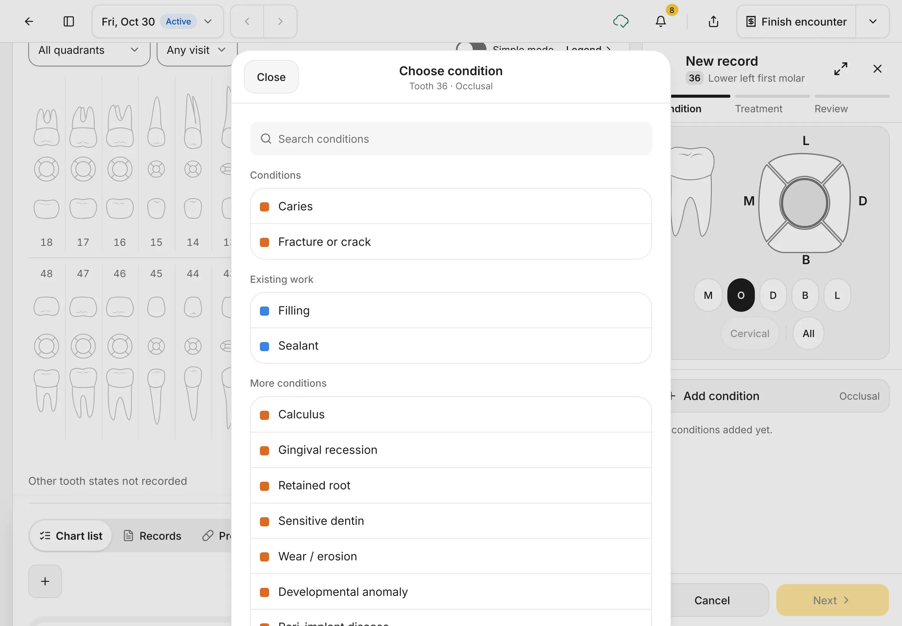

### 5. Check the condition, then tap Next

The condition is added to the record, with the surface it's on. You can add more than one condition before you move on. Use the pencil to change one, or the bin to remove it.

Tap **Next**.

You should see: **Caries** with **Occlusal** under it, and the surface coloured on the drawing.
{ .see }

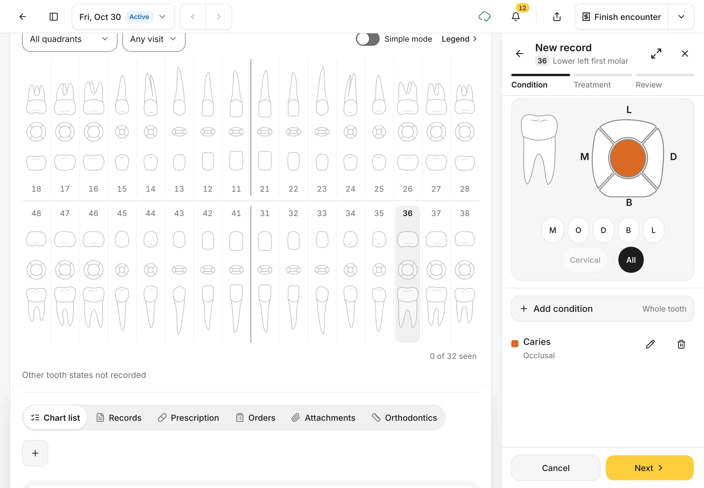

### 6. Choose the treatment

Dentalemon suggests the usual treatment for each condition, for example **Composite restoration** for caries. Tap it to pick a different one, or choose **No treatment**.

- Leave **Done today** off if you're planning the work for later. It goes on the patient's treatment plan.
- Turn **Done today** on if you did the work in this visit. It can then be charged.

Tap **Next**.

You should see: the condition, its **Treatment**, and the **Done today** switch.
{ .see }

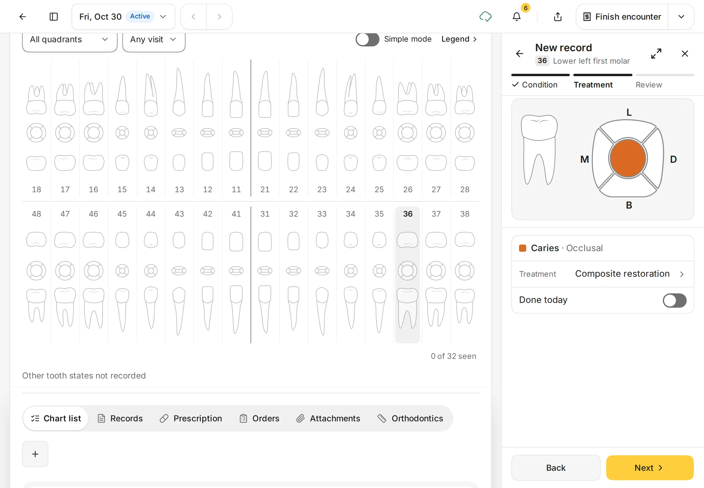

### 7. Review and save

Check the summary. Add a **Record note** if you want, then tap **Save record**.

Nothing is saved until you tap **Save record**. To leave without saving, tap **Back** until you reach the first step, then **Cancel**.

You should see: **Caries** with **Composite restoration · Planned** under it.
{ .see }

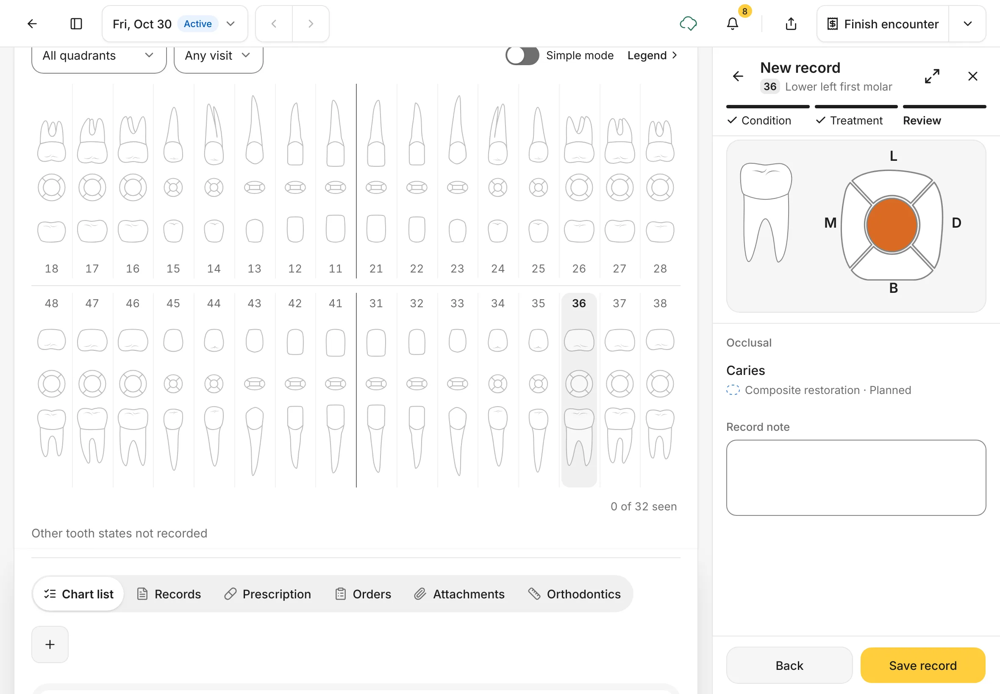

### 8. See it on the chart (and Undo if you need to)

The tooth now shows the condition in colour, and the planned work as a dashed blue outline. The tooth gets a check mark, and the count under the chart goes up, for example **1 of 32 seen**.

A message at the bottom confirms what you saved, for example **36 · Caries, composite restoration planned**. Tap **Undo** right away to take it back.

You should see: the saved record in the tooth panel, with **Mark done** under the planned treatment.
{ .see }

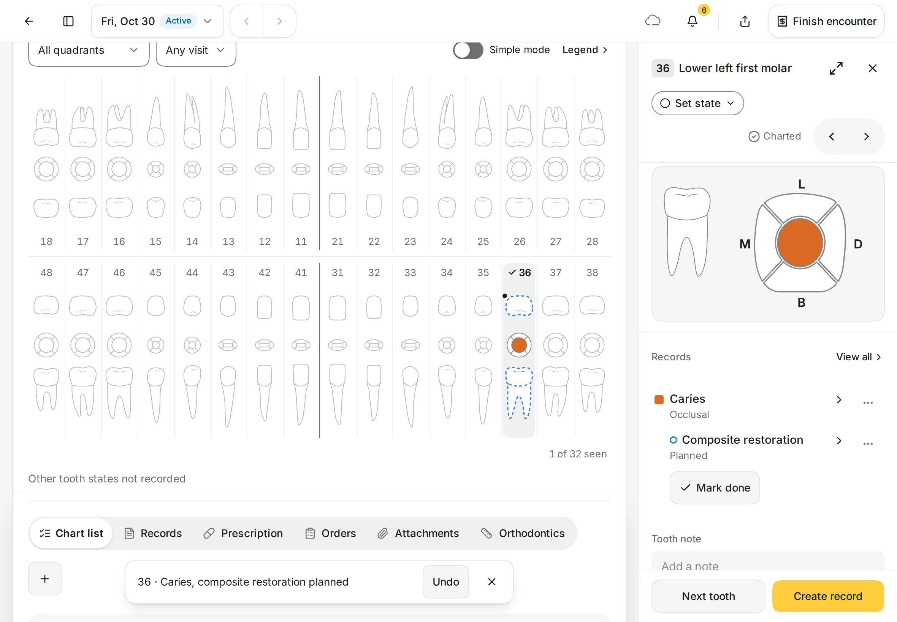

### 9. Mark healthy teeth quickly

For a tooth with nothing to record, tap the tooth, then tap **No findings**. The tooth counts as seen, and the button becomes **Next tooth** so you can move along the arch.

You should see: **No findings** next to **Create record** at the bottom of the panel.
{ .see }

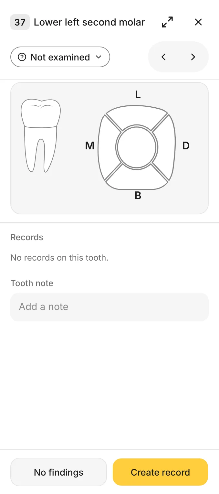{ .shot-sm }

### 10. Mark a missing or extracted tooth

A tooth's **state** is its overall condition. It shows as a button under the tooth's name. A tooth nobody has looked at yet says **Not examined**; a tooth you've already charted says **Set state**.

1. Tap the tooth, then tap its state button.
2. Choose the state:
    - **Healthy**: sound, nothing to chart.
    - **Watch**: keep an eye on it at the next visit.
    - **Missing**: the tooth isn't there and you don't know why.
    - **Extracted earlier**: the tooth was taken out before.
    - **Not examined**: clears the state, as if you hadn't looked.
3. Check **Changes to record**, which shows the state before and after, then tap **Update state**. Tap **Cancel** to leave it as it was.

You should see: the list of states, each with a short description. A choice that doesn't fit the tooth right now is greyed out and says why (for example, a tooth with planned work can't be marked **Missing**).
{ .see }

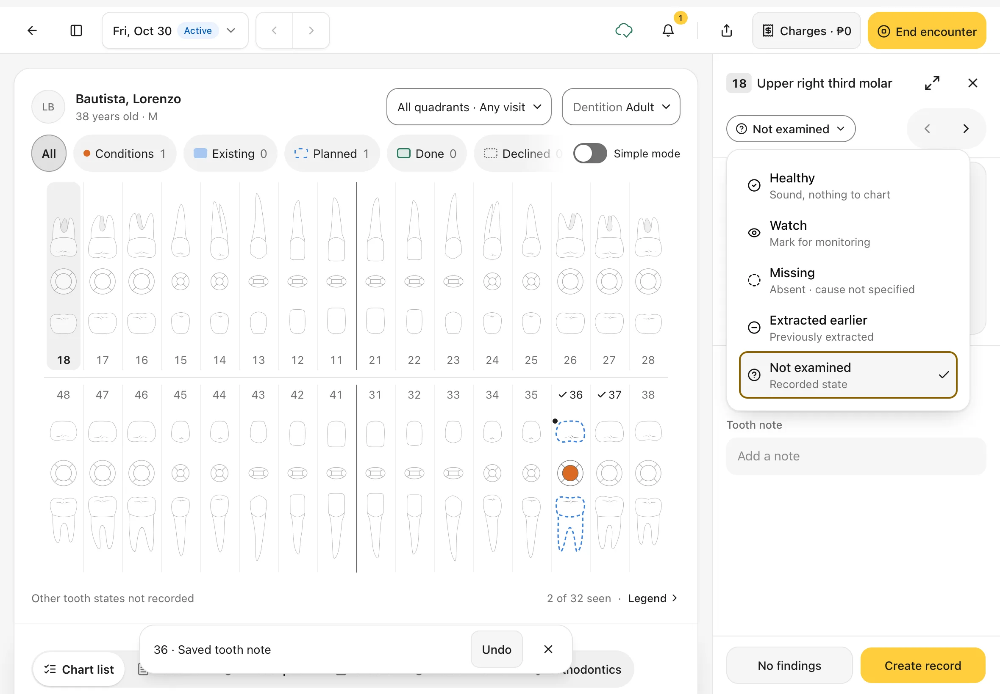

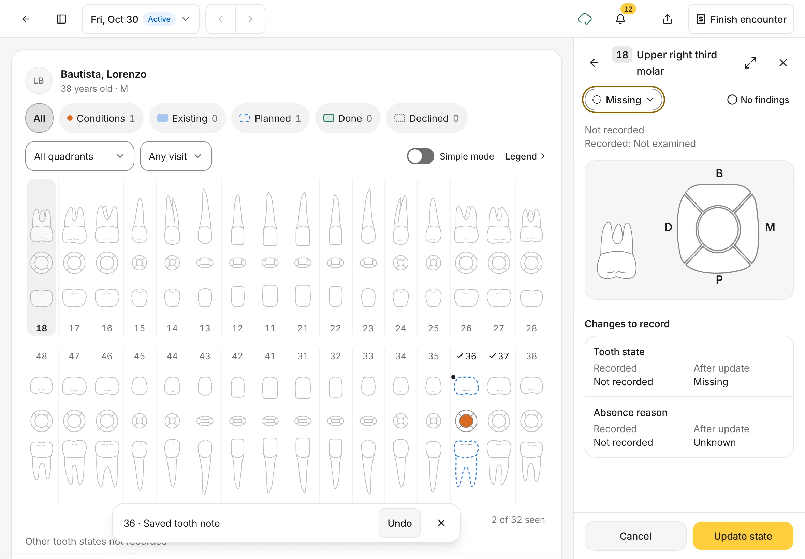

### 11. Check the Legend

Tap **Legend** above the chart to see what each mark means:

- **Planned**: dashed blue outline
- **Done**: solid green outline, tinted tooth
- **Declined**: dotted grey outline

It also lists the tooth codes, such as **D** for decayed and **I** for extraction.

You should see: **Chart legend** with **Chart statuses** and **Tooth codes**.
{ .see }

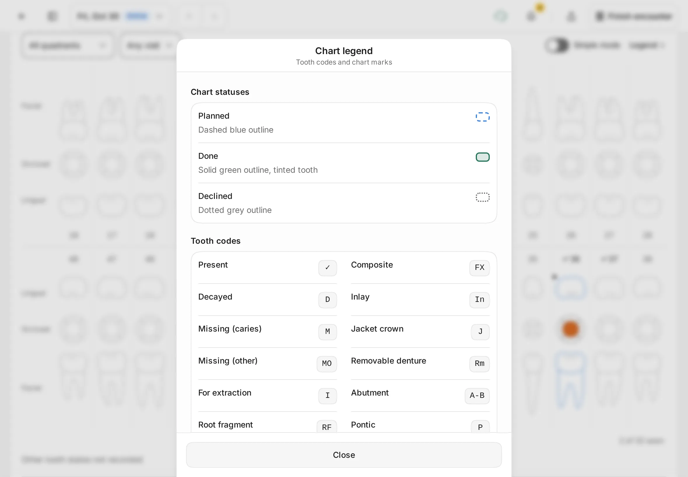

### 12. Record work for the whole mouth

Some work isn't on one tooth: a cleaning, a panoramic X-ray, a denture. Under the chart, tap **Whole-mouth work**.

1. Choose the **Treatment**. Each one shows its price and what it covers (**Whole mouth**, **One arch**, **Quadrants** or **Patient**).
2. For arch or quadrant work, choose which arch or quadrants.
3. Under **Record as**, choose **Planned** or **Done today**.
4. Tap **Add**.

You should see: **Whole-mouth work** with your clinic's treatments and prices.
{ .see }

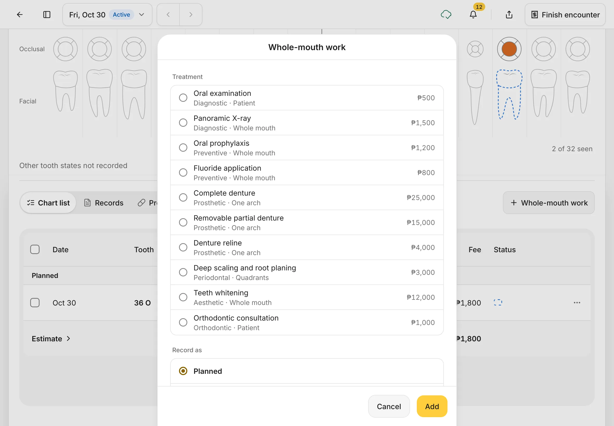

### 13. Add a note about a tooth

In the tooth panel, tap **Tooth note** (it says **Add a note**) and type, for example *Sensitive to cold since last week*. The note saves by itself when you tap anywhere else. A message confirms it, for example **36 · Saved tooth note**, with **Undo**.

You should see: your note under **Tooth note** in the panel.
{ .see }

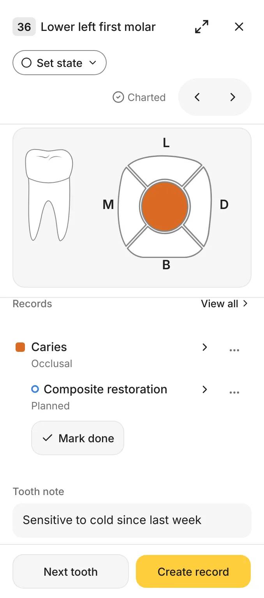{ .shot-sm }

### 14. Change or correct a record

Each record in the tooth panel has a **⋯** button. What it offers depends on the record:

| Record | **⋯** offers |
|---|---|
| A condition, such as **Caries** | **Resolve condition** (it's been dealt with) or **Entered in error…** |
| Planned work | **Mark done**, **Patient declined** or **Dismiss from plan…** |
| Work you did today | **Entered in error…** |

**Entered in error…** is for a record you saved by mistake. Pick a reason (for example **Wrong tooth or surface** or **Recorded twice**), then tap **Mark in error**. The record isn't deleted: it stays in the tooth's history, marked as an error.

You should see: the menu under **⋯**, headed with the record's name and surface.
{ .see }

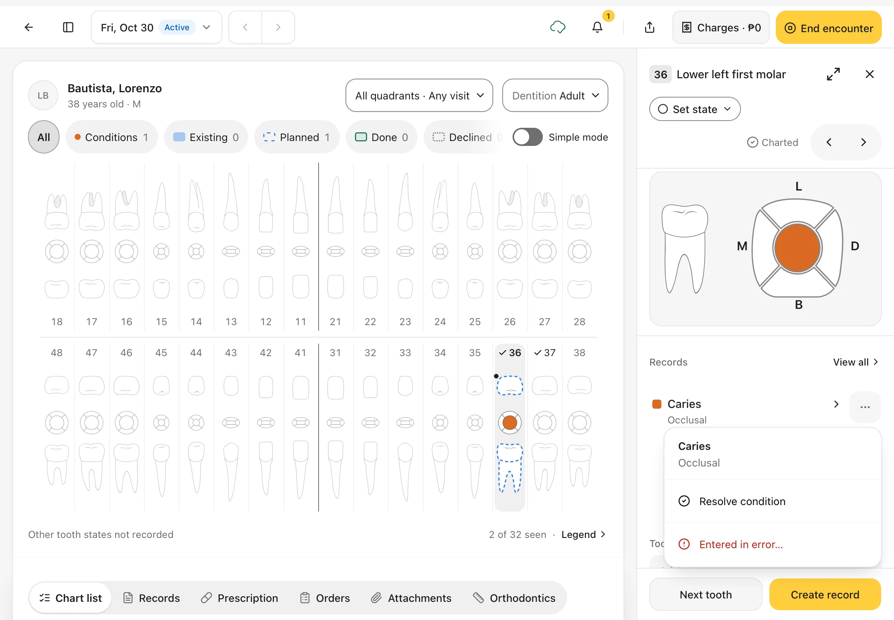

### 15. Stop half-way and come back

If you leave a record before saving it, for example by tapping the back arrow in the panel, Dentalemon keeps it for that tooth. The yellow button then reads **Resume record**. Tap it to carry on where you stopped.

While a record is waiting, you can't change the tooth's state. The panel says so.

You should see: **Resume record** at the bottom of the tooth panel.
{ .see }

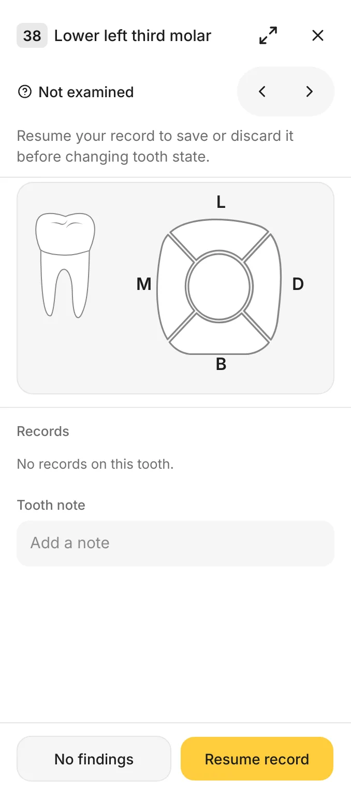{ .shot-sm }

To throw it away instead, tap **Resume record**, go **Back** to the first step, tap **Cancel**, then **Discard record**.

## Tips

!!! tip "Chart the whole mouth fast"
    Start at 18, then use **No findings** (it becomes **Next tooth**) on healthy teeth and **Create record** only where you find something.
    The count under the chart tells you how many teeth you've seen.

!!! tip "Bigger tooth panel"
    Tap the expand arrows in the tooth panel's corner to see the tooth full screen. This helps on a smaller iPad.

!!! warning "If something goes wrong"
    - **The Next button is greyed out.** Choose at least one condition first.
    - **You closed the record by mistake.** The button now says **Resume record**. Tap it to carry on where you left off.
    - **You saved the wrong thing.** Tap **Undo** on the message straight away. Later, use the **⋯** menu on the record in the tooth panel.

!!! info "Good to know"
    - Planned work goes to the patient's treatment plan. See [Treatment plan and Estimate](treatment-plan-and-estimate.md).
    - Work marked **Done today** can be added to the bill when you finish the visit.
    - Once a visit is finished, its chart is view only.

## What's next

- [Treatment plan and Estimate](treatment-plan-and-estimate.md)
