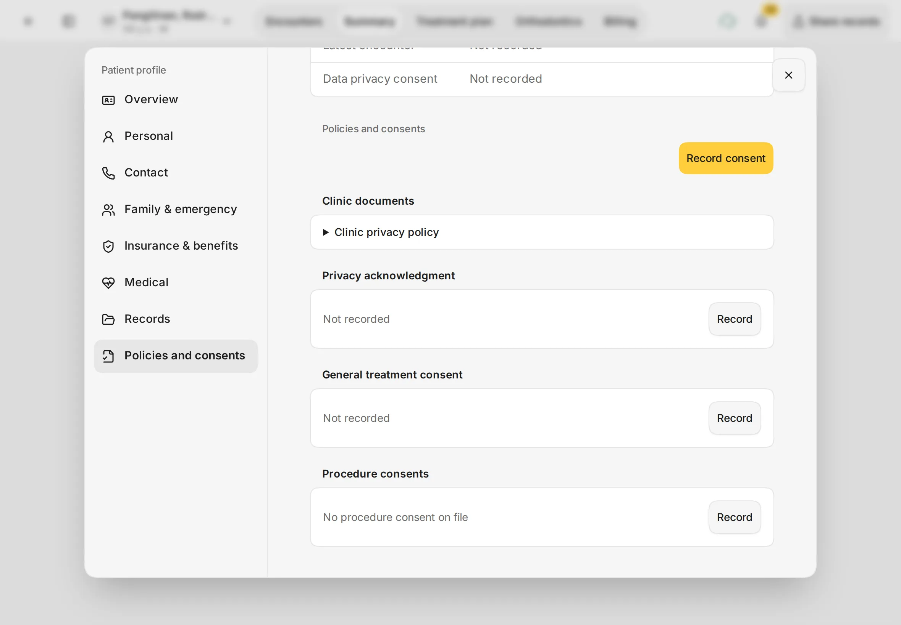
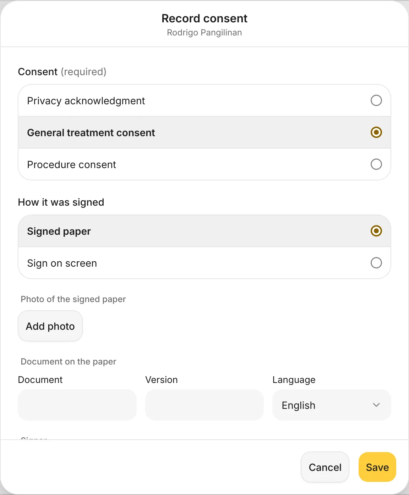
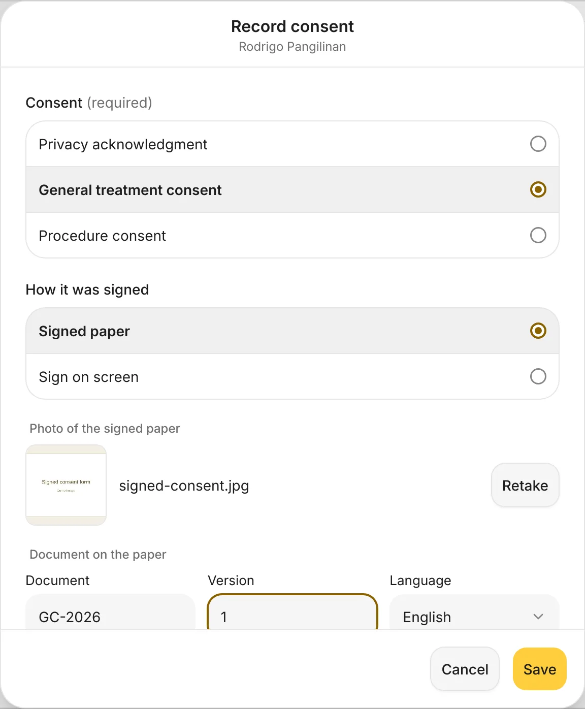
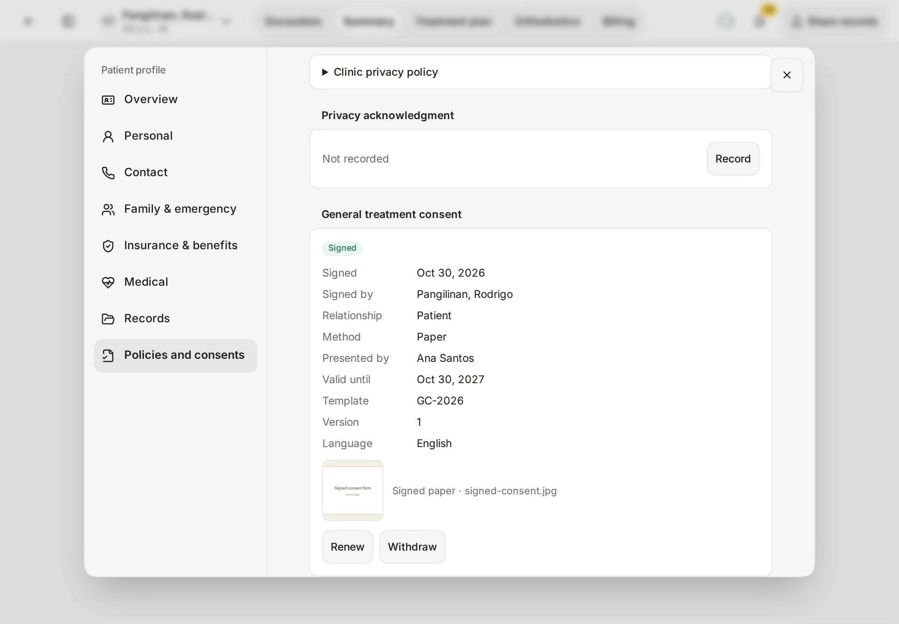
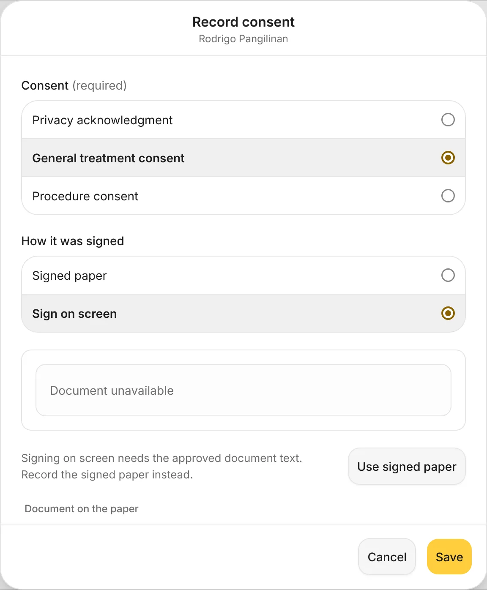

# Consents

Keep a record of the consents a patient has signed: privacy, general treatment and procedure consents.
{ .meta }

**Time:** about 2 minutes · **You'll need:** the patient's signed paper form, and the iPad camera to photograph it.
{ .meta }

## Before you start

- Have the patient sign your clinic's paper form first.
- Consents live in the **Patient Profile**. See [The patient page and profile](../patients/patient-page-and-profile.md).

## Steps

### 1. Open Policies and consents

On the patient's page, tap the patient's name at the top, then **View profile**. In the profile, tap **Policies and consents** on the left.

Each kind of consent has its own card: **Privacy acknowledgment**, **General treatment consent** and **Procedure consents**. One that hasn't been signed says **Not recorded**. Your clinic's own documents, such as the **Clinic privacy policy**, are listed under **Clinic documents**.

You should see: the consent cards, each with a **Record** button, and **Record consent** at the top.
{ .see }

### 2. Choose the consent

Tap **Record consent**, or **Record** on the card you need.

1. Under **Consent (required)**, choose **Privacy acknowledgment**, **General treatment consent** or **Procedure consent**.
2. Under **How it was signed**, choose **Signed paper**.

You should see: **Record consent** with the patient's name under the title.
{ .see }

{ .shot-sm }

### 3. Add a photo of the signed paper

1. Under **Photo of the signed paper**, tap **Add photo** and take a clear photo of the whole signed page. Tap **Retake** if it's blurry.
2. Under **Document on the paper**, type the **Document** code and **Version** printed on the form, for example *GC-2026* and *1*, and check the **Language**.
3. Check who signed under **Signer**, then tap **Save**.

You should see: the photo next to its file name, and the document code and version filled in.
{ .see }

{ .shot-sm }

### 4. Check the saved consent

The card now shows **Signed**, with the date, who signed, how (**Paper**), who presented it, **Valid until**, the template, version and language, and the photo.

- **Renew**: record a new signature when the consent expires or the form changes. The earlier one is kept.
- **Withdraw**: the patient takes back their consent. You'll be asked for the reason, and the record is kept.

Both show an **Undo** message for a few seconds.

You should see: **General treatment consent** marked **Signed**, with **Renew** and **Withdraw**.
{ .see }

## Signing on the iPad screen

The patient can also sign on the iPad: choose **Sign on screen** under **How it was signed**.

This only works once your clinic has added the approved wording of the document. Until then, the form says **Signing on screen needs the approved document text. Record the signed paper instead.** Tap **Use signed paper** to go back.

{ .shot-sm }

When the wording is set up, tap **Hand to patient**. You choose a passcode, the patient reads and signs, and you enter the passcode to take the iPad back.

## Tips

!!! tip "Photograph the whole page"
    Lay the form flat in good light so the signature and the document code are easy to read later.

!!! warning "If something goes wrong"
    - **Add a photo of the signed paper.** A paper consent needs its photo before you can save.
    - **Enter the document and version printed on the paper.** Fill in **Document** and **Version** from the form.

!!! info "Good to know"
    - The consent wording for **Sign on screen** is set in **Settings › Consents**. Ask your clinic admin before changing it.
    - A withdrawn or renewed consent is never deleted. The history stays on the card.

## What's next

- [Finish the visit](finish-the-visit.md)
