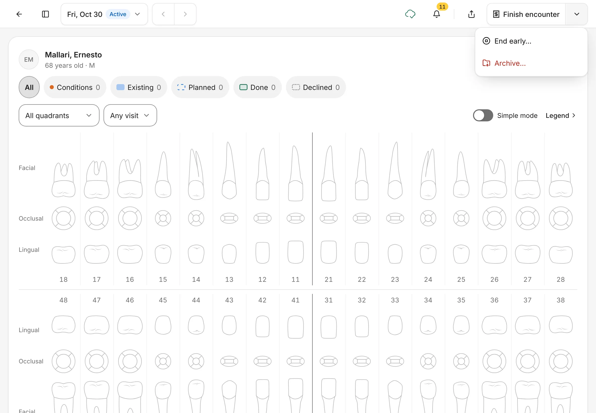
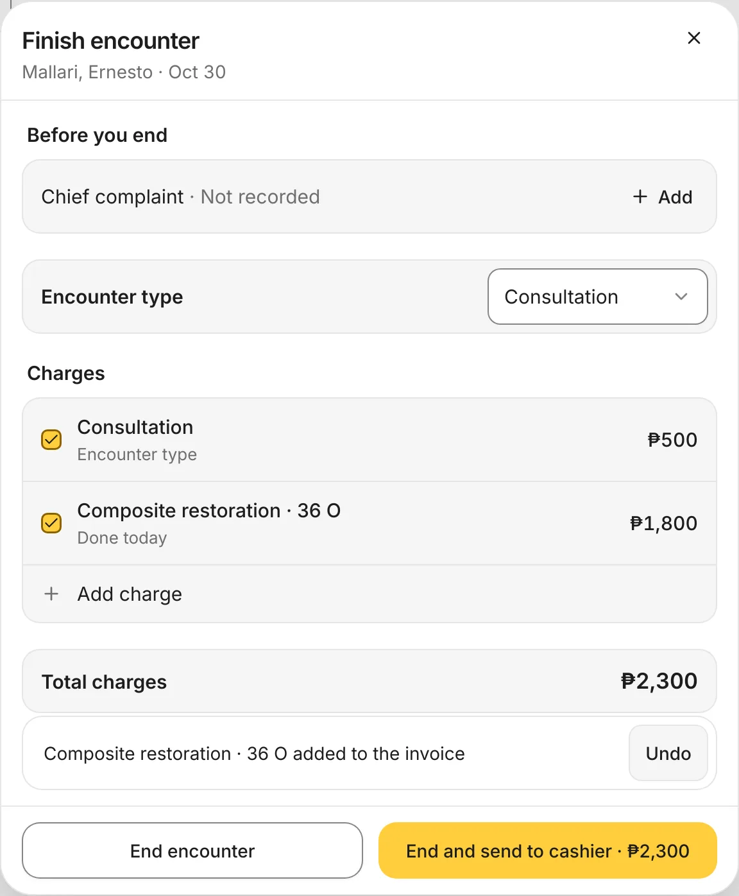
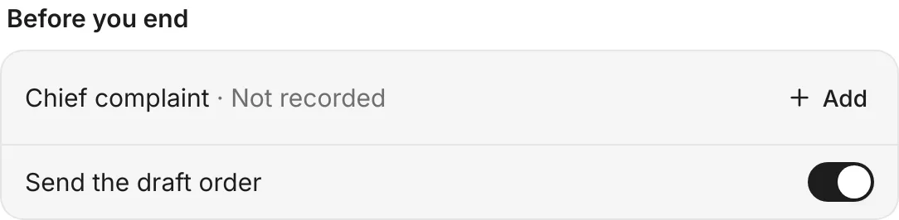
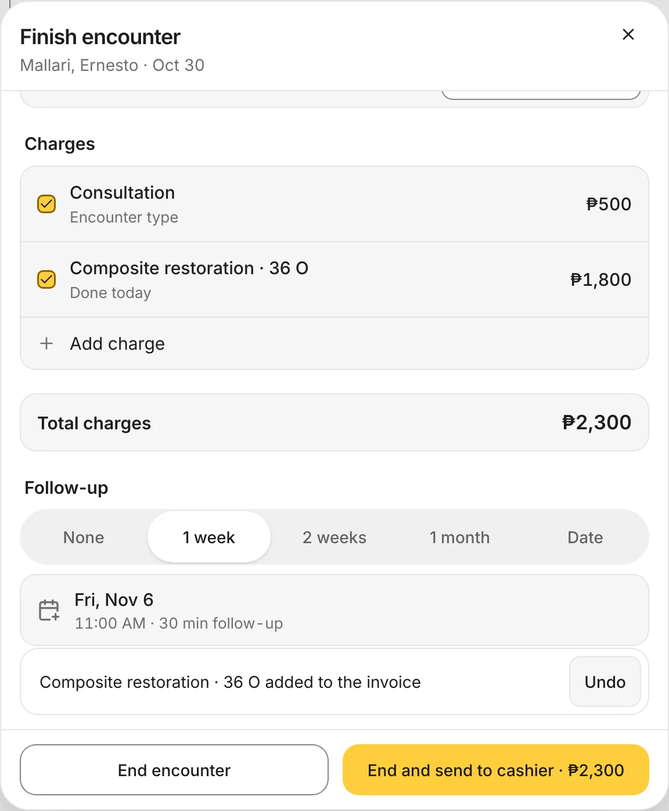
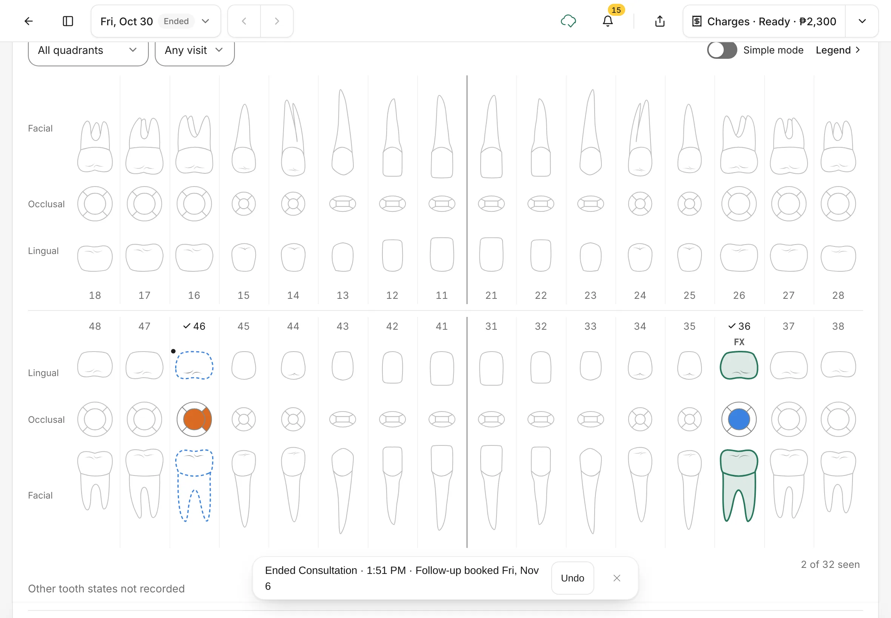
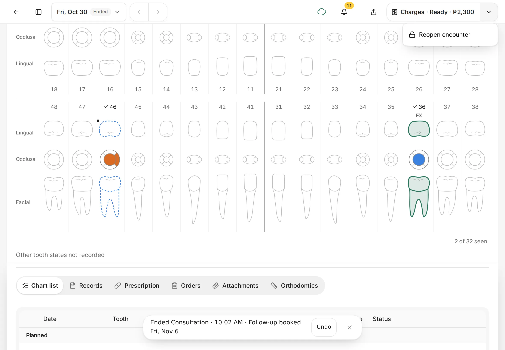
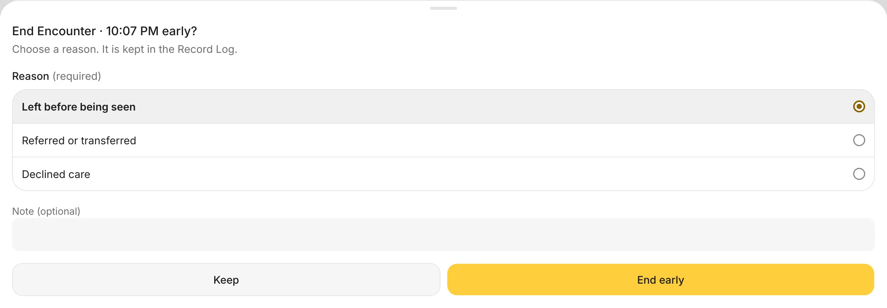
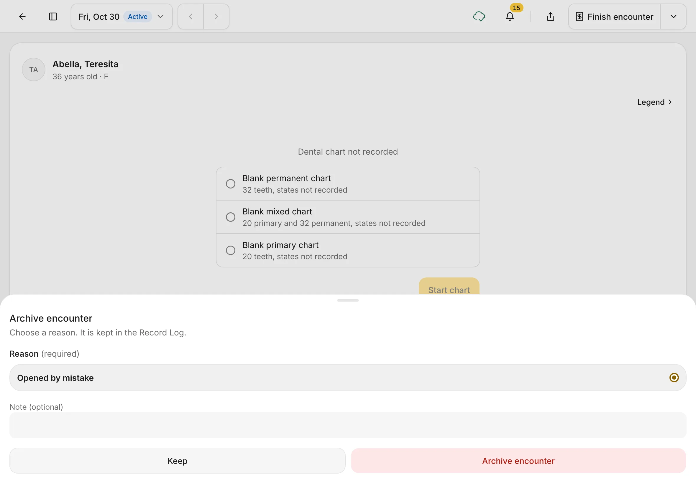

# Finish the visit

End the encounter, put the work you did on the bill, book the follow-up, and send the patient to the cashier, all from one sheet.
{ .meta }

**Time:** about 1 minute · **You'll need:** an open encounter with the visit's work charted.
{ .meta }

## Before you start

- Chart the work you did today with **Done today** on. See [Chart teeth](chart-teeth.md).
- Your prices come from **Settings › Services**.

## Steps

### 1. Tap Finish encounter

In the encounter's top bar, tap **Finish encounter**.

The **⌄** beside it has other choices. While nothing has been recorded yet, you'll see:

- **End early…**: the patient left before being seen, was referred or transferred, or declined care. You'll pick the reason.
- **Archive…**: remove an encounter that was opened by mistake.

You should see: **Finish encounter** at the top right. The **⌄** menu shows **End early…** and **Archive…** when you open it.
{ .see }

### 2. Check the Finish encounter sheet

The sheet shows the patient's name and today's date. Work through it from the top:

1. **Before you end** lists anything missing, such as **Chief complaint · Not recorded**. Tap **+ Add** to fill it in now, or carry on: reminders never stop you ending. If the visit has draft orders (for example a lab order you haven't sent), a switch such as **Send the draft order** appears here. It's on, so ending the visit sends them; switch it off to keep them as drafts.
2. **Encounter type**: choose **Consultation**, **Follow-up**, **Oral prophylaxis**, **Dental certificate** or **Procedure**. This sets the visit charge.
3. **Charges**: the lines start **unticked**. Tick each line you want to bill: the encounter type and the work you marked **Done today**. Each tick puts that line on the bill straight away, with **Undo**. Tap **+ Add charge** for anything else from your price list.

**Total charges** adds up the ticked lines.

You should see: the ticked charges and the total, for example **₱2,300**.
{ .see }

{ .shot-sm }

{ .shot-sm }

### 3. Book the follow-up

Under **Follow-up**, choose **None**, **1 week**, **2 weeks**, **1 month**, or **Date** to pick a day yourself.

Dentalemon finds the first open time and shows it in a card with the day, time and length, for example **Fri, Nov 6** and **10:30 AM · 30 min follow-up**. The booking is made when you end the encounter, and it then appears in **Appointments** like any other booking, where you can move or cancel it. See [Appointments](../schedule/appointments.md).

You should see: the follow-up card under the choices.
{ .see }

{ .shot-sm }

### 4. End the encounter

Choose how to end:

- **End and send to cashier · ₱*total***: ends the visit and sends the bill to the **Cashier** to collect payment. Use this when the patient pays today.
- **End encounter**: ends the visit without sending a bill.

The chart becomes view only, and the date pill at the top says **Ended**. A message confirms the encounter type, the time and the follow-up, with **Undo**.

The top button now reads **Charges · Ready · ₱*total***. Tap it to see the bill.

You should see: **Ended** at the top and a message that starts with **Ended** and the encounter type (for example **Ended Consultation**, or **Ended Encounter** if you didn't choose a type), then **Follow-up booked**.
{ .see }

### 5. Reopen if you need to

If you ended the visit too soon, open the **⌄** and tap **Reopen encounter**. You can only reopen today's encounters.

You should see: **Reopen encounter** in the **⌄** menu.
{ .see }

### 6. End a visit early

Use **End early…** when the visit didn't really happen, before you've recorded any care. It's only in the **⌄** menu until you start charting.

1. Tap **⌄** beside **Finish encounter**, then **End early…**.
2. Choose why: **Left before being seen**, **Referred or transferred** or **Declined care**.
3. Add a note if you want, then tap **End early**. Tap **Keep** to go back without ending.

You should see: **End Encounter · *time* early?** with the reason list and your choice marked. The encounter then ends. For **Left before being seen** and **Declined care**, the visit's unpaid charges are cleared too.
{ .see }

### 7. Archive an encounter opened by mistake

If you started an encounter for the wrong patient, or by accident, and nothing has been recorded in it, you can archive it.

1. Tap **⌄** beside **Finish encounter**, then **Archive…**.
2. The reason **Opened by mistake** is chosen for you. Add a note if you want.
3. Tap **Archive encounter**, or tap **Keep** to leave it.

You should see: **Archive encounter** with the reason and the **Archive encounter** button.
{ .see }

An archived encounter disappears from the patient's list of visits. You can bring it back from the **Patient Profile**.

## Tips

!!! tip "End and send to cashier"
    If the patient pays before leaving, always use **End and send to cashier**. The bill then shows up straight away at the **Cashier**. See [Charges and the Cashier](../payments/charges-and-cashier.md).

!!! warning "If something goes wrong"
    - **The total is ₱0.** Tick the charges you want to bill.
    - **Your work isn't listed under Charges.** It was charted as planned. Go back to the chart and use **Mark done**, or tap **+ Add charge**.
    - **Ending is blocked by a diagnosis.** Your clinic has turned on **Require a diagnosis before closing** in **Settings › Encounter**. Record the condition on the chart first.
    - **A tooth record is still open.** Dentalemon shows you the tooth first. Save or discard that record, then finish.

!!! info "Good to know"
    - Ending finalizes the visit's records. **Undo** or **Reopen encounter** opens the visit again, but records that were finalized stay final. To correct one, use **Amend…** on it.
    - Draft orders can be sent when you end. See [Notes, prescriptions, orders and attachments](notes-prescriptions-orders-attachments.md).

## What's next

- [Charges and the Cashier](../payments/charges-and-cashier.md)
- [Appointments](../schedule/appointments.md)
