# Notes, prescriptions, orders and attachments

Write the visit notes, prescribe medicine, order lab or imaging work, and attach photos or documents, all from the encounter.
{ .meta }

**Time:** about 5 minutes · **You'll need:** an open encounter for the patient.
{ .meta }

## Before you start

- Open the patient's encounter. See [Start an encounter](start-an-encounter.md).
- Everything on this page is in the row of views under the chart: **Chart list**, **Records**, **Prescription**, **Orders**, **Attachments** and **Orthodontics**. Scroll down below the chart to see it.
- To have your licence number printed on prescriptions, add it to your profile first: **Settings › Profile**. See [Settings basics](../clinic/settings-basics.md).

## Write the visit notes

### 1. Open Records

Tap **Records** in the row of views. The notes are laid out in four columns:

- **Subjective**: what the patient tells you (**Allergies**, **Chief complaint**, **History of complaint**)
- **Objective**: what you find (**Vitals**, **Soft-tissue exam**)
- **Assessment**: the conditions you've recorded on the chart
- **Plan**: what happens next (**Post-op instructions**)

An empty column says **Nothing recorded.** (**Assessment** says **No active conditions on the chart.**) and shows **+** buttons for what you can add.

You should see: the four columns, with **+ Chief complaint** under **Subjective**.
{ .see }

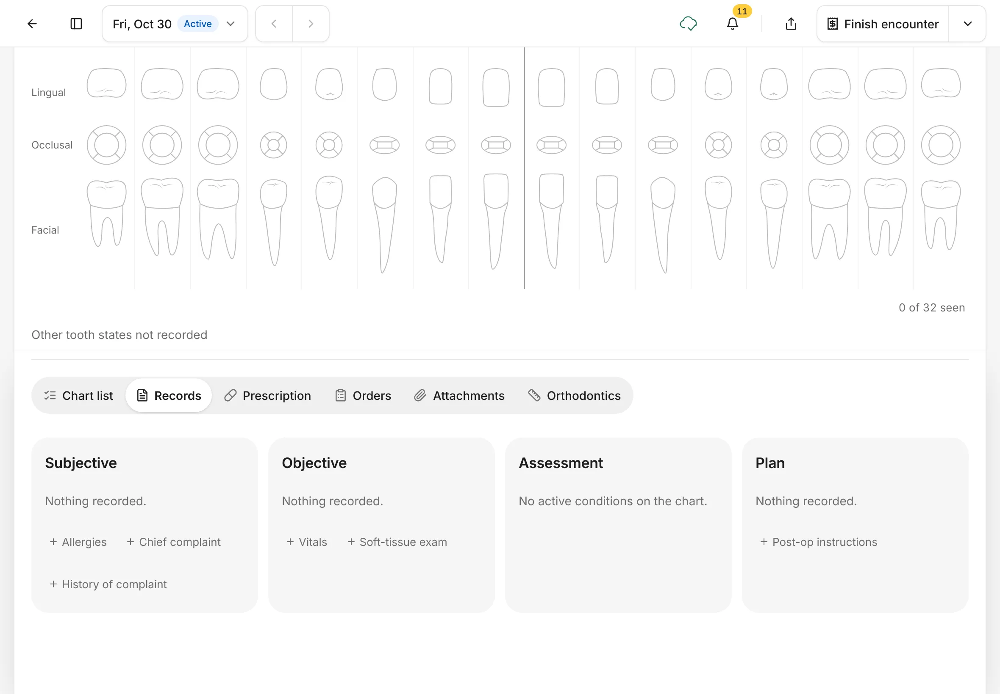

### 2. Add the chief complaint

Tap **+ Chief complaint**, type the patient's **Main concern**, then tap **Save**. Other notes work the same way.

You should see: **Add chief complaint** with a **Main concern** box.
{ .see }

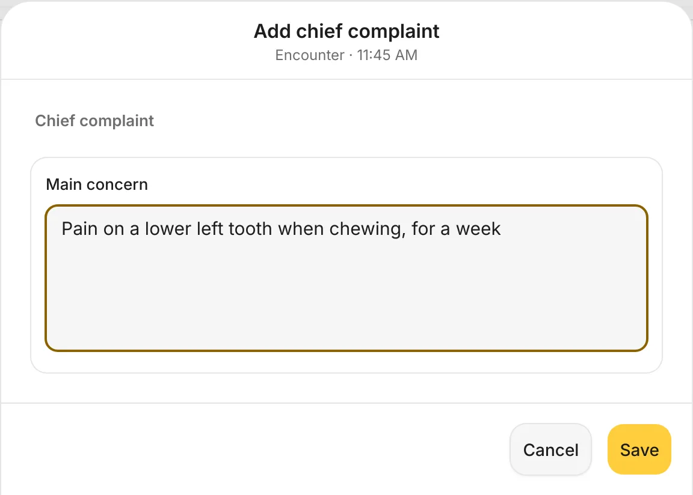{ .shot-sm }

A message says **Added chief complaint**, and the note appears as a card under **Subjective**. Tap the card to read or change it.

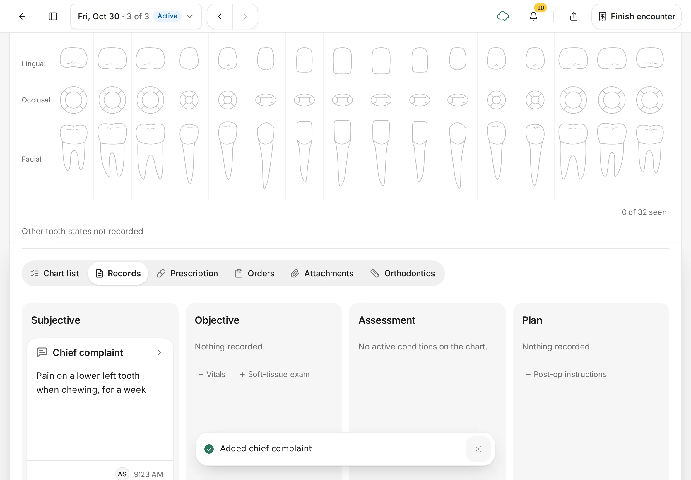

### 3. Record allergies

Always check allergies before you treat or prescribe.

1. Under **Subjective**, tap **+ Allergies**.
2. If the patient has none, switch on **No known allergies**.
3. Otherwise, under **Allergen**, type the start of the name and pick it from the list, for example **Penicillin**.
4. Choose the **Severity**: **Mild**, **Moderate** or **Severe**.
5. Add **First observed** and **Additional information** if you know them.
6. Tap **Save**.

You should see: **Add allergies** with the allergen and severity filled in. Afterwards, an allergy card appears under **Subjective**; a severe allergy is marked **Severe allergy** in red.
{ .see }

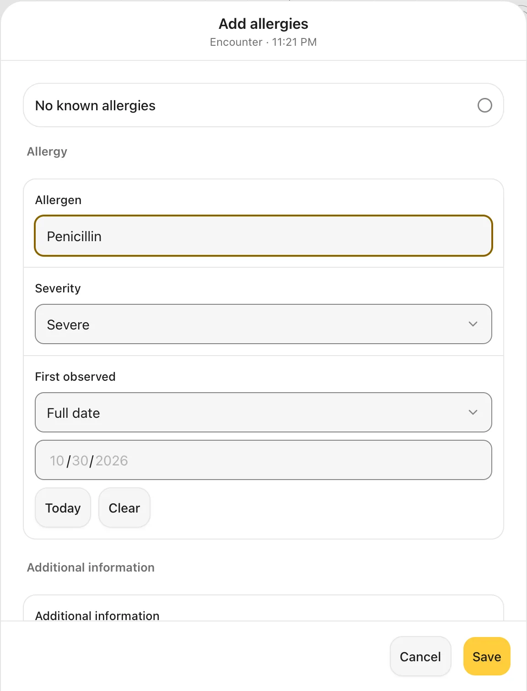{ .shot-sm }

Allergies recorded at an earlier visit are carried into every new encounter. Tap the card to read them: the reader says where they came from, for example **From Oct 30, 2026 encounter**, and they can't be edited from this visit.

### 4. Record vitals

Under **Objective**, tap **+ Vitals**. Fill in what you measured: **Systolic** and **Diastolic** blood pressure, **Temperature**, **Height** and **Weight**. Leave the rest empty. Tap **Save**.

You should see: a **Vitals** card under **Objective**, for example **120/80 BP**.
{ .see }

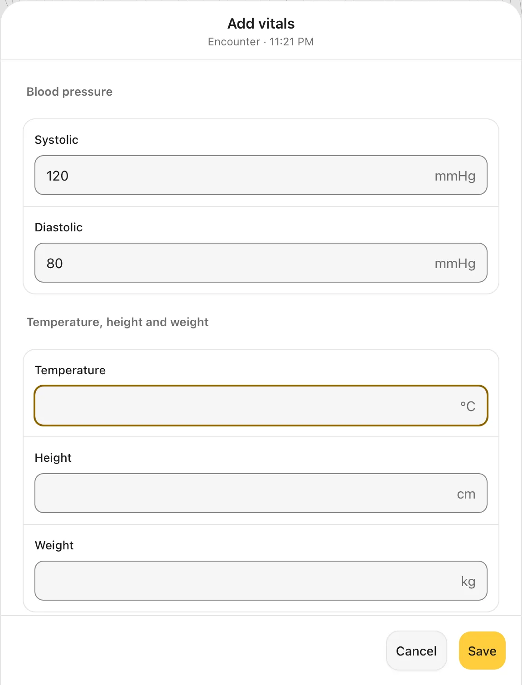{ .shot-sm }

### 5. Read or change a note

Tap any card to read it in full: who recorded it, when, and the details. While the visit is still open, tap **Edit** to change it, then **Save**.

You should see: the note with **Edit** at the top right.
{ .see }

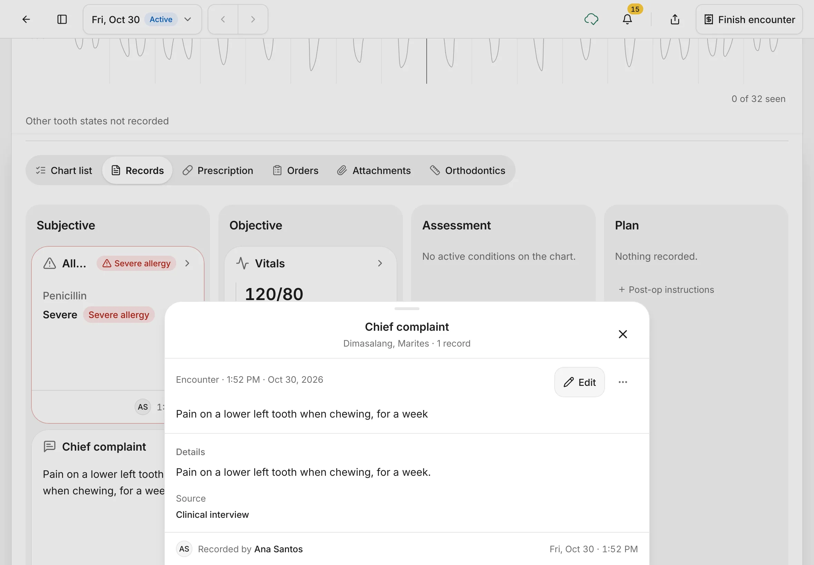

!!! note "After the visit has ended"
    The button reads **Amend…** instead of **Edit**. Make your change and tap **Continue**. Dentalemon then asks why: choose **Correction**, **Late entry**, **Clinical update** or **Other**, add a note if you want, and tap **Amend**. The reason is kept in the record's history. Tap **Keep** to go back without saving.

    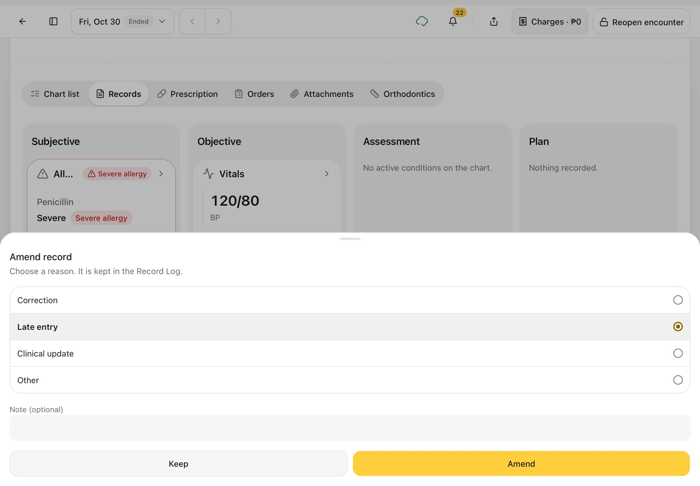

## Prescribe medicine

### 6. Find the medicine

Tap **Prescription** in the row of views, then **Add prescription**.

Type part of the name in **Search name, brand or strength**, for example *amox*, then tap the medicine and strength you want.

!!! warning "If the patient is allergic"
    The patient's allergies show in red under their name, for example **Penicillin · Severe**, and every matching medicine in the list has a red warning sign. When you tap one, Dentalemon warns you before adding it, for example **Penicillin allergy on record · Severe**. Tap **Keep current** to go back without adding the medicine, or **Choose medicine** to add it anyway. Record allergies first (step 3) so this check can work.

    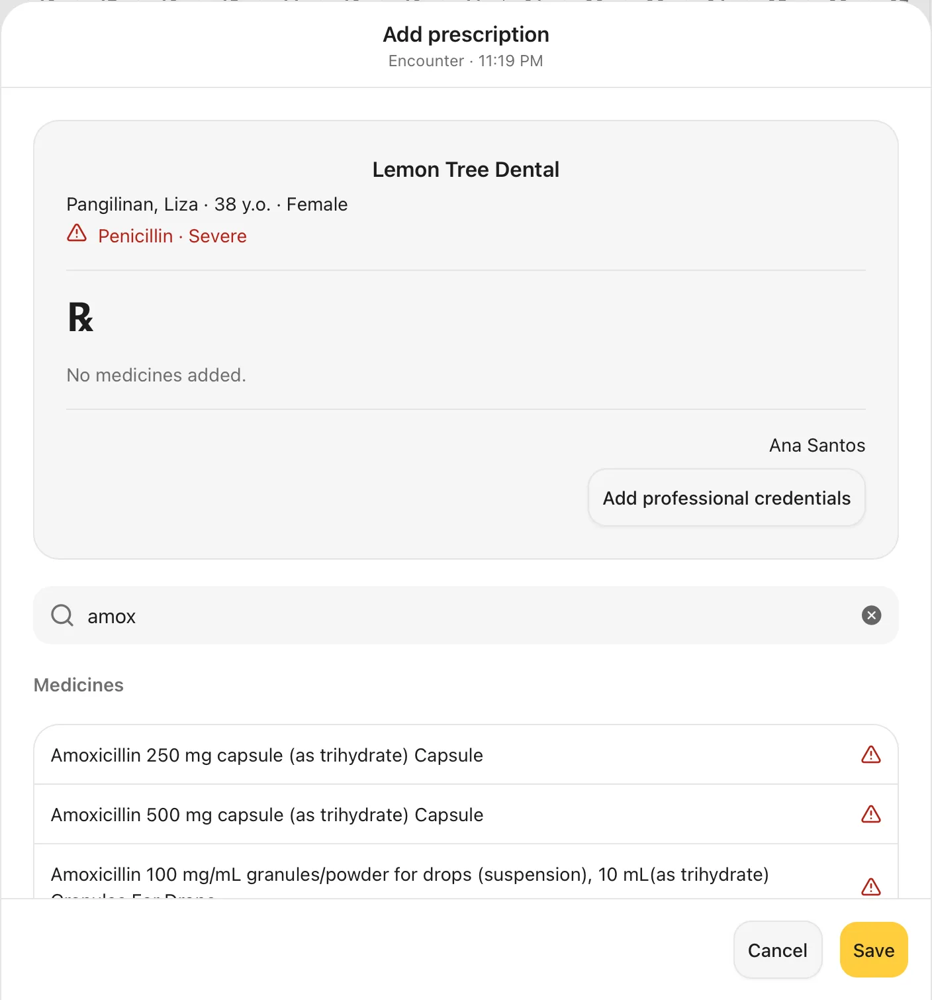{ .shot-sm }

You should see: a list of matching medicines under **Medicines**.
{ .see }

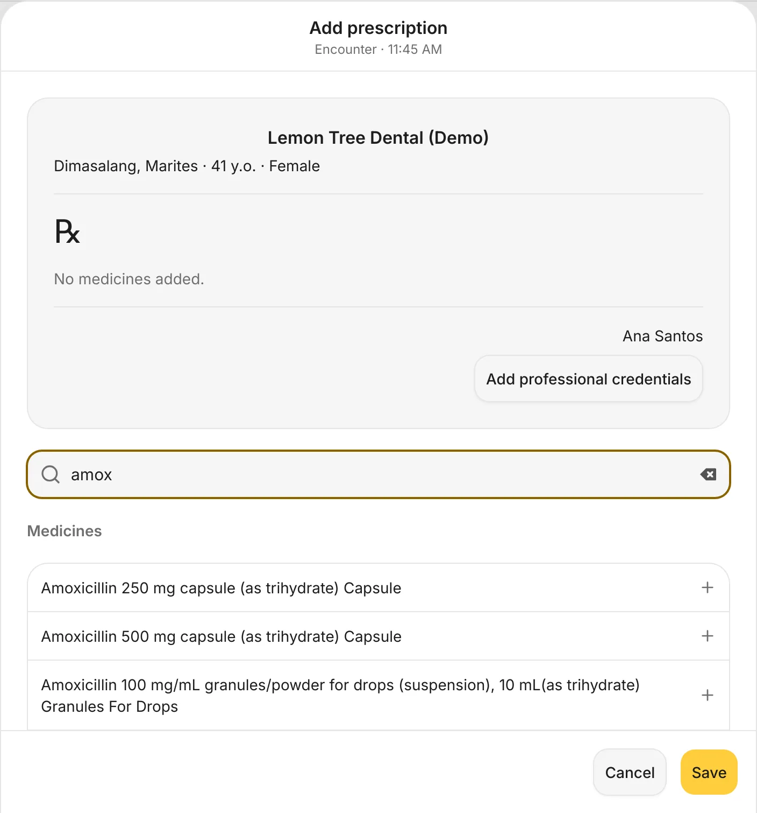{ .shot-sm }

### 7. Fill in the directions

The **Medicine** page opens with the name, strength and form filled in. Under **Directions**, fill in:

- **Take**: the amount and unit, for example *1 capsule*
- **Route**: for example *By mouth*
- **How often**: start typing and pick a suggestion, for example *3 times a day*
- **For how long**: for example *7 days*

Under **Quantity and refills**, enter the **Quantity** to dispense.

Tap **Prescription** at the top left to go back.

You should see: the medicine details and the **Directions** you entered.
{ .see }

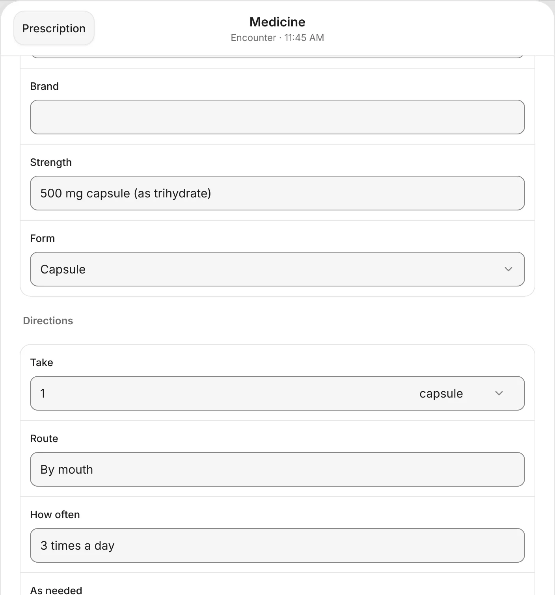{ .shot-sm }

### 8. Check and save the prescription

The prescription now lists the medicine with its directions in plain words. To add another medicine, search again.

Under the medicines:

- **Destination**: where the patient gets the medicine, **Patient-arranged** unless you change it. **Change in Settings** opens **Settings › Partners** in front of the prescription, where your clinic's referral partners are kept.
- **Add professional credentials** (under your name) opens **Settings › Profile**, where you add your licence numbers.
- **Remove all medicines** clears the list and starts again.

Tap **Save**.

You should see: **1. Amoxicillin 500 mg capsule…** with **1 capsule by mouth 3 times a day for 7 days** under it.
{ .see }

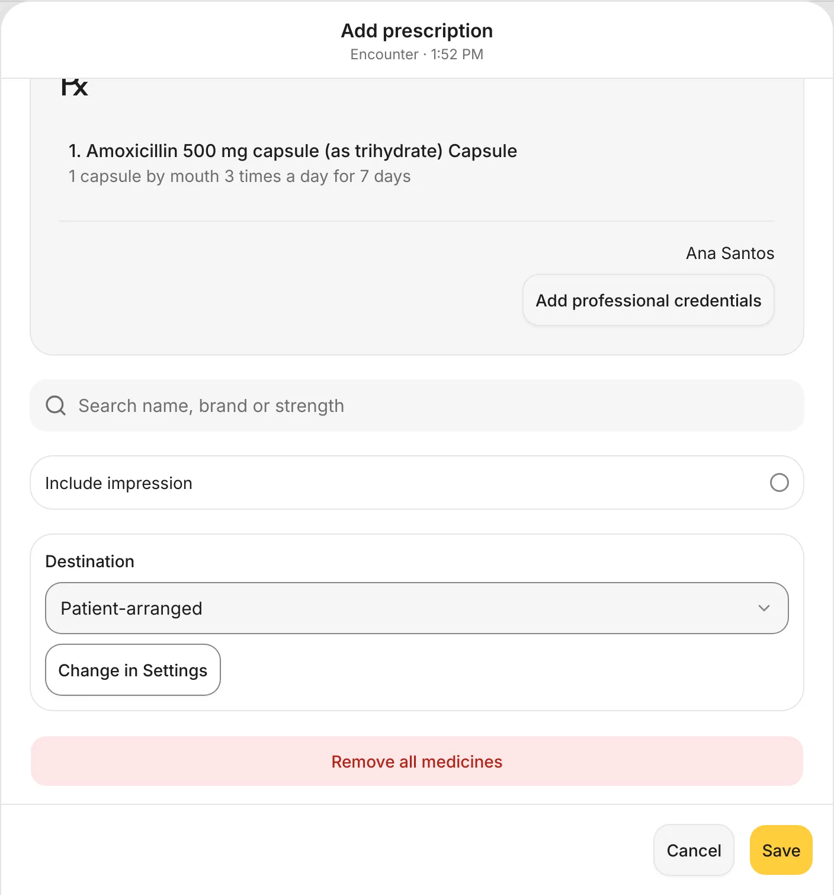{ .shot-sm }

### 9. Print it

The prescription appears in the **Prescription** view, laid out as it will print: your clinic, the patient, the **Rx** with **Sig:** and **Disp.**, and your name and licence numbers.

You should see: the prescription with **Print** and **Add prescription** above it.
{ .see }

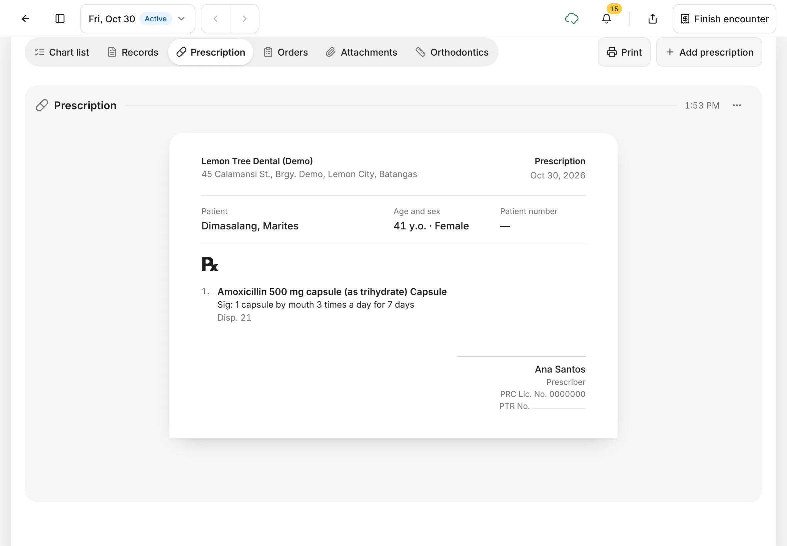

Tap **Print**. **Print prescription** opens with a preview. Choose the **Paper** size (**Half letter**, **A5** or **Letter**; Dentalemon remembers your choice), then tap **Print** to print it or save it as a PDF. A draft prescription is issued when you print it: the sheet says **Printing issues this prescription.**

If your licence number isn't set, the sheet says **Your licence number isn't set.** Tap **Add in Settings** to add it, or print with a blank line to write on.

You should see: **Print prescription** with the paper preview, **Paper**, **Cancel** and **Print**.
{ .see }

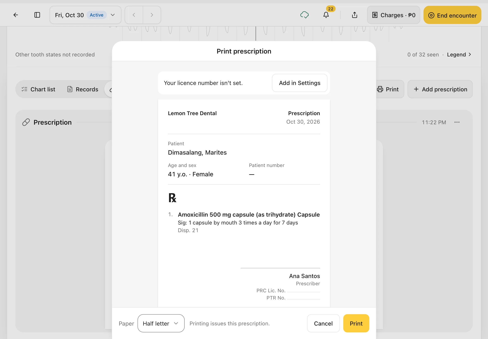

## Order lab or imaging work

### 10. Add an order

Tap **Orders** in the row of views, then **Add order**, and choose **Lab order** or **Imaging order**.

You should see: a small menu with **Lab order** and **Imaging order**.
{ .see }

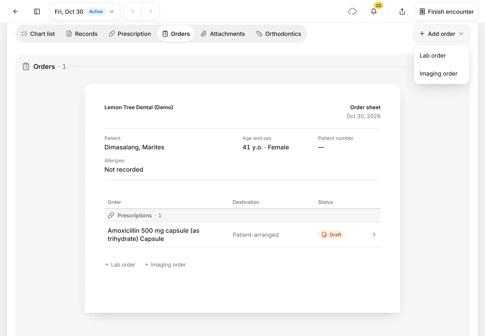

### 11. Choose the tests

1. Pick the **Kind**, for example **Laboratory or dental lab**.
2. Choose **Individual tests** or **Package**.
3. Tick the tests you want, or use **Search catalogue**. The list includes dental lab work (crowns, dentures, night guards) and blood tests. If a test isn't listed, type its name and tap **Use "…"**. Work from the patient's treatment plan is offered under **From the treatment plan**.
4. Under **ICD-10**, search by code or name to add the diagnosis if you need to.
5. Under **Clinical reason**, say why you're ordering it.
6. Check the **Destination**: **In-house**, **Referral partner** or **Patient-arranged**.
7. Tap **Save**.

You should see: a tick beside each test you chose, and the chosen tests listed under the catalogue, each with **✕** to remove it. The list stays where it is while you tick, and your search stays in the box.
{ .see }

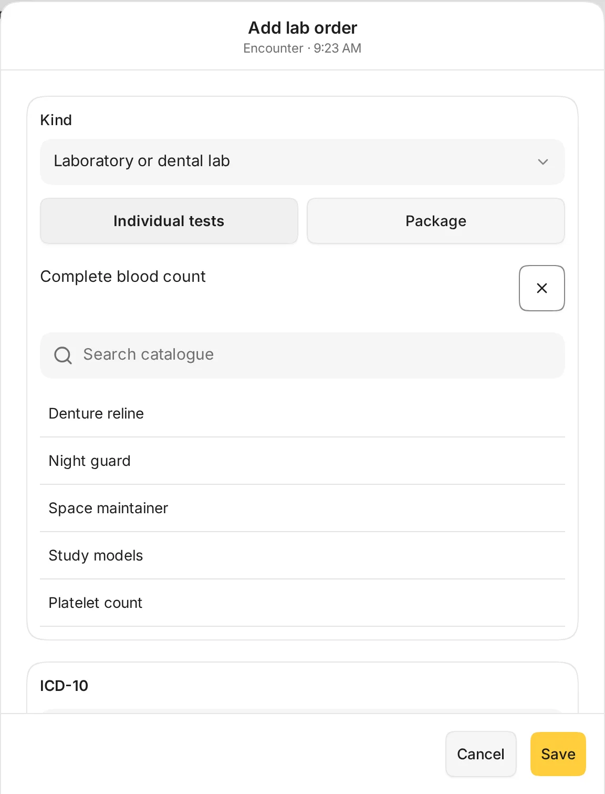{ .shot-sm }

An **Imaging order** works the same way. Its **Kind** is **Dental imaging**, and the list has X-rays such as **Periapical radiograph**, **Bitewing radiograph**, **Panoramic radiograph** and **Cone-beam CT**.

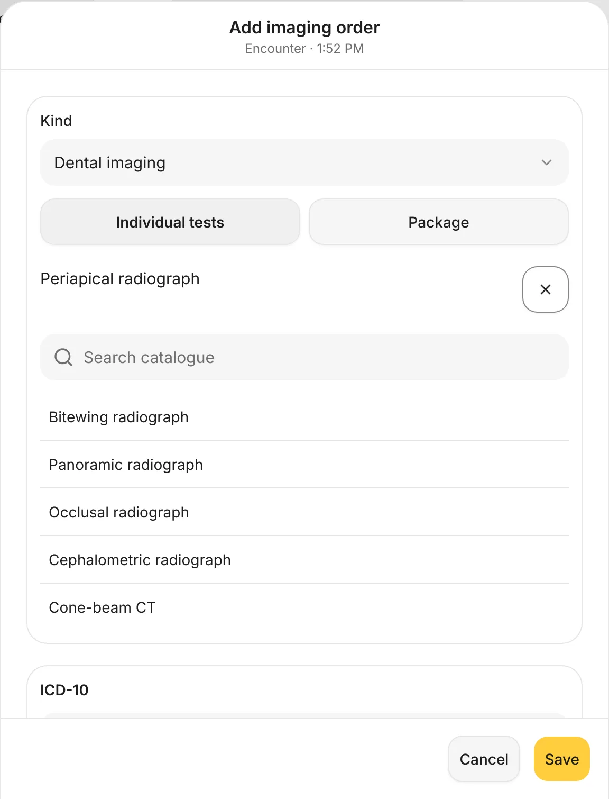{ .shot-sm }

### 12. Check the order sheet

The **Orders** view shows every order for this visit on one order sheet, grouped by kind (**Laboratory**, **Imaging**, **Prescriptions**), with each one's **Destination** and **Status**.

New orders start as **Draft**. Tap a line to see its details. The **+ Lab order** and **+ Imaging order** links under the list add a kind of order the sheet doesn't have yet.

You should see: your order listed with the status **Draft**.
{ .see }

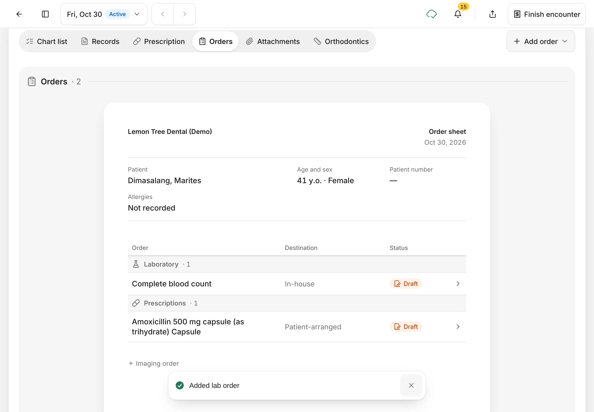

### 13. Send orders from the Orders page

Draft orders are sent when you finish the visit (see [Finish the visit](finish-the-visit.md)). To send one sooner, or to follow up on orders across the clinic, tap **Orders** in the sidebar.

**Clinic orders** lists every order in your clinic. By default it shows **Open** orders (Draft and Requested). Use the **Status**, **Type** and **Date** filters, or **Search orders…** by patient name. **List** and **Table** switch the layout. A row's **⋮** menu has **View encounter** and **Record logs**.

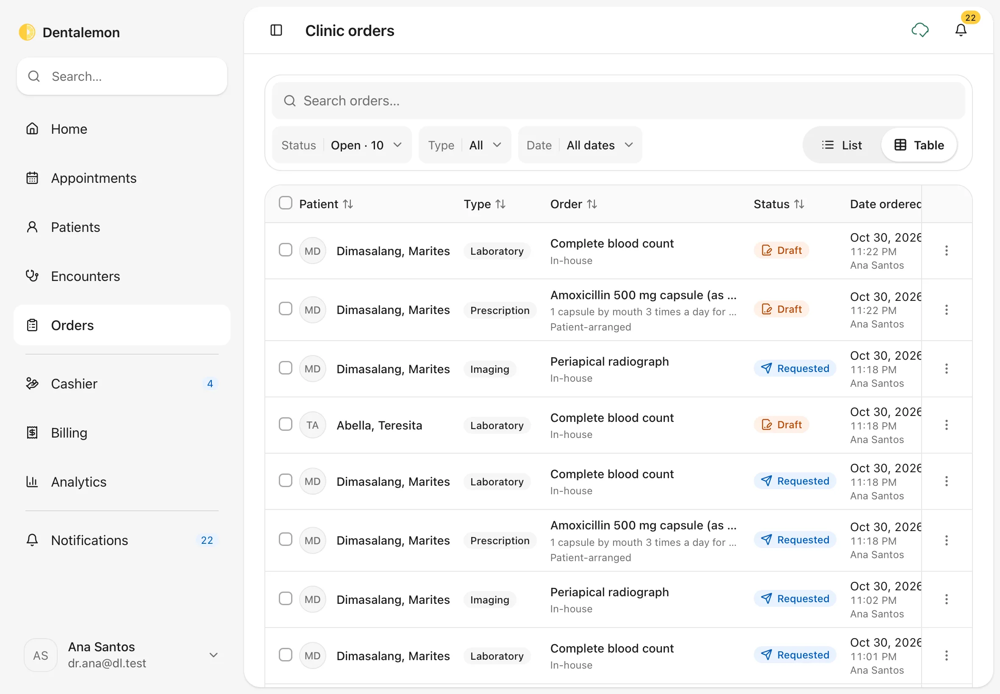

To send an order, tick it, then tap **Send**. **Discontinue…** cancels it (you'll be asked why).

You should see: **1 order selected** with **Send** and **Discontinue…**.
{ .see }

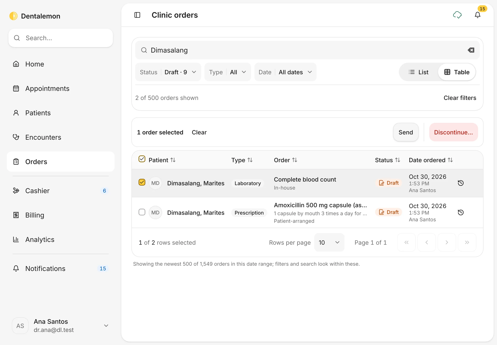

**Order sent** appears with **Undo**. The order is now **Requested**, so it leaves the **Draft** list.

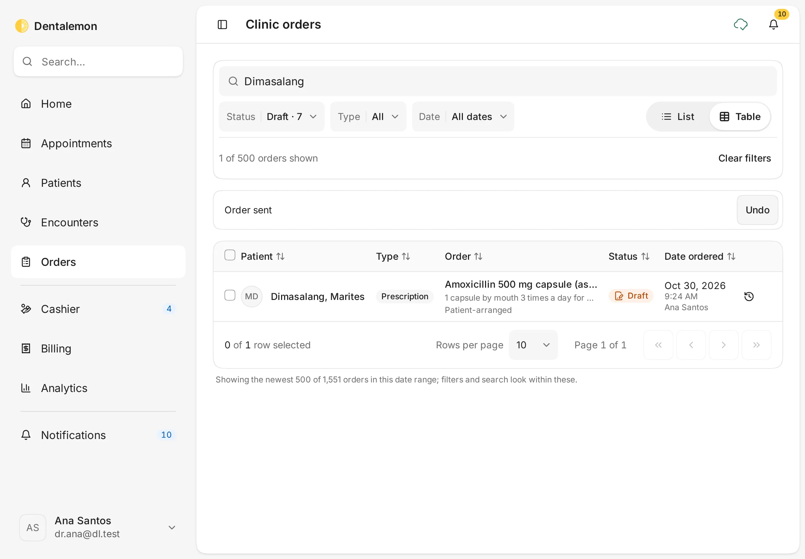

## Attach photos and documents

### 14. Add an attachment

Tap **Attachments** in the row of views, then **Add attachment**.

Tap **Choose files** and pick photos or PDFs: up to 10 MB each, 5 files at a time. Add a **Note** if you want, then tap **Save**.

On an iPad you can take a photo with the camera or pick one from your photo library.

You should see: your file listed under **Choose files**.
{ .see }

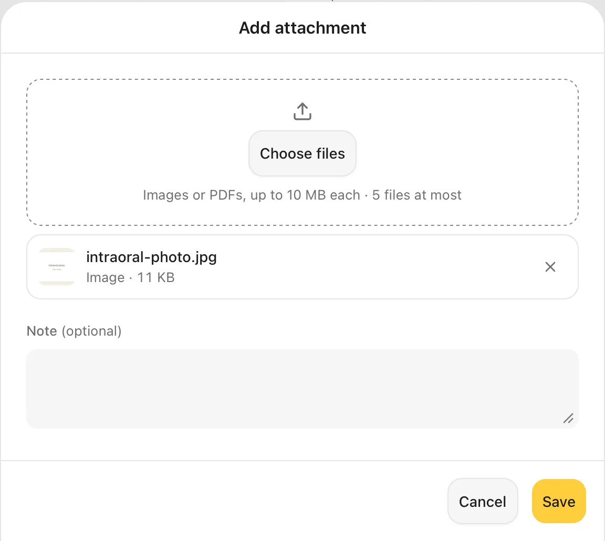{ .shot-sm }

The file appears in the **Attachments** view. To switch the layout, tap the grid button, then **Grid** or **List**.

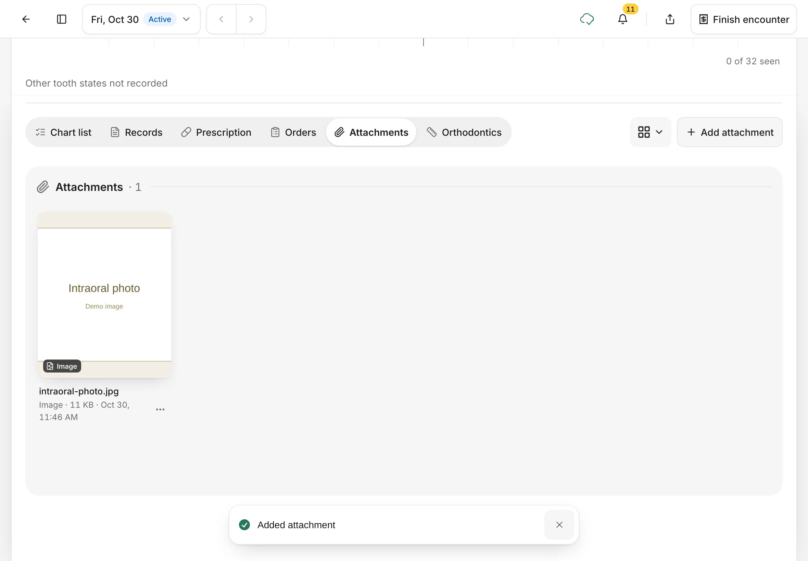

### 15. Open an attachment

Tap the picture or file. It opens large, with its name, type, size and the date it was added. Tap **✕** at the top right to close it.

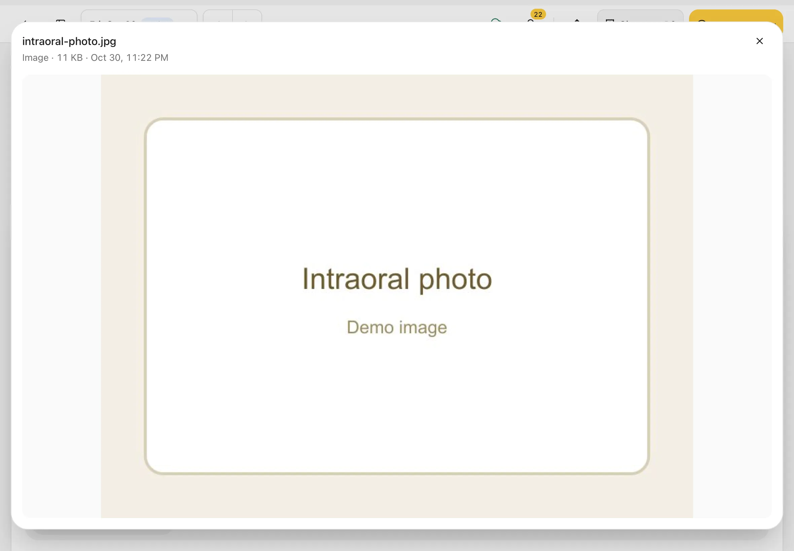

## Tips

!!! tip "Check allergies before you prescribe"
    The order sheet shows the patient's allergies under their name. If it says **Allergies not recorded**, ask the patient and add them in **Records › + Allergies** (step 3).

!!! warning "If something goes wrong"
    - **The medicine isn't in the list.** Try fewer letters, or the generic name. You can also type the details yourself on the **Medicine** page.
    - **Your licence number is blank on the prescription.** Add it in **Settings › Profile**.
    - **You sent an order by mistake.** Tap **Undo** right away. Later, use **Discontinue…** on the Orders page.

!!! info "Good to know"
    - You can add **Lab order** and **Imaging order** only. Older visits may show other kinds of order, but you can't create them.
    - **Send** marks the order as requested in Dentalemon. It doesn't send anything to an outside lab: give the patient the printout or contact the lab yourself.
    - Photos are made smaller when they're saved, to keep the app quick.

## What's next

- [Consents](consents.md)
- [Finish the visit](finish-the-visit.md)
