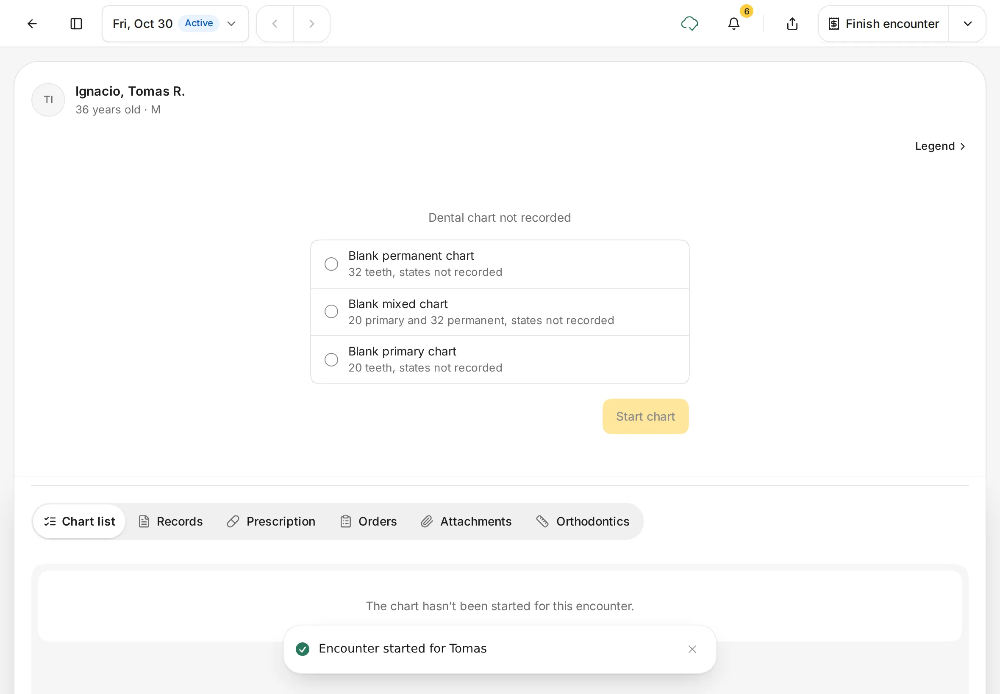

# Start an encounter

An encounter is one visit. It holds the dental chart, notes, prescriptions, orders and charges for that day.
{ .meta }

**Time:** about 2 minutes · **You'll need:** the patient on file ([Find or add a patient](../patients/find-or-add-a-patient.md)).
{ .meta }

## Before you start

- A patient can have only one open encounter at a time. If they already have one, open it instead of starting a new one.

## Ways to start an encounter

Pick whichever is closest to where you are:

| Where you are | What to tap |
|---|---|
| **Home** › **Up next** | **Start encounter** next to a booked patient |
| **Appointments** | **Check in** on the appointment (see [Appointments](../schedule/appointments.md)) |
| The patient's page, **Encounters** tab | **Start encounter** (first visit), or the **New encounter** folder |
| The patient menu (tap the patient's name) | **Start encounter** |
| **Encounters** in the sidebar | The yellow **+** button, then choose the patient |

## Steps

### 1. Start from the patient's page

Open the patient and tap **Encounters**. For a patient's first visit, you see **No encounters yet**.

Tap **Start encounter**.

You should see: **No encounters yet** and a **Start encounter** button.
{ .see }

!!! tip
    For a patient who has been here before, tap the **New encounter** folder at the right end of their shelf instead.

### 2. Find your way around the encounter

The encounter opens straight away, with a **Encounter started for *name*** message.

- **Top bar:** **←** goes back. The date button (for example **Fri, Oct 30 · Active**) lists the patient's other encounters, and **‹ ›** step through them. At the right are notifications, share, and **Finish encounter**.
- **The chart:** a new patient starts with **Dental chart not recorded**. Choose **Blank permanent chart**, **Blank mixed chart** or **Blank primary chart**, then tap **Start chart**. See [Chart teeth](chart-teeth.md).
- **Legend:** what each chart colour and mark means.
- **Views under the chart:** **Chart list**, **Records**, **Prescription**, **Orders**, **Attachments** and **Orthodontics**. Tap one to switch.

You should see: the patient's name, the chart area and the views row.
{ .see }

### 3. Or start from the Encounters page

Tap **Encounters** in the sidebar.

You should see: every encounter as a folder, newest first, each with a status such as **Pending** (still open) or **Closed**. Use **Status** and **Date** to filter, or **Search encounters…**.
{ .see }

### 4. Choose the patient

Tap the yellow **+** button. In **Add Encounter**, search for the patient, tap their name, then tap **Start encounter**.

You should see: **Add Encounter** with the patient you picked highlighted.
{ .see }

{ .shot-sm }

Dentalemon confirms with **Encounter started for *name***, and the new encounter appears first in the list. Tap it to open it.

## Tips

!!! tip "The bill is ready too"
    Every encounter opens with its own invoice. Work you mark as done can go straight onto the bill.
    See [Charges and the Cashier](../payments/charges-and-cashier.md).

!!! warning "If something goes wrong"
    **A patient in Add Encounter can't be picked.** They already have an open encounter, shown with an **Open encounter** tag. Open that one from their page.

!!! info "Good to know"
    An encounter stays **Active** until you finish it. See [Finish the visit](finish-the-visit.md).

## What's next

- [Chart teeth](chart-teeth.md)
