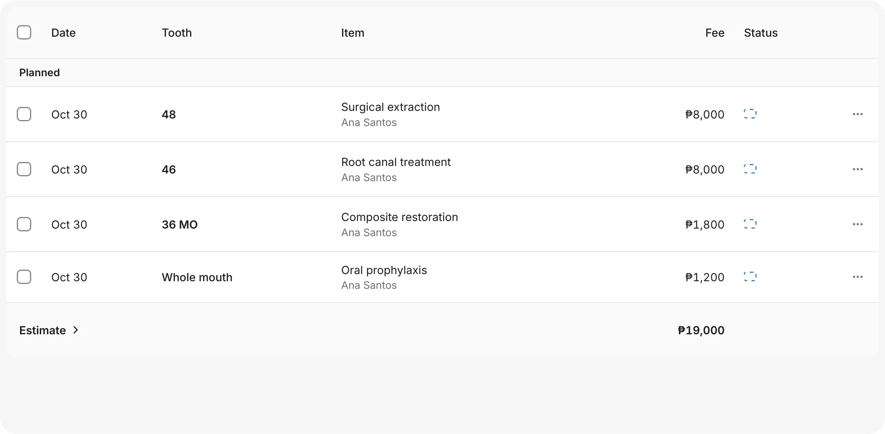
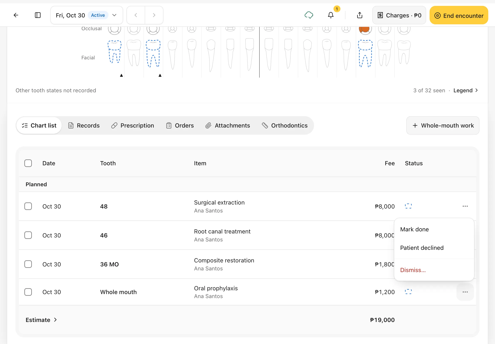
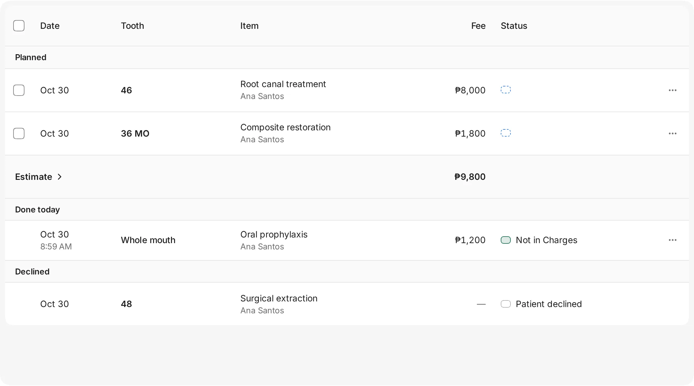
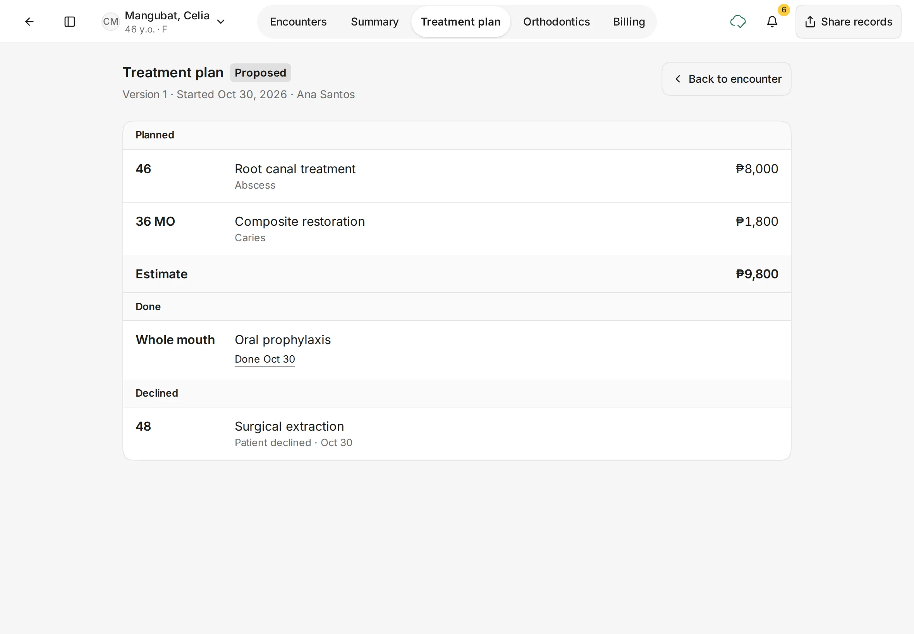
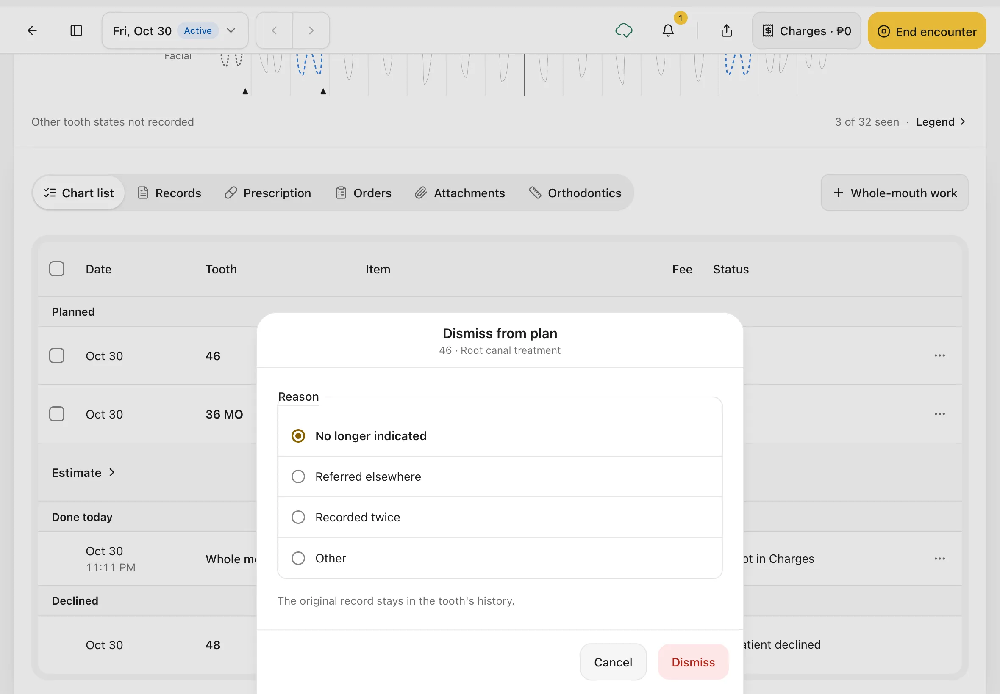
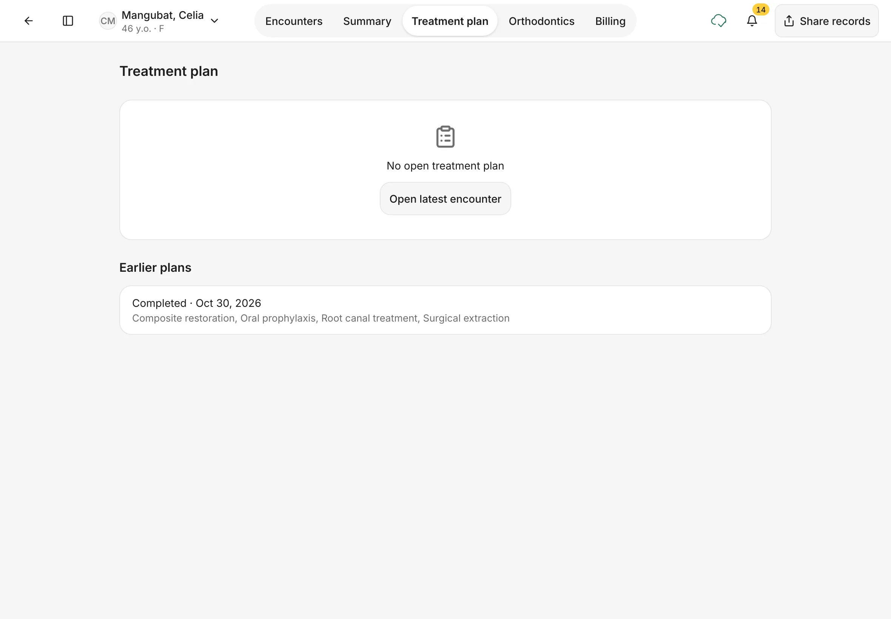

# Treatment plan and Estimate

See all the work you've planned for a patient, with its cost, and keep it up to date as work is done or declined.
{ .meta }

**Time:** about 3 minutes · **You'll need:** a patient with planned work on the chart.
{ .meta }

## Before you start

- Plan work on the chart first: record a condition and leave **Done today** off. See [Chart teeth](chart-teeth.md).
- Prices come from your price list in **Settings › Services**.

## Steps

### 1. Open the Chart list

In the encounter, scroll below the chart. **Chart list** is the first tab in the row of views, and it opens by default.

The list shows each item with its **Date**, **Tooth** (and surfaces, for example **36 MO**), **Item**, **Fee** and **Status**. It's grouped into **Planned**, **Done today**, **Declined** and **Conditions without treatment**. A group only appears when it has something in it.

At the end of **Planned**, the **Estimate** row adds up the fees of all planned work.

You should see: your planned work and its **Estimate**.
{ .see }

### 2. Update an item

Tap **⋯** at the end of a planned row:

- **Mark done**: you did the work in this visit. It moves to **Done today**.
- **Patient declined**: the patient doesn't want it. It moves to **Declined**.
- **Dismiss…**: take an item off the plan, for example when it's no longer needed. You'll be asked why (step 5).

You should see: a small menu with **Mark done**, **Patient declined** and **Dismiss…**.
{ .see }

### 3. Check the groups

The **Estimate** only counts work that's still planned, so it goes down as work is done or declined.

- Work in **Done today** shows **Not in Charges** until it's on the bill. See [Finish the visit](finish-the-visit.md).
- Declined work shows no fee and the status **Patient declined**.

You should see: the item you marked done under **Done today**, the declined one under **Declined**, and a smaller **Estimate**.
{ .see }

!!! tip "Update several items at once"
    Tick the boxes on the left of the planned rows, or the box in the header to select all, then choose **Mark done** or **Clear**.

### 4. See the whole treatment plan

Tap **Estimate** to open the patient's **Treatment plan** tab. It shows the plan across all visits:

- the plan's status (**Proposed**) and when it started
- **Planned** work with the condition it treats, and the **Estimate**
- **Done** work with the date it was done
- **Declined** work with the date the patient declined it

Tap **Back to encounter** to return to the visit.

You can also open it any time from the patient's page: tap the **Treatment plan** tab.

You should see: **Treatment plan · Proposed**, with the same **Estimate** as the Chart list.
{ .see }

### 5. Take an item off the plan

Use **Dismiss…** when planned work is no longer needed, was referred to someone else, or was planned twice. It's different from **Patient declined**, which records that the patient said no.

1. Tap **⋯** on the planned row, then **Dismiss…**.
2. Under **Reason**, choose **No longer indicated**, **Referred elsewhere**, **Recorded twice** or **Other**.
3. Tap **Dismiss**. Tap **Cancel** to keep it.

You should see: **Dismiss from plan**, with the tooth and treatment under the title. The item leaves the plan and the **Estimate** goes down. It still shows in the tooth's history.
{ .see }

### 6. When the plan is finished

When the last planned item is done, the plan is complete. The **Treatment plan** tab then says **No open treatment plan**, and the finished plan moves to **Earlier plans** with the date it was completed and the work it covered.

New planned work on the chart starts a new plan. **Open latest encounter** takes you back to the patient's most recent visit.

You should see: **No open treatment plan**, and the plan under **Earlier plans** marked **Completed**.
{ .see }

## Tips

!!! tip "Talk the patient through the Estimate"
    Open the **Treatment plan** tab on the iPad and go through it with the patient. Each line says which tooth, what work, and the fee.

!!! warning "If something goes wrong"
    - **The Estimate looks too low.** Only **Planned** work is counted. Work done today or declined is not.
    - **A fee shows ₱0 or the wrong amount.** Check the treatment's price in **Settings › Services**.

!!! info "Good to know"
    - The Estimate is a guide. Dentalemon can't print or share a signed estimate yet, and there are no plan versions to compare.
    - Planned work isn't charged until it's done.

## What's next

- [Notes, prescriptions, orders and attachments](notes-prescriptions-orders-attachments.md)
